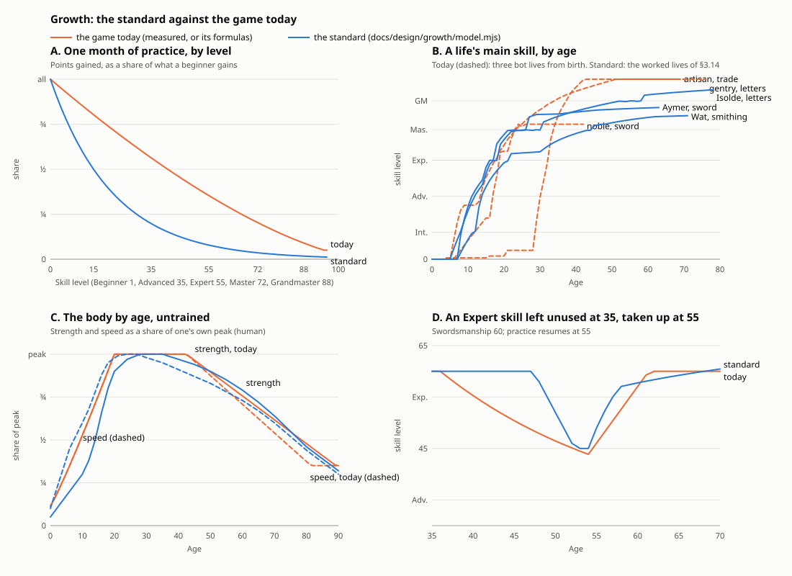

# The growth standard: how a person grows and declines over a life (G0)

*Stamped 2026-11-16 · work item G0 (owner order 54, the playtest's "growth is far too linear. study improvise compound and
find a perfect standard for this") · by Opus 5.5 · research and design only: no game code changed · builds on
`docs/design/growth.md` (G), which says what grows; this says how fast, how far, when it stops, when it fades, and why.*

The scripts beside it, in `docs/design/growth/`: `measure.mjs` plays bot lives and records growth year by year
(`today.json`), `analyze.mjs` reads it, `model.mjs` is the standard as a small runnable model, `lives.mjs` plays the
worked lives of §3.14 under it, and `chart.mjs` draws `curves.svg`. Every proposed number below comes out of `model.mjs`;
change it there and the tables and the chart follow.

---

## For the owner, on one page

**What is wrong today, measured.** I played nine lives (one died at ten) from birth with the game's own bot and wrote down every skill
and stat each year (§1). A main skill climbs in a nearly straight line: a straight line through its climbing years fits
it with an R² of **0.95** in the middle case (1.00 would be a ruler). It barely slows as it rises: a year at Expert
brings **3.4** points, a year at Intermediate **4.7**. The cause is a drip: once you hold a post, the daily plan and
the post feed its skill about **380 tiny gains a year**, each the same size, whatever happens in the life; an artisan
turned merchant went from Beginner to the top of Legend in trade in seventeen years. Where a skill does stall, it is for
a reason the game never tells you, and it never ends in a leap with a cause. Seven of the eight lives that grew up reached Grandmaster's
band and five the Legend band, where the world should hold ten Grandmasters and one Legend. The body peaks in the early twenties, is
flat to about 45, then falls by the same amount every year to the end, and a trained body never loses its training
however long it sits idle. Skills left unused start to slip after two years and keep slipping by the same share each
year, with no quick return.

**What real growth looks like (§2).** Fast at first, then slower and slower: a beginner gains in a month what a master
gains in two or three years. Long flat stretches, broken by a jump when something new happens: a better teacher, a hard
fight, a rival, a crisis. Doing the same work again and again stops teaching you once you can do it ("the village smith
who never gets better"). A good teacher roughly doubles the pace, but only up to just under his own level. Children learn
movement and tongues best, adults learn judgement best. Speed peaks in the early twenties, strength and endurance in the
late twenties, knowledge and judgement keep growing into the fifties and sixties. Decline starts slowly in the thirties
and speeds up after sixty. Unused skills fade slowly and come back quickly. People differ: some gain twice as much from
the same training.

**The standard (§3), in eight rules.**
1. **Every change has a reason you can read.** Each gain or loss is written with its cause (who taught you, which fight,
   which wound, your age, years unused), and the season's line and the Records tab say it in words.
2. **The curve.** The same month of practice is worth about thirty times more to a Beginner than to a Master. An ordinary
   talent working full time reaches Intermediate in a year, Advanced in four, Expert in about twelve, Master in about
   twenty-seven; a gifted one sooner, a poor one perhaps never.
3. **What kind of effort.** Routine work teaches at half pace and stops once you can do what the work asks. Practice
   alone teaches; a drill with a teacher teaches more; a task above your level under real stakes teaches most, and a
   failure at one teaches more than a success.
4. **Teachers** speed you up by how far above you they stand, and take you to one word under their own, no further.
5. **Age.** Each kind of skill has its best years: movement in childhood and youth, tongues before seventeen, learning
   from twelve to fifty, judgement from thirty to sixty.
6. **Plateaus with names, and leaps.** From Expert up you cross into the next word only by a deed fit for it (a won
   fight against a better man, a judged masterwork, a case carried). Until then extra effort is stored, and it lands at
   once with the deed: a visible leap. Every stall has a named reason and a named way out.
7. **Disuse.** Nothing fades for five to twelve years; then a little each year, never more than one word; it comes back
   five times as fast as it went. Endurance fades first if you stop training, strength slowly, knowledge slowest.
8. **The body by age.** Each stat has its own curve: speed peaks first and goes first, strength and endurance at the end
   of the twenties, reflexes hold until about fifty, wits until the fifties, will does not fade. Decline is slow at first
   and quickens after sixty; training keeps you higher but does not stop the clock. A wound or a long illness sets the
   body back, and the record says which.

**What it looks like.** Three worked lives (§3.14): Wat the smith's apprentice is Expert at 22 and then stuck for eight
years shoeing horses in a village ("your work asks nothing new of you"); a lord's commission at 30 starts him climbing
again, a guild masterwork at 44 makes him a Master, and after fifty his strength fades while his skill holds. Aymer, a knight's
son with a gift for the sword, is Expert at 17 after a tourney, stuck at the edge of Master for five years until he
finally beats his rival before the camp at 26, and from 55 "knows more than his arm can show". Isolde the scholar is
Expert at 18, stalls as a chancery clerk, is lifted by a great library at 30 and becomes one of the world's few
Grandmasters at 58 by a disputation before the court; the old tongue she stopped reading fades fifteen points and no further.
The chart (`docs/design/growth/curves.svg`) puts these curves beside today's.

**Choices you may want to overrule** (§5): trials at Expert and Master, not only at Grandmaster and Legend; the size
of the curve (thirty to one); one unit of effort per month instead of a daily drip; rust after five to twelve years.



---

## 1 · What the game does now, measured

### 1.1 The machinery

**Skills** (0 to 100 per skill, 38 keys in `GD.SKILLS`):
- **The gain** (`A.trainSkill`, `src/core/release/core/03-engine-base.js`):
  `g = amt × aptitude × (1 + perks) × specialism × (0.6 + Intelligence/120) × max(0.05, (1 − level/(cap+10))^1.5)`, with
  `cap` 60, 80 or 100 by aptitude. The diminishing term falls only about five times from level 5 to level 75
  (1.0 to 0.2), and has a floor. **Age is not in it at all**: a man of sixty learns a sword as fast as a boy of sixteen.
- **Wrappers.** `src/people/31-learn-by-doing` tags each gain practice (the daily plan and training activities, ×0.4) or
  use (everything else, ×1.2; a failed check ×1.5) and writes a season's line. `src/people/49-body-mind` folds merged
  skills. `src/people/999997-bodies` (C9) stops a skill past what its governing stats carry and trains those stats a little.
- **The sources.** The daily plan (`A.planDay`, `16-classes-roles-and-paths.js`) calls `A.trainSkill(pc, P.train, 0.105 × pace)`
  **every day** (about 365 calls a year); a job adds `A.trainSkill(pc, skill, 0.3)` from `A.pathMonth`; every event check
  trains its skill 1.5 (`18-event-view-a.js`); `fx: { skill: {...} }` adds what the card says; school 9 a year
  (`A.schoolYear`); battles, missions, offices and duels add 0.3 to 5 each.
- **Session quality** (`A.sessionQ`, `15-specialisms-and-promotion.js`) multiplies a training activity by health, mood,
  weariness, overtraining (the number of sessions in a year), a teacher in reach (up to ×1.5 by the gap in points),
  a fine weapon, a habit of years, and luck (×0.7 to ×1.3; 6% "breakthrough" ×2.1; 8% "bad day" ×0.35).
- **Rust** (`A.growthYear`): a skill of 30 or more not used for two years loses `(level − 30) × 3%` a year (×1.4 after
  34), every year, to 30; it comes back at the ordinary pace.

**Stats** (str spd ins sta int wil):
- **Childhood**: the player's body grows by v2's maturity curve (`src/people/99993-v2-stats/a-body.core.js`, `VS.grow`,
  from `src/people/engine/races.js`); others by `A.yearGrowth`'s `0.08 + 0.62 m^1.1`, almost a straight line.
- **Training** (`A.train`): `gain = amt × age step (½ a child, 1, 0.55 after 34, 0.25 after 50) × (0.25 + room × 1.1)`;
  the 0.25 floor means a stat keeps growing at a quarter pace right up to the hard cap of 1.02 × potential.
- **Age** (`A.ageFactor`, replaced by `BM.factorAt` in `src/people/49-body-mind/body.core.js`): 1.0 until about 42 (a
  human's `old` 50 × 0.85, ± 6 years per stat per person), then a **straight line** down to a floor of 0.35; speed falls
  1.2 times as fast, reflexes half as fast; wits from about 57; will never.
- **Detraining: none.** v2 has `detrain()` (`src/people/engine/body.js`) but nothing calls it: a body trained at 25 keeps
  its training at 45 having done nothing for twenty years, until the age line takes it.

**NPCs** get their skills rolled at birth and saved (growth.md §0); a few yearly nudges move some.

### 1.2 Measured: nine lives from birth

`node docs/design/growth/measure.mjs <build> --workers=2` on the build of `origin/v2-integration` at `1cb3dbc`
(132 features), nine fixed-seed lives played from birth for up to 75 years by the engine's own bot loop (one died at ten; a second
passive peasant was added for it): an artisan, a noble, a peasant, a merchant and a gentry daughter, "engaged" (a training activity each month, as an attentive player) or
"passive" (only answering the cards). `node docs/design/growth/analyze.mjs` reads `docs/design/growth/today.json`.

The three highest skills at the end of each life, where they climbed for five years or more (`analyze.mjs --md`).
"a year at Int." and "at Exp." are the mean gain in a year that began in that word; "flat years" are climbing years
that gained under half a point; "gains a year" is the median number of separate gains the skill got in a year.

| Life | Skill | 10 | 14 | 18 | 22 | 26 | 30 | 40 | 50 | 60 | 70 | R² | a year at Int. | at Exp. | flat years | gains a year |
|---|---|---|---|---|---|---|---|---|---|---|---|---|---|---|---|---|
| artisan-passive (d. 31) | learning | 25 | 44 | 61 | 74 | 82 | 87 |  |  |  |  | 0.98 | 6.2 | 3.7 | 0/17 | 116 |
| artisan-passive (d. 31) | melee | 0 | 19 | 47 | 69 | 75 | 72 |  |  |  |  | 1.00 | 7.2 | 5.1 | 0/10 | 365 |
| artisan-engaged (d. 70) | trade | 1 | 1 | 2 | 5 | 5 | 34 | 96 | 100 | 100 |  | 0.95 | 11.2 | 7.2 | 0/9 | 379 |
| artisan-engaged (d. 70) | learning | 28 | 37 | 53 | 66 | 75 | 82 | 94 | 100 | 100 |  | 0.96 | 3.6 | 2.7 | 1/30 | 112 |
| artisan-engaged (d. 70) | sword | 0 | 0 | 15 | 35 | 50 | 61 | 79 | 88 | 91 |  | 0.95 | 4.7 | 1.8 | 0/26 | 1 |
| noble-engaged (d. 42) | learning | 30 | 42 | 55 | 69 | 75 | 80 | 90 |  |  |  | 0.96 | 3.0 | 2.3 | 2/26 | 109 |
| noble-engaged (d. 42) | sword | 10 | 20 | 46 | 67 | 75 | 75 | 75 |  |  |  | 0.94 | 4.2 | 3.1 | 3/15 | 1 |
| noble-engaged (d. 42) | melee | 4 | 21 | 47 | 63 | 71 | 72 | 75 |  |  |  | 0.98 | 7.0 | 4.0 | 0/13 | 136 |
| peasant-engaged (d. 70) | learning | 27 | 33 | 51 | 63 | 73 | 81 | 88 | 88 | 88 |  | 0.98 | 2.5 | 2.6 | 2/23 | 112 |
| peasant-engaged (d. 70) | sword | 0 | 0 | 17 | 38 | 56 | 68 | 75 | 75 | 75 |  | 0.98 | 5.3 | 2.9 | 0/13 | - |
| peasant-engaged (d. 70) | trade | 1 | 1 | 1 | 2 | 2 | 2 | 71 | 88 | 79 |  | 0.96 | 15.1 | 7.7 | 0/6 | 378 |
| noble-passive (alive at 76) | diplomacy | 8 | 13 | 17 | 20 | 66 | 80 | 92 | 100 | 100 | 100 | 0.91 | 3.4 | 4.3 | 7/28 | 13 |
| noble-passive (alive at 76) | learning | 30 | 38 | 52 | 61 | 69 | 75 | 85 | 92 | 96 | 96 | 0.95 | 2.8 | 1.9 | 3/36 | 108 |
| noble-passive (alive at 76) | persuasion | 0 | 0 | 0 | 0 | 13 | 23 | 28 | 48 | 63 | 70 | 0.97 | 1.2 | 1.3 | 8/36 | 1 |
| merchant-engaged (d. 62) | learning | 30 | 30 | 30 | 30 | 40 | 57 | 79 | 91 | 97 |  | 0.92 | 1.0 | 2.5 | 14/40 | 113 |
| merchant-engaged (d. 62) | trade | 4 | 5 | 11 | 13 | 18 | 18 | 32 | 48 | 43 |  | 0.92 | 1.1 | - | 19/31 | 2 |
| merchant-engaged (d. 62) | persuasion | 0 | 0 | 8 | 21 | 21 | 23 | 32 | 32 | 42 |  | 0.84 | 0.6 | - | 31/41 | 2 |
| gentry-engaged (alive at 76) | learning | 30 | 40 | 56 | 69 | 77 | 83 | 93 | 99 | 100 | 100 | 0.96 | 2.8 | 2.9 | 3/30 | 113 |
| gentry-engaged (alive at 76) | diplomacy | 9 | 14 | 15 | 15 | 15 | 17 | 30 | 80 | 88 | 88 | 0.66 | 2.2 | 3.0 | 22/42 | 11 |
| gentry-engaged (alive at 76) | melee | 0 | 12 | 38 | 45 | 57 | 60 | 60 | 54 | 54 | 54 | 0.92 | 7.0 | - | 2/13 | 358 |
| peasant-passive-b (d. 54) | diplomacy | 1 | 15 | 57 | 77 | 88 | 95 | 100 | 100 |  |  | 0.90 | 11.2 | 5.3 | 0/14 | 378 |
| peasant-passive-b (d. 54) | learning | 20 | 34 | 49 | 60 | 67 | 75 | 86 | 93 |  |  | 0.95 | 3.3 | 2.2 | 0/33 | 111 |
| peasant-passive-b (d. 54) | intrigue | 0 | 0 | 7 | 20 | 26 | 42 | 60 | 73 |  |  | 0.98 | 2.6 | 1.3 | 0/29 | 1 |

**Pooled over all 23 climbs:** median R² **0.95** (19 of 23 at 0.92 or more; the lowest, 0.66, is a diplomacy that sat
untouched for twenty years and then climbed). Mean gain a year by the word the year began in: Beginner 1.4, Intermediate
**4.7**, Advanced **5.9**, Expert **3.4**, Master and above 2.0. 117 of 561 climbing years were flat. 14 of the 23 skills
were fed by a daily drip (a median of 116 gains a year, 0.016 points each; a post's own skill about 380).

The body, for the lives measured past sixty (each stat's effective value, `A.stat`, as a share of its own best; "a year" is
the change per hundred of the best):

| Life | Strength: best at | a year, 45-55 | a year, the last decade measured | Speed: best at | a year, 45-55 | the last decade | Wits: best at | Will: best at |
|---|---|---|---|---|---|---|---|---|
| artisan-engaged (d. 70) | 25 | -1.4 | -2.4 | 20 | -1.6 | -1.6 | 25 | 59 |
| peasant-engaged (d. 70) | 24 | -1.5 | -1.5 | 23 | -1.1 | -1.8 | 25 | 49 |
| noble-passive (alive at 76) | 24 | -1.4 | -1.4 | 25 | -1.8 | -1.6 | 33 | 73 |
| merchant-engaged (d. 62) | 25 | -1.3 | - | 22 | -1.8 | - | 49 | 48 |
| gentry-engaged (alive at 76) | 25 | -1.4 | -1.4 | 16 | -1.9 | -1.9 | 25 | 57 |

### 1.3 Why it feels linear

Five causes, each visible in the numbers above.

1. **The drip.** Once a person has a post, the daily plan trains that post's skill every day (`A.defaultPlan` sets it),
   and the post trains it again each month: about **380 gains a year of 0.02 to 0.05 each** into one skill (trade, faith,
   melee in the tables), whatever else happens. A skill fed that way climbs at the same pace year after year: the
   artisan who became a merchant went from trade 5 at 26 to **100 at 43**, Beginner to the top of Legend in seventeen
   years; the peasant from 2 at 30 to 88 at 50; the passive artisan's faith from 3 at 22 to 91 at 30 as a cleric (not in
   the table: it climbed in only four years, about 20 points a year at Intermediate, Advanced and still 9.5 at Expert).
2. **The bend is too weak.** `(1 − level/110)^1.5` makes a month at level 75 worth a fifth of a month at level 5 (§3.3's
   standard: a twenty-sixth), and the sources that feed a skill grow with the post (a better job, a higher office), so
   the pace barely falls: pooled over the lives, a year at Expert gains **3.4** points against **4.7** at
   Intermediate.
3. **No age in learning.** Nothing in `A.trainSkill` reads age: the merchant's learning went from 30 at 22 to 97 at 60,
   faster in his forties than in his twenties.
4. **Flat years without a reason, and jumps without a deed.** 117 of 561 of the climbing years were flat, but for
   unnamed causes: no source that year, or C9's hidden stall (the merchant's learning held at 29.99 from 10 to 25: his
   Will was just under what Journeyman asks, so every lesson for fifteen years was lost; nothing on the page says so). The big years (up to +17) come from a new post's
   drip starting, not from a deed. The 6% "breakthrough" of a training session is a luck roll worth one session.
5. **The body is a ruler.** The body's stats peak in the early twenties (strength 24 to 25, speed 16 to 25), stay flat to
   about 45, then fall by about the same amount every year (strength about 1.4 per hundred of its peak a year at 45-55
   **and** in the last decade measured, in four lives of five; real decline about triples). A trained body keeps its training forever (no detraining is called). Will only rises.

And the top is crowded: in seven of the eight lives that grew up a skill reached Grandmaster's band (88 or more), and in five the
Legend band (96 or more), where growth.md §2.2 wants one to ten Grandmasters and at most one Legend in the whole world.

---

## 2 · What is known about real growth, put plainly

### 2.1 Fast, then slower and slower
For almost any skill, the time a task takes falls steeply at first and then ever more slowly with practice: the
"power law of practice" (Newell and Rosenbloom, 1981, 15 data sets). Heathcote, Brown and Mewhort (2000) showed that
for one person at a time the curve is closer to an exponential approach to a limit, and that averaging many people
makes it look like a power law. Either way the shape is the same for a game: **the first hundred hours buy more than the
next thousand.** The common rule of thumb that each step of mastery costs about twice the time of the one before matches
v2's own hour ladder (`VS.HOURS`: 30, 200, 800, 2,500, 6,000, 12,000, 25,000, 50,000 hours).

### 2.2 Plateaus, dips and leaps
Real records of one person's progress are not smooth. Gray and Lindstedt (2017) re-read classic skill studies and found
long **plateaus** (stable, sub-optimal performance), **dips** while a person tries a new method, then **leaps** above the
smooth curve when the new method works. The way past a plateau is a new method, a new demand or a new teacher, not more
of the same.

### 2.3 Deliberate practice against repetition
Ericsson, Krampe and Tesch-Römer (1993): experts differ less in hours than in **deliberate practice**, effortful work on
a weakness with feedback, usually set by a teacher. Ordinary work, once it is automatic, stops improving the worker
("arrested development"; the typist who types every day for twenty years and never gets faster). Macnamara, Hambrick and
Oswald (2014) measured how much deliberate practice explains: about a quarter of the differences in games, a fifth in
music, a fifth in sports, very little in professions. Practice matters a great deal, and so do talent, age at the start,
teaching and luck.

### 2.4 A good teacher
One-to-one teaching with feedback raised students by about two standard deviations in Bloom's studies (1984); later
reviews of tutoring find smaller but real gains (about 0.4 of a standard deviation on average). In game terms: **a teacher
well above you can roughly double your pace; a teacher only a little above you helps a little; nobody teaches past what
they know.**

### 2.5 Sensitive periods in childhood and youth
Grammar is learned almost as well as a native until about 17, then the ability falls steadily (Hartshorne, Tenenbaum and
Pinker, 2018, 670,000 people); native-like command needs a start before about 10. Movement skills are learned most
easily in later childhood and early youth (coordination, balance, a sense of timing); strength training before puberty
buys mostly coordination, not muscle. Children cannot sustain hard practice, so their gains come from many short, varied
sessions and play.

### 2.6 Peak ages by kind of ability
- **Speed and power** peak in the early to mid twenties; **endurance** a little later, and longest events later still
  (Allen and Hopkins, 2015, a review of elite athletes).
- **Strength** peaks in the late twenties to early thirties and holds to about forty with training.
- **Reflexes:** simple reaction time barely slows until about fifty; choice reaction time slows steadily through adult
  life (Der and Deary, 2006, about 7,000 adults).
- **Mind:** raw processing speed peaks around 18 to 20, short-term memory around 25 to 35, vocabulary and knowledge in
  the late sixties, reading other people's feelings at 40 to 60 (Hartshorne and Germine, 2015). Judgement and
  knowledge keep growing long after the body has peaked.

### 2.7 Decline with age
Decline is **slow at first and quickens**: aerobic capacity falls about 3 to 6 per hundred a decade in the twenties and
thirties and more than 20 per hundred a decade in the seventies, whatever the activity (Fleg and others, 2005, the
Baltimore longitudinal study). Leg strength falls about 3 per hundred a year in people in their seventies, about three
times as fast as muscle mass (Goodpaster and others, 2006). Training keeps you higher at every age; it does not stop the
clock.

### 2.8 Use it or lose it
Unused skills decay, and the longer the gap the more: Arthur and others (1998, 53 studies) found little loss in the first
weeks and large loss after a year of non-use; **physical, natural skills keep far better than cognitive, artificial,
precise ones.** A 2025 review of 457 studies put the half-life of a newly learned procedure at about half a year for
accuracy and a year for speed. Well over-learned skills (riding, swimming, a trade done for years) last for decades.
**Relearning is fast:** muscle keeps the extra nuclei it built, so strength comes back faster the second time
(Bruusgaard and others, 2010, in mice; less clear in people), and endurance is lost fastest, within weeks of stopping.

### 2.9 Injury, illness and bed rest
Bed rest takes strength and endurance fast (weeks cost what months built). A serious wound costs the use of its part
while it mends and can leave a lasting limit (a limp, a stiff hand, a lost eye). Long illness costs condition broadly.
Recovery is slower with age.

### 2.10 Talent: people differ in how much they gain
Under the same twenty weeks of training, gains in aerobic capacity ranged from almost nothing to very large; about half
of the difference in how much people gained ran in families (Bouchard and others, 1999, the HERITAGE family study).
Talent sets both the pace and how far ordinary effort carries a person, which growth.md §1.4 already says.

### 2.11 Fatigue and overtraining
More training than one can recover from first stops paying, then makes things worse; a long excess ("overtraining
syndrome") takes weeks to months of rest to undo (Meeusen and others, 2013, the joint European and American consensus).
Rest is part of training.

### 2.12 How well-regarded games do it

| Game | How growth works | What works | What feels linear or wrong |
|---|---|---|---|
| **Crusader Kings III** | Childhood education focus plus a guardian set an education trait at 16; adult lifestyle experience buys perks; stats fall with age and illness | The guardian's quality matters; childhood is a sensitive period with a lasting result | Adult growth is a steady experience bar on a timer; the same perk every few years whatever you do |
| **Dwarf Fortress** | Skills rise by use with experience per level growing each level; unused skills become "rusty", then lose levels; attributes rise with use and fall with age | Rust with a named state; experience by doing; legendary skill is rare | Gains are per action and steady; no teacher's ceiling; plateaus only by lack of work |
| **Kenshi** | Stats grow by doing; experience is larger against stronger opponents ("stronger opponent logic"); training dummies stop at low levels | The best rule in any game here: **you learn most from what is above you**, and safe practice stops early | Grinding is the method; no age, no decline |
| **Mount & Blade II** | Skills rise by use; attributes and focus points set a learning rate and a learning limit past which gains slow to nothing | A soft limit set by talent; gains by doing | The limit is a number the player buys; the same action always teaches the same |
| **RimWorld** | Experience by work, multiplied by passion; a daily soft cap; skills above 10 drain every day and must be kept up | Passion as talent; a daily cap against grinding; high skill needs upkeep | Decay is constant and immediate at the top, so masters are a treadmill; work is the only teacher |
| **Football Manager** | A hidden potential ability; current ability grows with training, match experience, a mentor and the coach's quality; most players peak 27 to 30 and decline from the early thirties, pace first | **The model to copy for the body**: peaks and declines differ by attribute, a mentor and match experience matter, potential is hidden and found | Growth after the peak is mostly invisible to the player; reasons are vague ("good training") |

### 2.13 Sources
- Newell, A. and Rosenbloom, P. (1981). Mechanisms of skill acquisition and the law of practice. ([summary](https://en.wikipedia.org/wiki/Power_law_of_practice))
- Heathcote, A., Brown, S. and Mewhort, D. (2000). The power law repealed: the case for an exponential law of practice. *Psychonomic Bulletin & Review* 7. ([link](https://link.springer.com/article/10.3758/BF03212979))
- Gray, W. and Lindstedt, J. (2017). Plateaus, dips, and leaps: where to look for inventions and discoveries during skilled performance. *Cognitive Science* 41(7). ([doi](https://doi.org/10.1111/cogs.12412))
- Ericsson, K., Krampe, R. and Tesch-Römer, C. (1993). The role of deliberate practice in the acquisition of expert performance. *Psychological Review* 100(3).
- Macnamara, B., Hambrick, D. and Oswald, F. (2014). Deliberate practice and performance in music, games, sports, education, and professions: a meta-analysis. *Psychological Science* 25. ([summary](https://www.sciencedaily.com/releases/2014/07/140716123835.htm))
- Bloom, B. (1984). The 2 sigma problem. *Educational Researcher* 13(6). ([pdf](https://www.gwern.net/doc/psychology/1984-bloom.pdf)); Nickow, Oreopoulos and Quan (2020), tutoring meta-analysis, NBER w27476 ([pdf](https://www.nber.org/papers/w27476.pdf)).
- Hartshorne, J., Tenenbaum, J. and Pinker, S. (2018). A critical period for second language acquisition. *Cognition* 177. ([MIT](https://dspace.mit.edu/handle/1721.1/126641))
- Hartshorne, J. and Germine, L. (2015). When does cognitive functioning peak? *Psychological Science* 26. ([PMC](https://pmc.ncbi.nlm.nih.gov/articles/PMC4441622/))
- Allen, S. and Hopkins, W. (2015). Age of peak competitive performance of elite athletes: a systematic review. *Sports Medicine* 45(10). ([doi](https://doi.org/10.1007/s40279-015-0354-3))
- Der, G. and Deary, I. (2006). Age and sex differences in reaction time in adulthood. *Psychology and Aging* 21(1). ([PubMed](https://pubmed.ncbi.nlm.nih.gov/16594792/))
- Fleg, J. and others (2005). Accelerated longitudinal decline of aerobic capacity in healthy older adults. *Circulation* 112. ([PubMed](https://pubmed.ncbi.nlm.nih.gov/16043637/))
- Goodpaster, B. and others (2006). The loss of skeletal muscle strength, mass, and quality in older adults. *J Gerontol A* 61. ([PubMed](https://pubmed.ncbi.nlm.nih.gov/17077199/))
- Arthur, W., Bennett, W., Stanush, P. and McNelly, T. (1998). Factors that influence skill decay and retention. *Human Performance* 11. ([pdf](https://www.gwern.net/doc/psychology/spaced-repetition/1998-arthur.pdf)); procedural skill retention meta-analysis (2025), *Psychological Bulletin* 151(6) ([PubMed](https://pubmed.ncbi.nlm.nih.gov/40455501/)).
- Bruusgaard, J. and others (2010). Myonuclei acquired by overload exercise precede hypertrophy and are not lost on detraining. *PNAS* 107. ([PMC](https://pmc.ncbi.nlm.nih.gov/articles/PMC2930527))
- Bouchard, C. and others (1999). Familial aggregation of VO2max response to exercise training: the HERITAGE family study. *J Appl Physiol* 87. (reviewed in [PMC2760930](https://pmc.ncbi.nlm.nih.gov/articles/PMC2760930))
- Meeusen, R. and others (2013). Prevention, diagnosis and treatment of the overtraining syndrome: joint consensus statement of the ECSS and the ACSM. *Med Sci Sports Exerc* 45.
- Game mechanics: [RimWorld wiki, Skills](https://rimworldwiki.com/wiki/Skills); [Dwarf Fortress wiki, Skill and Rust](https://dwarffortresswiki.org/index.php/DF2014:Skill); [Kenshi wiki, Martial Arts](https://kenshi.fandom.com/wiki/Martial_Arts); [Mount & Blade wiki, Skills (Bannerlord)](https://mountandblade.fandom.com/wiki/Skills_(Bannerlord)); Crusader Kings III and Football Manager from their own manuals and play.

---

## 3 · The standard

### 3.1 Rule zero: every change has a reason the player could read

This is order 54's rule applied to growth. **No skill point or stat point moves without a cause written beside it.**
- Every gain and loss goes through one function that takes the cause: `{ kind, who, what }`, for example
  `{ kind: 'drill', who: 'Sir Odo' }`, `{ kind: 'stretch', what: 'the duel with Sir Rauf' }`, `{ kind: 'work', what: 'the forge' }`,
  `{ kind: 'age' }`, `{ kind: 'disuse', years: 9 }`, `{ kind: 'wound', what: 'a burned hand' }`.
- The season's ledger sums them by skill and cause. The season's line names the two largest causes and any stall
  ("Smithing held: the village work asks nothing new of you"). The Records tab keeps the turning points: a word reached
  and by what, a stall begun and why, a leap and the deed that made it, rust begun, a stat's peak and the year it turned,
  a wound's cost.
- **The test of rule zero:** over a whole bot life, the sum of the ledger for each skill and stat equals its change,
  and no ledger entry lacks a cause (§4.3, `g0Reason`).

### 3.2 The formula family

For a skill, one effort gives

```
gain = EU × Q × T × talent × age(kind) × condition × R(level) × reach
```

| Term | What it is | Values |
|---|---|---|
| **EU** | Units of effort: one month of steady, purposeful practice | the daily plan at a steady pace is 1 a month; see §3.12 for every source |
| **Q** | Quality of the effort (§3.4) | work 0.5, and 0.08 past what the work demands; practice alone 0.8; a drill 1.0; a stretch 1.0 to 1.8 (a failed stretch a third more) |
| **T** | The teacher (§3.5) | ×1.15 one word above you, ×1.4 two, ×1.6 three or more; a good teacher up to a fifth more |
| **talent** | The area's talent letter (growth.md §10) | F 0.5, E 0.7, D 0.85, C 1.0, B 1.15, A 1.35, S 1.8, SSS 3.0 |
| **age(kind)** | How well this age learns this kind of thing (§3.6) | 0.1 to 1.8 by kind and age |
| **condition** | Health, spirits, weariness, overtraining, extra sessions (§3.7) | ×0.2 to ×1.06 |
| **R(level)** | The practice curve (§3.3) | `1.8 × e^(−level / 21.6)` |
| **reach** | Past how far ordinary effort carries your talent, a quarter (growth.md §1.4) | F 35, E 55, D 72, C 80, B 88, A 96, S and SSS no limit |

…then clamped by **the teacher's ceiling** (a teacher's lessons stop one word under him), **the trial at the edge of the
next word** (§3.9), **the body** (C9: a skill works at the word its governing stats carry) and **the world's room**
(growth.md §2.2: ten Grandmasters, one Legend). For a stat, the same shape (§3.11).

Nothing in it is new to the game except the curve's steepness, the age term, the quality term, the trials and the
ledger. Talent, the body gate and the census are growth.md's; the teacher and the session's condition exist today in
`A.sessionQ`, applied to all practice instead of training activities only.

### 3.3 The practice curve

`level after E units of effort = 21.6 × ln(1 + E/12)` for an ordinary talent with no teacher, so a unit of effort at
level L is worth `R(L) = 1.8 × e^(−L/21.6)` points.

| Level | Points from a month of drill | Months for one more point |
|---|---|---|
| 1 (Beginner) | 1.7 | under one |
| 15 (Intermediate) | 0.9 | 1 |
| 35 (Advanced) | 0.36 | 3 |
| 55 (Expert) | 0.14 | 7 |
| 72 (Master) | 0.06 | 16 |
| 88 (Grandmaster) | 0.03 | 33 |

Years of full-time drill to first reach each word, an adult with no teacher and no trials, by talent (`model.mjs`):

| Talent | Intermediate | Advanced | Expert | Master | Grandmaster |
|---|---|---|---|---|---|
| E | 1.4 | 5.8 | 17 | 104 | never |
| D | 1.2 | 4.8 | 14 | 32 | never |
| **C** | **1.0** | **4.0** | **12** | **27** | 112 |
| B | 0.9 | 3.5 | 10 | 23 | 50 |
| A | 0.8 | 3.0 | 9 | 20 | 43 |
| S | 0.6 | 2.3 | 6.5 | 15 | 32 |

A teacher, a good age and stretches shorten this; work alone and a poor age lengthen it. The ratio of a beginner's
month to a master's (level 5 against 75) is **26 to 1**; today it is 5 to 1.

### 3.4 Quality: what kind of effort it was

| Kind | Example | Q | Its limit |
|---|---|---|---|
| **Work** | the day's work at your post: horseshoes, writs, a watch | 0.5 | **the routine ceiling:** past what the work demands, 0.08. Each post has a demand (a village smith's work Advanced, an armourer's Expert, a duke's commissions Master) |
| **Practice** | the training plan with no one to correct you | 0.8 | your talent's reach |
| **Drill** | deliberate practice set by a teacher, a regiment's drill, a school | 1.0 | the teacher's ceiling |
| **Stretch** | a task above your level with something at stake: a commission, a fight with a better man, a case, a storm at sea | 1.0 + 0.04 per point the task stands above you, to 1.8; failed, a third more | none; it is also how trials are passed (§3.9) |

This is where the owner's "nothing without reason" bites hardest: **a person stops improving because his life stops
asking more of him**, and starts again when it does (Kenshi's stronger-opponent rule, Ericsson's arrested development).

### 3.5 Teachers

- The pace by the gap in words between teacher and pupil: one word ×1.15 (polish, not a new word), two ×1.4, three or more
  ×1.6; a patient, skilled teacher (a temperament, a teaching art, or a merged Teaching skill in G) up to a fifth more.
- **The teacher's ceiling:** his lessons take you to the top of the word under his. Past it, your own practice and
  stretches carry on; his drill adds nothing. The record says it: "Master Hobb has taught you all he can."
- A teacher must be present and willing: a bond, a fee, your post, your blood (growth.md §2.7). A regiment's drill
  master, a guild master, a school, an order and a house are teachers to their own.
- A rival is a moving stretch: while someone near your level keeps beating you, every bout is a stretch, and beating him
  at last is a deed (§3.9).

### 3.6 Age of the learner, by kind

| Kind | Skills | 4 | 8 | 12 | 16 | 20 | 30 | 45 | 60 | 75 |
|---|---|---|---|---|---|---|---|---|---|---|
| **Movement** | every weapon, riding, athletics, stealth, crafts of the hand, music, the sea, the land | 0.3 | 0.9 | 1.15 | 1.15 | 1.05 | 0.93 | 0.7 | 0.48 | 0.33 |
| **Tongues** | languages (growth.md's language skills) | 1.75 | 1.65 | 1.49 | 1.26 | 1.05 | 0.73 | 0.57 | 0.5 | 0.43 |
| **Lore** | letters, medicine, faith, trade, stewardship, logistics, siegecraft, survival, tracking, gambling | 0.25 | 0.6 | 0.9 | 1.05 | 1.09 | 1.05 | 1.0 | 0.9 | 0.7 |
| **Judgement** | command, tactics, diplomacy, intrigue, persuasion, etiquette, deception, intimidation | 0.23 | 0.4 | 0.6 | 0.75 | 0.85 | 1.0 | 1.0 | 1.0 | 0.85 |

(Values from `LEARN_AGE` in `model.mjs`, read at those ages.) Under four, nothing but play and the mother tongue. Other
peoples read the table through their own growing years and old age (`humanAge`: an elf of 80 learns like a man of 24).

### 3.7 Condition: the month you are in

- **Extra sessions** in one month are worth 1, 0.7, 0.45, then 0.25 each, and each adds load (today's `GD.INTENSITY` and
  B6's load stay the dial).
- **Weary** ×0.85, **in low spirits** ×0.88, **in good heart** ×1.06, **hurt** ×0.6 to 1 by health (today's `A.sessionQ`).
- **Overtrained:** load above what you can carry for two months running sets "overtrained": gains ×0.5 and the body's
  conditioning slips a little each month until a month of rest. The record says so.
- **Luck** stays small and named: a good day and a bad day (×0.7 to ×1.3) as now; the 6% "breakthrough" roll is retired
  for skills (§3.9 replaces it with deeds), kept for a training session's mood.

### 3.8 Plateaus, each with a named reason and a named way out

| Plateau | When | The line in the record | What breaks it |
|---|---|---|---|
| **The routine** | your only effort is work and you can already do what it asks | "Smithing held this year: the village work asks nothing new of you." | a harder post or commission, a teacher, deliberate practice, a stretch |
| **The teacher's ceiling** | you have reached the top of the word under your teacher | "Master Hobb has taught you all he can." | a better teacher, a manual, travel to another school, a rival |
| **The edge of a word** | from Expert up, you are at the edge and have not yet shown it | "You are ready for more than you have shown." (shows the stored effort as ticks) | a deed fit for the next word (§3.9) |
| **The body** | a governing stat is below what the next word asks (C9) | "Your arm cannot carry what your hand knows." | build the stat; or accept it |
| **Talent's reach** | past how far ordinary effort carries your talent | "This comes harder to you than to others, and always will." | nothing but time (a quarter pace), or a breakthrough that lifts the body |
| **Age** | the learning age has fallen, or the body is fading | "Your hands learn slower than they did." | teach instead; a stretch still teaches |
| **No room** | ten Grandmasters alive, or a Legend (growth.md §2.2) | "The world has ten. One must die or be surpassed." | surpass one, or outlive one |
| **Overtraining or illness** | load or sickness for months | "You have trained past what you can bear." / "The fever took the season." | rest |

A plateau is not a wall: below the edge the work still moves you at its slow pace, so a long, patient life still
climbs. What it never does is climb **at the same pace for no reason**.

### 3.9 Trials at the edges: stored effort and leaps

- **From Expert up, a word is crossed by a deed fit for it.** growth.md §2.2 already asks one for Grandmaster and Legend
  (a proof before witnesses, and room in the world). The standard adds softer ones for **Expert** and **Master**:
  - **Expert:** any stretch at or above Expert's level that succeeds once you are ready: a commission judged good, a real
    fight won against a trained man, a case carried, a ship brought through a storm. Most working lives find one within a
    few years of being ready.
  - **Master:** the same at Master's level, before people who can judge: a masterwork the guild names, a duel won against an
    Expert or better of renown, a battle commanded and won, a disputation before a court.
- **Stored effort.** Effort that would carry you past the edge is stored, up to five points' worth, shown as ticks
  beside the word ("ready for more than you have shown"). With the deed, it lands **at once**, plus a point for the deed
  itself: a visible leap of two to six points, with its reason in the record ("Smithing leaps: a harness the guild names
  a masterwork").
- **A deed far above you** (not yet at the edge) is a stretch of the highest quality, not a leap.
- **The deed must be real:** won, judged, witnessed, by the same odds the game uses everywhere. A bot cannot farm it,
  because a stretch has stakes (a wound, a loss, a lawsuit, a ruined commission).

This is how growth gets its **plateaus and leaps** without a lottery, and why every leap has a story.

### 3.10 Disuse: slow to start, quick to return, by kind

| | Below Expert | Expert | Master | Grandmaster, Legend |
|---|---|---|---|---|
| Years unused before rust (movement and judgement ×1.5, tongues ×0.8) | 5 | 8 | 12 | never by disuse |

- Then a little each year: 1 point the first rusty year, 2 the next, 3 a year after. **Never more than one word down,
  and never more than 15 points below the best you held.** A good Memory stretches the years by up to half
  (growth.md §2.7, unchanged).
- **Quick to return:** while a skill is under its best, practice brings it back at **five times** the pace; a season
  with a sword in hand brings back what ten idle years took. A fifth of the rust never returns: a skill unused for a
  lifetime does shrink.
- **By kind:** physical, over-learned skills (riding, a trade worked for years, a weapon drilled from youth) keep longest;
  tongues learned late and precise lore keep least (Arthur 1998).
- **The body detrains** (§3.11): endurance first (weeks), speed next, strength slowly (and comes back twice as fast),
  the mind's training slowest.
- The page says it plainly: "Rusty: Riding, not ridden in nine years."

### 3.11 The body: stats by age, training, detraining, setbacks

**Each stat follows its own curve**, as a share of the person's own grown peak (untrained, human years; another people
through its own growing years and old age; `AGE_CURVE` in `model.mjs`):

| Stat | 6 | 12 | 16 | 20 | Best years | 40 | 50 | 60 | 70 | 80 | Why |
|---|---|---|---|---|---|---|---|---|---|---|---|
| **Speed** | 0.45 | 0.68 | 0.88 | 0.98 | 22 to 27 | 0.91 | 0.83 | 0.73 | 0.60 | 0.44 | first to peak, first to go (Allen and Hopkins) |
| **Strength** | 0.20 | 0.38 | 0.66 | 0.90 | 28 to 35 | 0.97 | 0.90 | 0.79 | 0.64 | 0.46 | the spurt follows puberty; holds to forty; falls faster after sixty (Goodpaster) |
| **Endurance** | 0.45 | 0.68 | 0.83 | 0.94 | 25 to 32 | 0.95 | 0.88 | 0.79 | 0.65 | 0.47 | slow decline that quickens with each decade (Fleg) |
| **Reflexes** | 0.50 | 0.75 | 0.90 | 0.99 | 22 to 30 | 0.97 | 0.93 | 0.87 | 0.79 | 0.69 | simple reactions hold to about fifty (Der and Deary) |
| **Wits** | 0.55 | 0.78 | 0.90 | 0.97 | 22 to 45 | 1.00 | 0.99 | 0.96 | 0.90 | 0.82 | processing slows late; knowledge is in skills, which keep growing |
| **Will** | 0.50 | 0.70 | 0.82 | 0.90 | 30 to 70 | 1.00 | 1.00 | 1.00 | 1.00 | 0.95 | grows with hardship borne, fades only at great age |
| **Looks** | (a child's) | | 0.92 | 1.00 | 20 to 28 | 0.91 | 0.81 | 0.70 | 0.58 | 0.48 | scars, pox, care and dress move it (growth.md §1.1) |

(The seventeen stats of growth.md §1.1 take the nearest row: Toughness as Strength, Hands as Reflexes but later (to 55),
Senses as Reflexes with the eyes going from 45, Memory as Wits, Judgment rising to 60 as v2's `judgmentAgeBonus` already
does, Cunning and Presence as Will, Nerve as Will with danger survived.)

- **Training** moves conditioning toward the stat's ceiling, slower near it and **with no floor** (today's 0.25 floor
  goes): `dT = 0.035 × intensity × trainability(age) × talent × (ceiling − T)/(ceiling − 1)`. **Trainability by age:**
  a child of 6 to 10 gains a fifth to a third of an adult's from drilling (coordination, not muscle), 13 a little over
  half, 16 nine tenths, 18 to 35 all of it, 45 four fifths, 55 two thirds, 65 a half, 80 a third.
- **Detraining:** each idle month loses a share of what training added: endurance 6 in 100, speed 3, strength 2.5,
  reflexes 1.5, wits 1, will 0.5. Below the best you have held, training brings it back **twice as fast**.
- **Ceilings and breakthroughs** stay as v2 and growth.md §1.2 set them (a breakthrough raises your own ceiling by about an
  eighth, never past your people's limit); a breakthrough needs a named deed, as in §3.9.
- **The read value** is `potential × curve(stat, age) × conditioning × (1 − wound or illness setback)`, then traits, build
  and gear as today. Training holds you higher at every age; it does not stop the curve (Fleg).
- **Setbacks:** a wound cuts its part's stats while it mends (49-body-mind's parts) and may lower that stat's
  **ceiling** for good (a limp: Speed; a stiff hand: Hands; a lost eye: Senses); a month abed costs about three idle
  months of conditioning; a long illness, a season's growth and a little conditioning. Each is a ledger line with its name.

### 3.12 How events, training and use feed in

| Source | Today | Under the standard |
|---|---|---|
| Daily training plan | 0.105 × pace a day into one skill, ×0.4 | **once a month**: 1 EU × pace (rest 0.15, light 0.5, steady 1, hard 1.4, brutal 1.7), Q practice, or drill with a teacher present; stats by the plan |
| A job or post | 0.3 a month, "use" ×1.2 | 0.6 EU a month, Q work, against the post's demand (each `GD.CAREERS` rank names one) |
| An event check | 1.5 pass, 2.25 fail | 0.3 EU, Q stretch by the check's difficulty against your level; a failure ×1.3 |
| `fx: { skill: { k: n } }` | n points | n × 0.2 EU, Q by the card's tag (`stretch` by default when the card has stakes) — keeps the 5,400 cards' relative sizes |
| A fight, duel or battle | 0.3 to 5 points | 1 to 3 EU, Q stretch against the opponent's level; winning a fight against a better opponent can be the deed of §3.9 |
| School, a regiment's drill, an order | 9 a year (school) | 0.8 to 1.2 EU a month, Q drill, T by the master |
| A manual or book (E2) | — | drill with the book as a teacher of its stated word, a reader only, slower (×0.7) |
| Watching a better hand | — | 0.2 EU, Q stretch, Senses and Wits decide |
| Teaching others | — | 0.2 EU a month of practice in what you teach (it keeps you sharp; it does not lift you) |
| Age | the straight line from ~42 | the stat's curve, a ledger line the year each stat turns (49-body-mind already writes it) |

### 3.13 Showing it to the player, in words

No percentages and no bare numbers for the player (D-007 rules; the numbers live in tests and tools).
- **The word and its ticks:** "Swordsmanship: Expert ▮▮▮▯▯" (how far into the word), and stored effort at an edge as
  hollow ticks: "Expert ▮▮▮▮▮ ▫▫ ready for more than you have shown".
- **The pace, in words, on a click:** "coming quickly", "steadily", "slowly", "hardly at all", "stalled", always with
  the reason ("stalled: the village work asks nothing new of you"; "slowly: you are past forty, and no one here can
  teach you").
- **The season's line** (31-learn-by-doing's, rewritten): "This season Swordsmanship rose, chiefly from Sir Odo's drill and
  the bout with Sir Rauf. Riding held: nothing you ride asks more of you." Two causes at most, a stall named.
- **The record's turning points:** "26: Swordsmanship leaps to Master: beats Sir Rauf at last, before the whole camp."
  "34: A crossbow bolt in the thigh at the siege; Speed set back." "41: Speed has begun to leave you." "54: Rusty: Riding."
- **The body:** each stat's word as C9 writes it, with rising, holding or fading, and why ("fading: the years; you still
  train"), and the room left (plenty, some, little, none).
- **A teacher's judgement** speaks in its own voice (growth.md §1.4): "You will never be a swordsman. You might be a good
  soldier."

### 3.14 Worked lives

Played by `node docs/design/growth/lives.mjs` under `model.mjs`; each month is a script of what the person does, and the
model decides what it is worth. Levels are the number beneath the word; "works as" is C9's body gate; `*` marks stored
effort at the edge of the next word. Stats are a share of an untrained grown person of one's people (1.0 the middle).

#### Wat, a smith's apprentice (artisan's son; Craft talent B, body C)

| Age | Smithing | Trade | Athletics | Strength | Endurance | Wits |
|---|---|---|---|---|---|---|
| 6 | - | - | Beginner 7 | 0.2 | 0.5 | 0.6 |
| 10 | Beginner 11 | - | Beginner 10 | 0.3 | 0.7 | 0.7 |
| 14 | Advanced 36 | - | Beginner 10 | 0.7 | 1.0 | 0.9 |
| 18 | Advanced 49 | - | Beginner 4 | 1.4 | 1.3 | 1.0 |
| 22 | Expert 59 | Beginner 6 | Beginner 1 | 1.7 | 1.5 | 1.0 |
| 26 | Expert 59 | Beginner 15 | Beginner 1 | 1.8 | 1.6 | 1.0 |
| 30 | Expert 60 | Intermediate 21 | Beginner 1 | 1.8 | 1.6 | 1.0 |
| 35 | Expert 66 | Intermediate 26 | Beginner 1 | 1.8 | 1.6 | 1.0 |
| 40 | Expert 70 | Intermediate 31 | Beginner 1 | 1.8 | 1.5 | 1.0 |
| 45 | Master 74 | Intermediate 34 | Beginner 1 | 1.7 | 1.5 | 1.0 |
| 50 | Master 76 | Advanced 38 | Beginner 1 | 1.5 | 1.2 | 1.0 |
| 55 | Master 77 | Advanced 40 | Beginner 1 | 1.5 | 1.3 | 1.0 |
| 60 | Master 79 | Advanced 40 | Beginner 1 | 1.4 | 1.2 | 1.0 |
| 65 | Master 79 | Advanced 41 | Beginner 1 | 1.3 | 0.8 | 0.9 |
| 70 | Master 80 | Intermediate 35 | Beginner 1 | 1.2 | 0.7 | 0.9 |

- 2: Athletics reaches Beginner.
- 8: Smithing reaches Beginner.
- 12: Smithing reaches Intermediate.
- 14: Smithing reaches Advanced.
- 15: Athletics rusting, unused 8 years.
- 20: Trade reaches Beginner.
- 21: Smithing leaps (+2.6): his journeyman's piece, judged by the guild.
- 22: Smithing reaches Expert.
- 27: Trade reaches Intermediate.
- 44: Smithing leaps (+2.0): a harness the guild names a masterwork.
- 45: Smithing reaches Master.
- 46: Trade reaches Advanced.
- 47: a burned hand; Strength set back.
- 67: Trade rusting, unused 5 years.
- 70: Trade reaches Intermediate.

#### Aymer, a knight's son (noble; Swordsmanship talent A, Speed talent B)

| Age | Swordsmanship | Riding | Command | Strength | Speed | Reflexes |
|---|---|---|---|---|---|---|
| 6 | - | Beginner 6 | - | 0.2 | 0.5 | 0.5 |
| 10 | Intermediate 29 | Intermediate 26 | - | 0.3 | 0.6 | 0.7 |
| 14 | Advanced 44 | Advanced 39 | - | 0.6 | 0.9 | 0.9 |
| 18 | Expert 64 | Advanced 52 | - | 1.3 | 1.2 | 1.1 |
| 22 | Expert 72 * | Advanced 55 | - | 1.6 | 1.3 | 1.2 |
| 26 | Expert 72 * | Advanced 55 * | Intermediate 22 | 1.7 | 1.3 | 1.2 |
| 30 | Master 80 | Advanced 55 * | Advanced 35 | 1.7 | 1.2 | 1.2 |
| 35 | Master 81 | Advanced 55 * | Advanced 38 | 1.5 | 1.0 | 1.2 |
| 40 | Master 82 | Advanced 55 * | Advanced 51 | 1.6 | 1.1 | 1.2 |
| 45 | Master 83 | Advanced 55 * | Expert 59 | 1.6 | 1.1 | 1.2 |
| 50 | Master 83 | Advanced 55 * | Expert 60 | 1.5 | 1.0 | 1.0 |
| 55 | Master 84 (works as 75) | Advanced 54 * | Expert 60 | 1.4 | 1.0 | 0.9 |
| 60 | Master 84 (works as 75) | Advanced 40 * | Expert 61 | 1.3 | 0.9 | 0.9 |

- 2: Riding reaches Beginner.
- 8: Swordsmanship reaches Beginner.
- 8: Riding reaches Intermediate.
- 9: Swordsmanship reaches Intermediate.
- 12: Swordsmanship reaches Advanced.
- 13: Riding reaches Advanced.
- 17: Swordsmanship leaps (+6.5): tourneys of the march.
- 18: Swordsmanship reaches Expert.
- 25: Command reaches Beginner.
- 26: Swordsmanship leaps (+6.5): beats Sir Rauf at last, before the whole camp.
- 26: Command reaches Intermediate.
- 27: Swordsmanship reaches Master.
- 30: Command reaches Advanced.
- 34: a crossbow bolt in the thigh at the siege; Speed set back.
- 44: Command leaps (+3.6): a banner in the field.
- 45: Command reaches Expert.
- 54: Riding rusting, unused 8 years.

#### Isolde, a scholar (gentry daughter; Letters talent A, Wits talent B)

| Age | Letters | The old tongue | Diplomacy | Wits | Will |
|---|---|---|---|---|---|
| 6 | Beginner 6 | - | - | 0.6 | 0.5 |
| 10 | Intermediate 27 | Intermediate 29 | - | 0.8 | 0.7 |
| 14 | Advanced 41 | Advanced 45 | - | 1.0 | 0.8 |
| 18 | Advanced 55 * | Advanced 51 | - | 1.2 | 1.1 |
| 22 | Expert 71 | Advanced 55 | - | 1.3 | 1.2 |
| 26 | Expert 72 | Advanced 55 | Beginner 10 | 1.3 | 1.2 |
| 30 | Expert 72 * | Advanced 52 | Intermediate 17 | 1.3 | 1.2 |
| 35 | Master 79 | Advanced 54 | Advanced 38 | 1.3 | 1.4 |
| 40 | Master 82 | Advanced 55 | Advanced 47 | 1.3 | 1.4 |
| 45 | Master 85 | Advanced 55 | Advanced 52 | 1.3 | 1.4 |
| 50 | Master 87 | Advanced 46 | Advanced 55 * | 1.3 | 1.4 |
| 55 | Master 88 * | Advanced 40 | Expert 60 | 1.3 | 1.4 |
| 60 | Grandmaster 91 | Advanced 40 | Expert 60 | 1.3 | 1.3 |
| 65 | Grandmaster 92 | Advanced 40 | Expert 60 | 1.3 | 1.2 |
| 70 | Grandmaster 93 | Advanced 40 | Expert 60 | 1.2 | 1.2 |
| 75 | Grandmaster 94 | Advanced 40 | Advanced 51 | 1.2 | 1.1 |

- 6: Letters reaches Beginner.
- 8: Letters reaches Intermediate.
- 9: The old tongue reaches Intermediate.
- 11: The old tongue reaches Advanced.
- 12: Letters reaches Advanced.
- 18: Letters leaps (+6.5): disputations at the school.
- 19: Letters reaches Expert.
- 23: Diplomacy reaches Beginner.
- 28: The old tongue rusting, unused 6 years.
- 30: Letters leaps (+3.5): the duke's library: books no one had read in a century.
- 30: Diplomacy reaches Intermediate.
- 31: Letters reaches Master.
- 35: Diplomacy reaches Advanced.
- 50: Diplomacy leaps (+3.6): embassies.
- 51: Diplomacy reaches Expert.
- 55: a winter fever; Wits set back.
- 58: Letters leaps (+3.0): carries a disputation before the royal court, and the world has room for her.
- 59: Letters reaches Grandmaster.
- 71: Diplomacy rusting, unused 16 years.
- 74: Diplomacy reaches Advanced.

What the three show: fast early climbs that bend; long flat stretches with a named cause (Wat's village forge, 22 to 30;
Aymer's five years at the edge of Master until he beats his rival; Isolde's chancery years); leaps with a deed; a teacher's
ceiling; a body that peaks at the end of the twenties and fades slowly, then faster; skills that work below what they
know once the body fades (Aymer from 55); rust that stops fifteen points or a word down, whichever comes first.

### 3.15 Other people

NPCs are not simulated month by month (growth.md §2.7: a kit worked out when asked). The standard gives the kit its
shape: a person's level in a kit skill is `level = 21.6 × ln(1 + E/12)` with `E` the effort of his life so far (years
in each post × that post's EU, × talent, × the age term of the years he spent there), held at his post's routine ceiling
unless his post stretches him, minus disuse for skills of an earlier life, clamped by the census of the top. So a
captain of fifty is better than one of thirty, but not by twice; an old smith's skill stays while his strength fades; a
master's pupils sit one word under him. Pure, hashed, ten microseconds, never saved (as growth.md §2.7).

---

## 4 · For the builders

### 4.1 What changes, where

| File / function | Change |
|---|---|
| **new** `src/people/engine/growth.js` (+ `tests/v2/growth.test.js`) | The standard as an engine module: `R`, `quality`, `teacherMul`, `teacherCap`, `learnAge`, `ageCurve`, `graceYears`, trials, the effort function, the stat month, the NPC kit level. Port `docs/design/growth/model.mjs`; bundle with `tools/build-v2.mjs` |
| `src/core/release/core/03-engine-base.js` `A.trainSkill` | becomes `A.grow(p, k, eu, cause)`; `A.trainSkill(p, k, amt)` stays as a shim that converts `amt` to EU (×0.2) with a cause read from `A.GROW.src` and the calling card, so 5,700 callers keep working |
| `03-engine-base.js` `A.train` | the stat effort: no 0.25 floor, trainability by age, talent; the cause passed in |
| `src/people/49-body-mind/body.core.js` `BM.factorAt` (`A.ageFactor`) | per-stat curves from `growth.js` instead of the straight line; keep each person's ± offset (`BM.shift`) and care (`bmCare`) |
| `src/people/99993-v2-stats/a-body.core.js` `VS.sync`, `VS.grow` | detraining (`B.detrain`, at last called), regain ×2 below the best, the stat month once a month |
| `src/core/release/core/16-classes-roles-and-paths.js` `A.planDay`, `A.planMonth` | the plan's skill gain moves from daily to the month (one effort), its quality from the teacher present |
| `src/core/release/core/15-specialisms-and-promotion.js` `A.sessionQ`, `A.growthYear` | the condition term for every effort; teacher by word gap; luck kept, the skill "breakthrough" roll retired; rust replaced by §3.10 |
| `src/core/release/core/17-careers-and-event-engine-a.js` `A.pathMonth` | work EU against the rank's demand (`GD.CAREERS[c].demand[r]`, data) |
| `src/core/release/core/18-event-view-a.js` `A.applyFx`, check training | pass the card as the cause; checks as stretches by difficulty |
| `src/core/release/core/06-prison-travel-school-ai.js` `A.schoolYear` | school as monthly drill with its master |
| `src/people/31-learn-by-doing/grow.core.js` | the ledger and the season's line (causes, stalls); the USE/PRACTICE weights retire into Q |
| `src/people/999997-bodies/a-floor.core.js` | the body gate unchanged; its stall gets a ledger reason |
| **new** `src/people/NN-growth/` feature | trials and stored effort, the plateau reasons, record lines, the words of pace, `C.ready(p, k)` for cards that offer a deed, effect key `deed` |
| `src/ui/999996-profile-tab` | word + ticks + stored ticks, pace and reason on click |
| NPC kits (G3) | `growth.js` kit level by age and posts |
| D11+ training | a unit's drill is a teacher of the drill master's word and Q drill; tailored training (order 54) is a choice of which skills get the EU |

### 4.2 Save data and old saves

- **The player:** per skill `{ best, rust, held, proved }` beside `p.skills` (the level stays where checks read it) and
  `p.used` (exists): about 40 skills × 4 small numbers, under 2 KB. Per stat, v2's `c` and `cb` (exist) plus `Tbest`.
  The ledger keeps one season (as `p.grow` does now) and the record keeps its turning points (capped, oldest summarised).
- **Migration** on first load: `best = level`, `rust = 0`, `held = 0`; `proved` set for every edge already below the
  level (nobody loses a word); the routine ceiling and teacher read from the current post. The new age curves move an old
  player's stats at once; blend old and new over twelve months (`p.g0mig = year`) so nothing jumps in a single press.
- NPCs store nothing new.
- The sample saves in `tests/saves/` must keep loading (`tests/suites`' save tests already enforce it).

### 4.3 Tests that would prove "not linear" (and "not without reason")

| Test | What it checks | Bar |
|---|---|---|
| `g0Curve` (unit) | the same effort at level 5 and 75 | ratio ≥ 20 (the standard gives 26; today 5) |
| `g0Bands` (bot lives) | mean yearly gain while Intermediate against while Expert, main skills, 12 lives | ≥ 3 to 1 (today 1.4 to 1) |
| `g0Bends` (bot lives) | the yearly gain while Expert, as a share of the yearly gain while Intermediate, main skills | ≤ ⅓ (today 0.72; the worked lives 0.07 to 0.33) |
| `g0Straight` (reported, not a gate) | R² of a straight line through the main skill's climbing years | reported by `analyze.mjs` (today 0.95; the worked lives 0.79 to 0.95). R² alone cannot tell a bent curve with plateaus from a line, so it is not the gate |
| `g0Top` (bot lives) | lives whose skill reaches Grandmaster's band without a proof and room | none (today seven of eight) |
| `g0Plateau` (unit + one life) | a smith who only works plateaus at his work's demand (under 0.5 a year), the record names it; a stretch or a teacher restarts the climb (≥ 3× the plateau's pace) | as stated |
| `g0Leap` (unit) | a deed at the edge moves the level by ≥ 2 in one step, with its cause | as stated |
| `g0Teacher` (unit) | a teacher's drill alone stops at the top of the word under him | exact |
| `g0Peaks` (unit) | untrained curves: speed's best between 20 and 28, strength 24 to 35, endurance 24 to 34, will no fall before 70 | as stated |
| `g0Decline` (unit + lives) | the yearly fall at 70 is at least twice the fall at 45, for strength, speed and endurance | ≥ 2 |
| `g0Detrain` (unit) | idle months lose endurance first; strength returns twice as fast below its best | as stated |
| `g0Decay` (unit) | an Expert skill unused 8 years is unchanged, then falls, never more than one word or 15 points, and returns ×5 | exact |
| `g0Reason` (bot life, 30 years) | the ledger's sum equals each skill's and stat's change; no entry without a cause | exact (1e-6) |
| `g0Ages` (unit) | a child of 8 learns a sword faster than a man of 45, a tongue far faster; a man of 45 learns command faster than a boy of 14 | as stated |
| existing `renderRng`, `replayWithRender`, save tests | rendering is pure, replays match, old saves load | unchanged |

`analyze.mjs` already computes the bot-life numbers (R², gains by word, flat years); a test can call it on a run.

### 4.4 Cost budget per month

- The daily drip goes (about 365 `trainSkill` calls a year into one skill): **fewer calls, not more.** Target: at most
  ~30 effort calls a month for the player (the plan, the post, the month's cards and fights), each a handful of
  multiplications: under **0.05 ms a month**; the stat month (6 to 17 stats): under 0.02 ms; the yearly disuse pass over
  ~40 skills: under 0.1 ms a year.
- NPC kit levels: pure, memoised per person per year, about 10 µs a view (growth.md §5's budget).
- Held by `tools/bench/next-month-speed.mjs` and `press-gate.mjs` (A1's budgets unchanged), and a `g0Cost` test that times
  a thousand efforts with the runner's `cpu()`.

### 4.5 Order of work

G0 (this) → **G1** (stats and talent: the per-stat curves, detraining, trainability, talent letters) → **G2** (skills and
words: the curve, quality, teachers, trials, the ledger, the season's line, disuse) → D11 and D11+ build training on it
(a regiment's drill is a teacher and a quality; tailored training chooses where the EU go). Each stage keeps the
balance league (`tools/bench/balance.mjs`) inside its bands, or widens one with a reason.

---

## 5 · Choices the owner may want to overrule

1. **Trials at Expert and Master** (§3.9). growth.md asked a proof only for Grandmaster and Legend; this adds softer deeds
   at Expert and Master so that plateaus end in leaps with a story. Without them the curve still bends, but the flat
   stretches have fewer named endings.
2. **The steepness** (§3.3): thirty to one between a beginner's month and a master's, an ordinary talent at Master in
   about twenty-seven years of full-time drill. Steeper keeps masters rarer; flatter lets more lives reach them.
3. **Monthly, not daily** (§3.12): the plan trains once a month instead of a sliver a day. Same total, a clearer
   cause, much cheaper.
4. **The routine ceiling** (§3.4): work alone stops teaching once you can do it. A player who never seeks more will
   plateau, which is the point, and the game tells them why.
5. **Rust after five to twelve years** (§3.10), kept from growth.md §2.7 and made kinder than today's two years.
6. **Card effects in EU** (§3.12): `skill: { k: n }` becomes n × 0.2 units of effort, so a card that gave a beginner 3
   points gives a master a fraction of one. A card that should give a fixed jump says `deed`.
