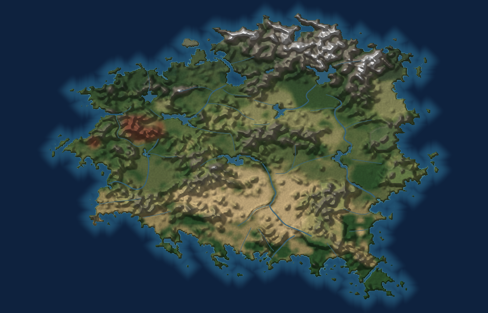
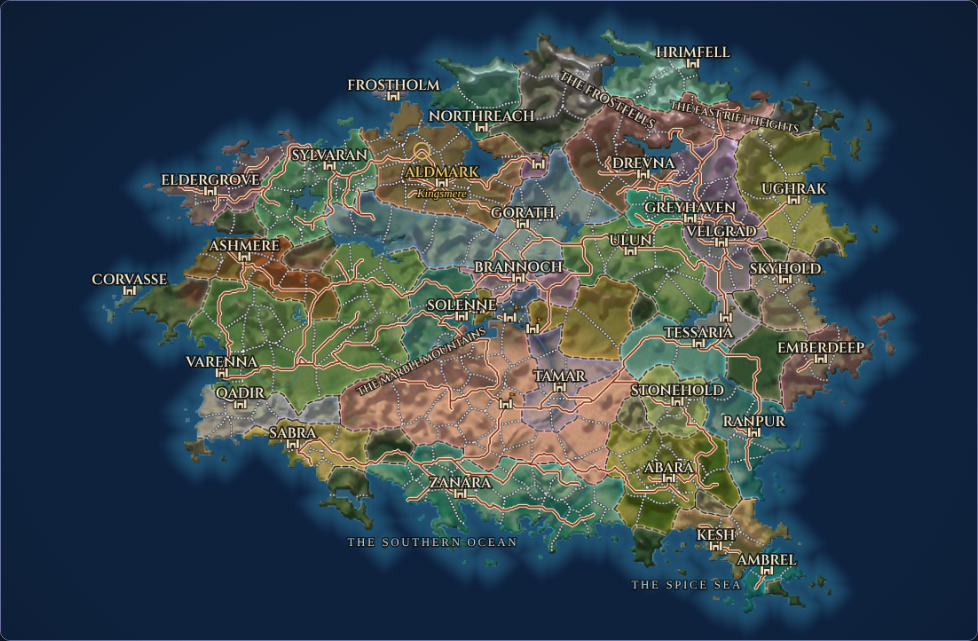
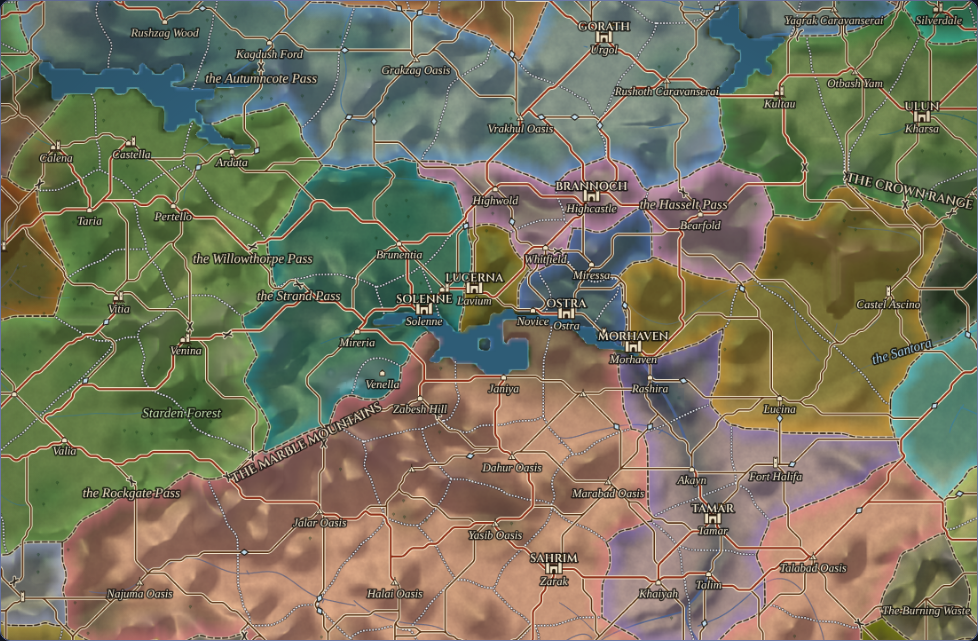
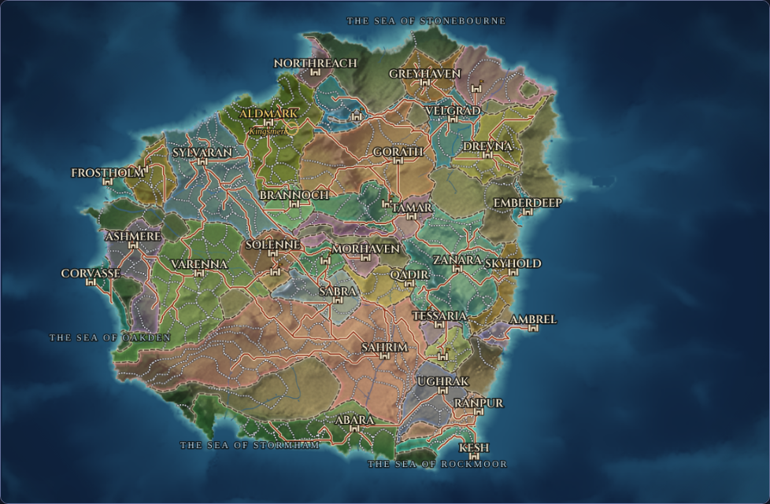
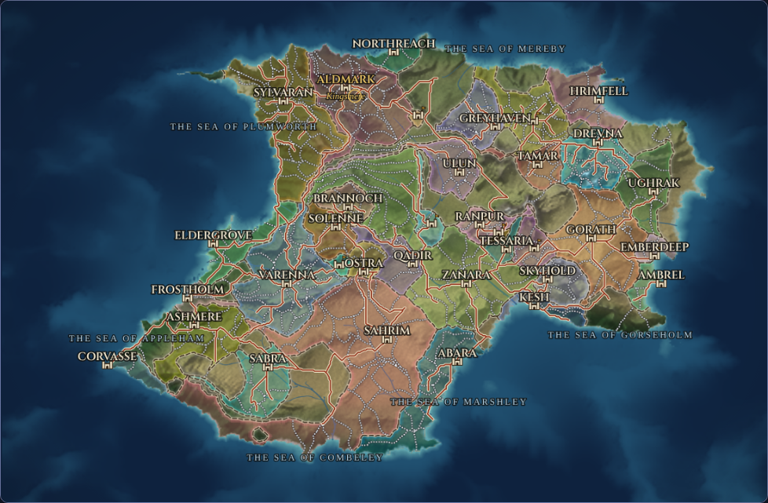
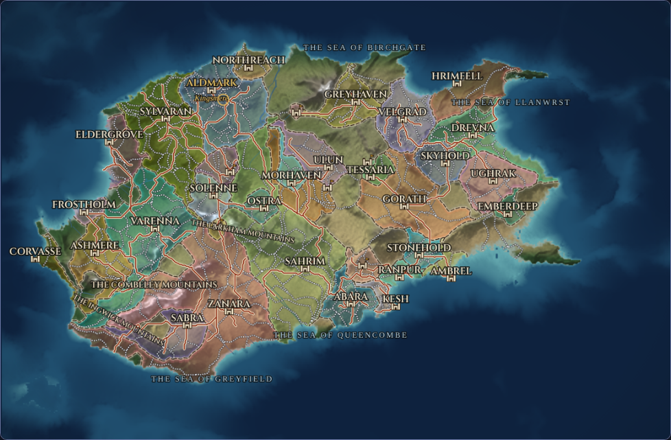

# M1: the one continent

**Now: the designed continent, map version 4 of `ardan-v2-map:one`** (orders 72 and 73; D-152 to D-155). The continent
is designed on purpose from the owner's picture (`reference/owner-continent.webp`) and the lore's names, in
[`map-design.md`](map-design.md), and the game builds that design: authored control data (`design/`, turned into
`data/map/v4.json` by `node tools/m1/v4-data.mjs`) plus generated detail (`src/map/99991-v2-map/g-v4.core.js`), never
drawing `A.rand`. The lore was then brought into line with it ([`lore-changes.md`](lore-changes.md)), and
`node tools/lint-lore-map.mjs` holds the words to the map at a baseline of 0. A version 3 save keeps its version 3 map.

The built game's own map, rendered by `node tools/m1/render-v4.mjs <built.html> --out=docs/design/m1`:

| The ground | The realms | Close, on the Middle Sea |
| --- | --- | --- |
|  |  |  |

Beside them, the design on the owner's picture: [`design-on-picture.jpg`](design-on-picture.jpg) and the design sketch
[`design-sketch.png`](design-sketch.png).

To change the map: edit `design/seats.tsv` or `design/features.json` (the owner's questions in `map-design.md` section 9
may come back that way), then run `node tools/m1/design-sketch.mjs`, `node tools/m1/v4-data.mjs`, build, run
`node tools/m1/facts.mjs <built.html>` and `node tools/lint-lore-map.mjs --list` to see what lore the change moves.

## Before the design: choosing a seed (D-142, D-148 to D-150; replaced by D-152)

What follows is the seed era, kept as what was tried. The owner's order 68 (D-142): Ardan has one geography for every
life, built from one map seed chosen once by measured quality. Thirty candidates, how each was read, and why the winner won.

**Chosen then: `ardan-v2-map:m1-02`** (map version 3). A save begun on it keeps it.

| The winner, `m1-02` | Runner-up, `m1-08` | Runner-up, `m1-27` |
| --- | --- | --- |
|  |  |  |

Each picture is the game's own full map at its widest, for a life begun in Aldmark on that continent. The scores come
from `scores.json`, written by `node tools/m1/choose-seed.mjs <built.html> --n=30 --png`.

### How a candidate was read

Every candidate was built in the page by the code a life plays on (`A.V2MAP.build`, map version 3, the D9 ground with
it). It was then read on seven counts, each from 0 to 100.

| Count | Weight | What it reads |
| --- | ---: | --- |
| **lore** | 30 | Do the realms' heartlands fit the Codex? Each of 29 realms has the words its name and its primer's first line give it, scored 0 to 1 and averaged. The words are: a sea realm on the coast, mountain folk high, steppe and plains realms on open grass, the dry realms on dry land, the forest realms in wood, the north, south, east or west its primer names, Tamar's river, Drevna's lakes, Irondeep beside Aldmark, and Abara beside Tamar. The table is `LOREFIT` in the tool, each line quoting its source. |
| **roads** | 20 | Do roads read as roads (D9-2's legibility)? This is the share of road length that does not run along a border. The D9-2 readings (69, 75 and 73 of 100) were blind playtests of crops, so they cannot be scored per seed. In those playtests the strangers' mistakes were province bounds taken for roads (20 times) and tracks taken for borders (10). Both happen where a road and a border lie side by side. So this counts every road cell in a run of four or more cells (40 km) within one cell of a border. A road crossing a border touches it for two or three cells, not four. |
| **borders** | 15 | The release's 39 realm borders that are kept. The Codex's neighbours, allies and rivals stay neighbours. |
| **rivers** | 10 | Rivers that reach the sea: every river mouth (flow from 120), weighted by its flow, that runs into the open sea and not into a lake, an inland sea or a sink. |
| **sizes** | 10 | Provinces in range: the share whose land is between half and twice the release's. |
| **one piece** | 5 | One connected landmass: the share of the generated land that is the one continent. |
| **towns** | 10 | D9's ground: the mean of the share of towns on a road and the share on water. |

**Gate.** Some rules are held for every continent by the game's own tests, so the one continent must pass them. A
candidate that fails one is out, whatever its total. The gate checked here is from `v2mapSeaRealms`: a realm named for
the sea has its capital on the coast, and one named for islands has at least two thirds of its provinces on the coast.

### The thirty candidates

| # | Seed | Total | lore | roads | borders | rivers | sizes | one piece | towns | Gate |
| ---: | --- | ---: | ---: | ---: | ---: | ---: | ---: | ---: | ---: | --- |
| 1 | `m1-02` | **68.8** | 67.1 | 68.4 | 43.6 | 100 | 46.7 | 100 | 88.1 | |
| 2 | `m1-08` | **68.3** | 63.8 | 65.5 | 53.8 | 100 | 43.8 | 100 | 86.3 | |
| 3 | `m1-27` | **68.3** | 61.9 | 69.3 | 48.7 | 100 | 50 | 100 | 85.3 | |
| 4 | `m1-18` | 68 | 59.3 | 65.1 | 56.4 | 100 | 48.7 | 100 | 88.1 | |
| 5 | `m1-25` | 67.9 | 58.3 | 70.6 | 48.7 | 100 | 52 | 100 | 87.9 | |
| 6 | `m1-23` | 67.7 | 55.9 | 65.6 | 66.7 | 96 | 46.4 | 100 | 85.5 | |
| 7 | `m1-04` | 67.3 | 59.7 | 66.3 | 56.4 | 98.8 | 43.1 | 100 | 84.6 | |
| 8 | `m1-07` | 67.1 | 62.4 | 66.2 | 43.6 | 100 | 48.7 | 100 | 87.1 | |
| 9 | `m1-21` | 66.5 | 55.7 | 64.2 | 53.8 | 98.5 | 52.3 | 100 | 88.1 | |
| 10 | `m1-05` | 66.4 | 61.1 | 66.6 | 46.2 | 100 | 41.5 | 100 | 86.3 | |
| 11 | `m1-15` | 66.2 | 61.8 | 67.2 | 33.3 | 100 | 54.6 | 100 | 87.4 | |
| 12 | `m1-20` | 66.2 | 59.8 | 66.3 | 46.2 | 100 | 43.5 | 100 | 86.8 | |
| 13 | `m1-12` | 66 | 61.1 | 68.4 | 35.9 | 100 | 47.4 | 100 | 88.2 | |
| 14 | `m1-10` | 65.9 | 56.5 | 66.8 | 41 | 97.6 | 58.2 | 100 | 88.4 | |
| 15 | `m1-28` | 65.8 | 63.3 | 66.7 | 33.3 | 100 | 48.4 | 100 | 86.6 | |
| 16 | `m1-26` | 65.7 | 65.1 | 65.8 | 46.2 | 76.5 | 46.1 | 100 | 88.4 | |
| 17 | `m1-11` | 65.5 | 58.1 | 67.2 | 48.7 | 96.3 | 38.6 | 100 | 87.9 | |
| 18 | `m1-03` | 65.3 | 57.6 | 64.5 | 35.9 | 99.5 | 58.5 | 100 | 89.7 | |
| 19 | `m1-24` | 65.1 | 57.4 | 64.2 | 51.3 | 95.5 | 39.5 | 100 | 88.7 | |
| 20 | `m1-14` | 64.9 | 58.8 | 63.1 | 61.5 | 70.4 | 46.7 | 100 | 87.3 | |
| 21 | `m1-17` | 64.3 | 57.8 | 67.9 | 38.5 | 84.2 | 52.3 | 100 | 89.4 | |
| 22 | `m1-19` | 63.8 | 55.3 | 67.8 | 38.5 | 96.7 | 43.8 | 100 | 87.9 | |
| 23 | `m1-09` | 63.6 | 57.6 | 68.8 | 51.3 | 54.3 | 54.9 | 100 | 89.9 | |
| 24 | `m1-01` | 63.4 | 57.1 | 63.5 | 30.8 | 99.4 | 50.7 | 100 | 89.5 | |
| 25 | `m1-06` | 63.2 | 55.4 | 66.9 | 30.8 | 100 | 45.8 | 100 | 89.5 | |
| 26 | `m1-30` | 63.2 | 62.9 | 67.3 | 28.2 | 81.7 | 45.1 | 100 | 89.5 | |
| 27 | `m1-16` | 63.1 | 57.7 | 65.5 | 51.3 | 65.3 | 46.1 | 100 | 88.2 | |
| 28 | `m1-29` | 62.3 | 53.8 | 66.3 | 61.5 | 49.3 | 49 | 100 | 88.6 | |
| 29 | `m1-13` | 60.4 | 54.7 | 66.7 | 41 | 66.2 | 43.5 | 100 | 85 | |
| — | `m1-22` | 70.3 | 66.3 | 67.8 | 51.3 | 99.5 | 52.6 | 100 | 89.1 | **out:** Ambrel (the spice islands) has 1 of 3 provinces on the coast |

### Why `m1-02`

- **It fits the lore best of the candidates that pass the gate** (67.1; the field ranged from 53.8 to 67.1). Sylvaran
  and Eldergrove are in wood. The dry realms (Sahrim, Qadir, Tamar, Sabra) are on dry land. Stonehold, Brannoch and
  Irondeep stand high; Skyhold and Emberdeep only partly. Frostholm, Northreach and Hrimfell are in the north and on the
  coast. The east (Velgrad, Ughrak, Ambrel, Hrimfell) is in the east.
- **Its roads read well** (68.4, fifth of thirty; the best was 70.6). Its realm borders have the second fewest roads
  running beside them (15.7% of road length).
- **Every river reaches the sea** (35 of 35 mouths). The land is one piece with no islets, every province is on a road,
  and three towns in four stand on water (233 of 306).
- **Where it is weaker:** only 17 of the release's 39 realm borders are kept (43.6). `m1-23` keeps 26, but it is weaker
  on lore (55.9) and its rivers (96). And just under half of its provinces are within half to twice the release's size,
  the middle of the field. `m1-22` scored higher (70.3) but is out: its spice-island sultanate holds one coastal
  province of three.
- **The runners-up:** `m1-08` (68.3) keeps more borders (21) but fits the lore less (63.8: Frostholm is not in the north,
  Emberdeep is not high). `m1-27` (68.3) has the best roads of the three (69.3) but puts Stonehold off the heights and has
  44 desert provinces against the lore's few.

### What no candidate got right (the reason for the design)

These failings were the same on all or nearly all seeds, so choosing a seed cannot fix them. They come from the generator.

- **The Middle Sea realms lose their sea.** Lucerna (a lagoon republic) and Ostra (a harbour of bankers) are inland on
  all thirty candidates, Greyhaven (58 galleys) on 29, Sabra (the pearl emirate) and Ulun (by the Salt Sea) on 27, and
  Qadir (galleys on the desert coast) on 25. The generated continent has no inland sea, and only realms *named* for the
  sea (isles, coast, reef, and the three kept by id, `VM.SEA_ID`) are seated on the shore. Seating every realm whose
  release land was mostly coastal on the shore would need a new map version. It would also need a choice between an
  outer coast and an inland sea for the Middle Sea.
- **Drevna, "the Lakeland",** has no lake shore on 26 of the thirty. The generator makes few lakes.
- **Neighbours the primers name:** Irondeep is beside Aldmark on 2 of the thirty. Abara (the source of Tamar's river) is
  beside Tamar on 5.
- **On `m1-02` itself:** Aldmark, "the empire of the northern plains", has no plains province. D-061 caps every terrain
  word at 31% of the provinces, and Aldmark's land is read as wood and hills. Gorath, "the southern grass", sits in the
  north centre.

## Undo or change

The design is `A.V2MAP.DESIGN` (= `A.V2MAP.ONE`, the seed `one`); `VM.build` builds it as version 4 and any other seed as
version 3 did. Setting `A.V2MAP.ONE` to `null` gives every life its own generated continent again; setting it to a seed
such as `m1-02` gives every life that one. Either way run `node tools/m1/facts.mjs <built.html>` and the lore lint, since
the lore now follows the design. Lives already saved keep the continent and version they were made on. The commits:
the design `41b7c4e4`, the build `012bdea7` (D-154), the lore `c4cd08cb` (D-155).
