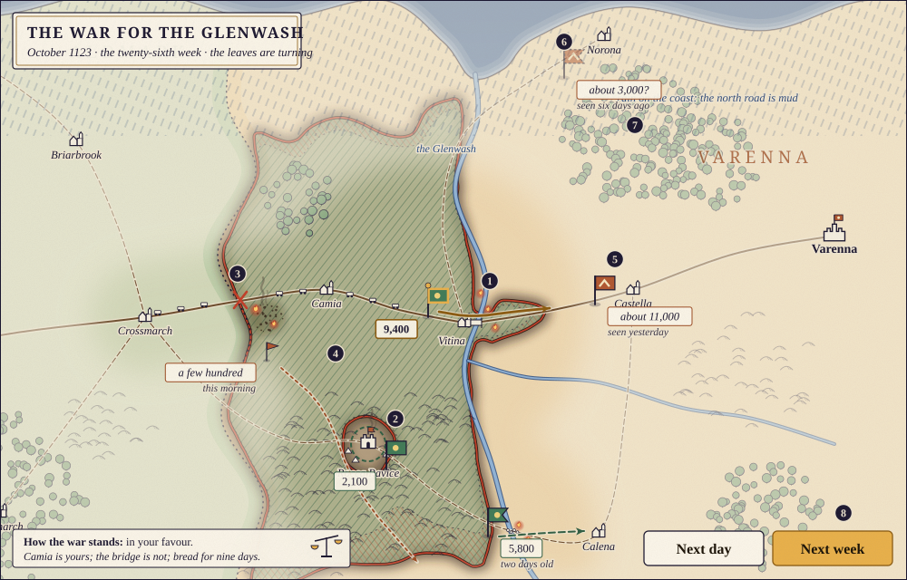
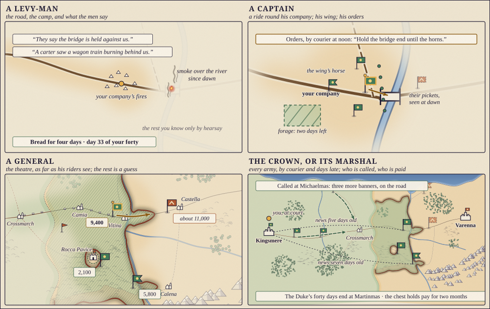
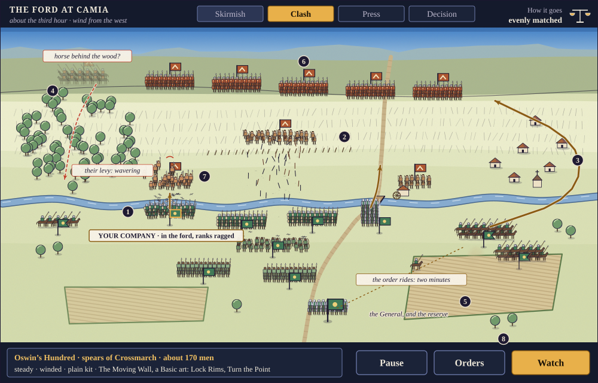
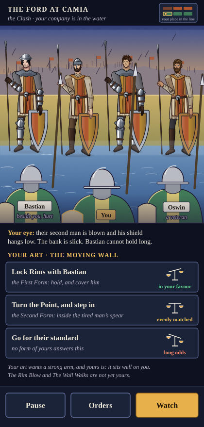

# War as a living picture: fronts that burn, armies on the roads, battles seen close (D12a)

*Stamped 2026-11-14 05:21 ET · work item D12a (owner orders 34 and 49; D-039 item 13 as replaced by D-047) · by Fable 5.2 at maximum effort · a design for the owner to steer; nothing is built · supersedes nothing; once approved it steers W0, D9's war pieces, D11 and D12b*

The owner's words: "I no longer am a fan of the HOI4 war system within this game, but the game board representations, war simulation and tactics to the small details should be redesigned and still incorporated." Then: "Not a war board, just a well built visual simulation where you can get an up close and tactical view of it."

**The plan in short.**
- **One war, one simulation, three distances:** the *theatre* (the war on the inked map), the *field* (one engagement, from a hill behind your own line) and the *press* (your own place in that line). Nothing is fought twice.
- **You watch it.** Standards march on roads, the front creeps like a burn, carts feed armies, castles hold out as embers. Numbers wait behind a press, in words.
- **At your rank.** A levy-man sees the road and the camp; a captain a ride round his company; a general the theatre as far as his riders see; the crown every army, by courier and days late.
- **Armies are who came,** never a recipe: contingents by rank and oath, armed by their lord, fighting in their regiment's standard art.
- **A battle is Watch, Pause, Orders.** It plays, and stops when your rank has something to decide. Orders ride by courier and arrive late. Two to twelve minutes; quick fingers are never needed.
- **Arts fight.** You fight with the forms you have learned; a legendary in a master's hand breaks a company's front, if it lands.
- **One engine for every battle in the world,** watched or not. Each cause is written down as it acts, so the report is a record, not a guess.
- **Gone:** the war score, army templates, divisions with "organisation" and "combat width", the Industry and Manpower tabs, five separate battle resolvers. Each has a named heir (§4).
- **Cheaper:** all the world's wars in about 12 ms of a month where the war map now takes 40 to 85; under 40 KB of a save.
- **Nine stages, ten choices for the owner** (§6, §7).

Technical detail is under **For the builders**. A busy reader can keep to §1.1 to §1.3, §2.2 to §2.4, the pictures, §4 and §7. Costs come from the code and a throwaway trial (`docs/design/trials/war.mjs`); the pictures are drawn by `docs/design/war/build.mjs`.

## 0 · What the game has now, measured

| | Today | Where it stops |
|---|---|---|
| The war on the map | 204 divisions of up to 7,200 men step daily between 306 provinces some 200 km across; a province is taken whole when a day counter fills. `A.wsDay` is 48.7% of an engine month while any war runs | The owner's "tile map flattens tactics and terrain". Nothing creeps |
| A fight | `A.fightDay`: divisions fill a "combat width", trade soft and hard attack, and lose "organisation" until one side leaves. About 160 a year in a test world | Hearts of Iron's model in medieval dress: no ground, no formation |
| A battle you play | Five resolvers for one fight (line mission, wing battle, v2's four phases, 72's book scene, the general's map command); three only nudge the real fight | A scene and the map can disagree; choices are fixed lists (W1) |
| The war score | One number, −100 to 100, rewritten weekly from provinces held; it forces peace at ±80 and sizes the treaty | A gain shown to the player is gone in eight days |
| Templates | "Line Division" of nine battalions, designed with army experience | A recipe, not people. `GD.NOBLE_RUNGS` says a baron owes 300 men and a count 4,000; no army is built from it |
| The War Room | 59 `UI.wr*` functions; tabs Command, Forces, Templates, Industry, Manpower, Wars | A modern staff's desk (W8) |

Much is kept (§4): seeded captains, drill that gates formations, generals with tempers, "What decided it", named men, siege choices, rumour. In all, about 9,700 lines of war in the release and 7,000 in eleven features.

## 1 · The theatre: the war on the map

### 1.1 One war, three distances

You open the war where your rank stands and move between **the theatre**, **the field** and **the press** by pressing a place or pinching. They are one state: the company that wavers in the press is the one whose standard dips on the field.

### 1.2 What the theatre shows

The ground is D9's inked map. On it:

- **Armies are standards on the roads.** The flag's cut says what leads (square for foot, swallow-tail for horse); yours is edged in gold. A press opens a slip: who leads, about how many, how fed. The enemy is an estimate with its age (5: "about 11,000, seen yesterday"; 6: a guess six days old, drawn faint).
- **The front burns** (D-016). Land a side holds beyond its border is hatched in its ink. Its edge is a char line, with embers where there was fighting this week (1). Last week's edge stays as a dotted line and the ground won is cross-hatched (4), so momentum shows. The rules, by which the picture's front was drawn:
  1. An army holds the country its riders and foragers reach: about a day's ride, farther along roads, less through wood, hill and marsh, and across a river only by a bridge or a ford.
  2. Where two reaches meet, the stronger pushes the edge a little each week. A skirmish nudges it. A won battle sends it leaping to the next river, ridge or wall.
  3. A castle or walled town that has not fallen holds its own country whatever flows round it (2: Rocca Pavice, an ember island behind the front). When it falls, its country goes with it.
  4. Land nobody garrisons drifts back to its owner. Winter slows everything.
  5. A raid scorches without holding: black stipple, a poorer harvest (E1), nothing left to forage.
- **Supply is carts on a road** from a base to the army. Cut the road and they stop at a red cross (3); the slip says "bread for nine days", then "short", then "starving".
- **A siege** is a ring, tents and smoke round a place (2); pressing it opens the walls (§2.8).
- **This week's marches** are arrows on the roads: gold for yours, dashed for your side's. The enemy's shows only if a scout or a taken letter told you.
- **Weather and season** are on the map: rain that turns a road to mud (7), a snow line coming down, a pass with the date it shuts (8), a river in spate that drowns its ford.
- **How the war stands** is one line of words and a tipped scale, its reasons on a press. It replaces the war score (§4).

It moves when time moves. On campaign the two buttons are Next day and Next week, as now (D-026); a press plays that stretch of marching, burning and weather in two or three seconds. Only what is notable stops a week: a battle, an order, hunger, a wall breached. At rest, embers and smoke drift; under reduced motion nothing does.

### 1.3 At your rank

The standing rule (war screens only when deployed, at your rank) becomes one rule of sight: **you are shown what your post's own eyes, riders and letters could know.**

| Who | Sees | Decides on the march and in camp | At a siege |
|---|---|---|---|
| Levy-man, soldier | The road, the camp, smoke on the horizon; rumour, late and sometimes wrong | Keep up or straggle; forage; go home when his forty days end? | A ladder, a mine |
| Sergeant | The same, and his section's tasks | Keep twelve men together: pickets, foraging | A ladder party, a watch |
| Captain | A ride round his company; his wing; enemy pickets as last seen; his orders, by letter | Order of march, scouts, drill, pay; follow or bend an order | A gate, a sap or a tower |
| Commander of a wing | His wing's stretch of front; the other wings as last told | The van or the rearguard; the camp's site | A sector of the ring |
| General | The theatre as far as his riders see; beyond, a pale veil and guesses with their age | Road, pace, where to offer battle, supply, winter quarters | Starve, dig, storm or offer terms |
| The crown, or its Marshal | Every army, by courier, as many days old as the road is long | Whom to call and for how long, whom to hire, who commands, when to treat | Which places to take |

A townsman behind besieged walls gets the siege from inside; a scout on a mission his own strip of map; everyone else rumour, as now.

**Scouting sharpens the picture.** With no riders out, an enemy army is "a host, somewhere east". Light horse give "about 11,000, seen yesterday"; scouts close in, "some 10,400, many of them horse"; a spy or a taken letter, their arrow for the week.

### 1.4 The war's verbs, each with a place

The owner's list (flanking, stealth, attrition, blockade, encirclement, sieges, supply lines, ambush, scouting) as orders given on the map and read from the ground:

| Order | Needs | Shows as |
|---|---|---|
| March (steady, forced, cautious) | A road; forcing it sheds stragglers | A column to scale: ten thousand men, ten kilometres |
| Hold a crossing or a pass | A ford, bridge or pass | A standard planted there; whoever comes must fight for it |
| Raid, cut a road | Horse; an enemy road in reach | A fast pennon; scorch; the red cross on their supply |
| Screen and scout | Light horse or the Scout Regiment | Your veil pushed back, theirs pulled close |
| Ambush; a flank or night march | A wood, a defile or a second road, and scouts they failed to send | Nothing, until the battle opens with their column strung out |
| Besiege, relieve, blockade | A ring of men; for a port, ships | The ring; stores counting down |
| Encircle | Every road out held | The front closes into a ring; the slip reads "cut off" |

### 1.5 For the builders: the campaign

- **Hosts on roads.** An army is at a place on D9's route graph or part-way along a road, with a next event (arrive, meet, run short, a term of service ends); the day step handles only events that fall due. With about 40 hosts in the field, every war runs at one fidelity, near or far: P12 is closed by doing less work, not by coarser rules.
- **The burn** is a byte of hold for each 10 km cell of `MAP.grid`, per war, touched weekly and only along the front. `press = enemy reach − holder's reach − the cell's damp`; hold falls under pressure and the cell changes hands at nothing; held land hardens; ungarrisoned land drifts home. Reach is a bounded flood from each host and stronghold over D9's ground (road 0.3, open 1, wood 2, marsh 3, a river edge shut except at crossings). A won battle adds a burst. The edge is a contour, cached each week; `build.mjs` draws picture 1 this way.
- **Provinces stay** for law, titles and markets; `p.occ` becomes a reading (who holds the seat and most of the cells).
- **Sight** is one function, `A.WAR.know(pc)`: a scope (road, ride, wing, theatre, realm), a reach and an age. The theatre, the field, the Annals and D10's persona tests all ask it.
- **AI generals** keep 38-orders' tempers and pick a new objective when an event frees them, searching a month's march.
- **Dice.** The war has its own seeded stream (`seed:war`, position saved), as E1's economy does, and each battle a stream from it; orders are journalled; drawing reads and never writes.

## 2 · The field and the press: one engagement, close

### 2.1 The ground is the map's

A battle is fought where the armies met. `fieldAt(site)` cuts a patch from D9's data: the stream is the map's river, the ford is where the road crosses, the wood, ridge and village are where the map has them. The same site is always the same field: a second battle at the ford at Camia, twenty years on, is fought over the same stones. A skirmish gets 600 metres, a great battle 2,500.

### 2.2 What you see

You look from a hill behind your own side: your men from behind, theirs facing you (6: their line on the ridge you must climb). A man is the same size near and far, so a block reads as a count.

- **A company is its men:** about two hundred, as small figures in the figure library's colours, under its standard (one figure for about six men here; your own company man for man up close). Its shape is its formation: a tight block is a wall, a narrow one a column (at the bridge), a scatter is loose order (the bowmen, 2).
- **State is posture, then words.** A company whose ranks are ragged looks it (1: yours, coming out of the water); a wavering one sheds men backwards and its standard dips (7). A press gives the words: *ranks* firm, ragged or lost; *nerve* steady, shaken, wavering or broken; *wind* fresh, winded or blown.
- **Arrows are in the air;** dust rises behind horse; the fallen stay where they fell, so by the end the field shows where it was decided.
- **Orders are gold arrows** (3: the horse sent round the village onto their flank). An order on its way is a rider on a dotted line, with its time (5). What the enemy is only reported to be doing is a thin vermilion line and a question mark (4).
- **Three controls keep their names and places:** Pause, Orders, Watch (8). Above, the stretch of the battle you are in (Skirmish, Clash, Press, Decision, read from the state, not a clock) and how it goes, in words and a scale.

### 2.3 How it plays, and how long

**Watch.** The battle plays: ten to twenty-five seconds of marching, shooting and pushing. **Pause.** It stops by itself when your rank has something to decide: the arrows come, a gap opens beside you, an order arrives, their line wavers. You may also stop it yourself. **Orders.** You answer on a sheet of two to four choices, each with its odds in words and the tipped scale; a commander may instead press a company, an order, then a place. The picture stands still while you choose.

- **Orders take time.** A captain's voice reaches his company at once, and drilled men move sooner than raw ones. A general's order rides: one to four beats by the distance, and a galloper can fall. Orders given before the lines meet (the array, "hold until the horns") cost nothing, so a plan pays.
- **Fight it out** is always on the Orders sheet: the same battle played to its end on your standing orders, as ten seconds of the field or at once.

| | Decisions | To play |
|---|---|---|
| A skirmish, a raid, a foraging fight | 2 to 3 | 1 to 2 minutes |
| A battle, as a soldier or sergeant | 3 to 5 | 3 to 6 |
| A battle, leading a company | 5 to 8 | 5 to 9 |
| A battle, commanding a wing or the field | 8 to 14 | 8 to 12 (a great battle to 15) |
| An assault on a wall | 3 to 6 | 3 to 6 |

Each stretch has its deciders: in the Skirmish, bowmen and light horse; at the Clash, the lines; in the Press, flanks and reserves; at the Decision, the charge, the pursuit or the last stand.

### 2.4 Your own part

**In the line** (levy-man, soldier, sergeant) you are in the press: the men beside you by name, the enemy's rank in front drawn by the figure library, your own rank's helms and shoulders close. At each pause your art offers the forms you have learned that answer the moment, beside the plain moves any man has (hold, push, cover the man beside you, give ground). The sheet says what your eye tells you and how your art sits on your body (growth.md §3.6). What you do decides your own skin, the men beside you and your section's stretch of line; it moves the battle a little, and the report says how much. A sergeant also keeps twelve men in their rank.

**Leading a company,** you are on the field with the press a step away. You choose its formation from those its art teaches and its drill allows; when it looses, charges, holds or gives ground; and whether to follow, bend or ignore the wing's order, to be praised or charged for it afterwards. In the front rank your men are steadier and you can be killed or taken.

**Commanding a wing or the field,** you set the array before the lines meet, then send orders, keep or spend the reserve, and call the pursuit or forbid it. You see what a man on that hill would see: a wing in dead ground is "as last reported".

### 2.5 What beats what, and what ground does

| Arm | Beats | Fears | Its own orders |
|---|---|---|---|
| Knights, heavy horse | Bowmen and loose foot in the open; levies | Spears standing in their ranks; stakes; mud; woods | Charge now, wait for the gap, dismount and hold |
| Light horse | Bowmen with no spears to run behind; baggage; the broken | Anything armoured or set | Screen, harry, feign flight |
| Spears and pikes | Horse, while they stand in their ranks | Arrows; a turned flank | Lock the wall, ground the butts |
| Men-at-arms on foot | Spears and levies in the long push | Bowmen they cannot catch; a flank | Break the line, storm the breach |
| Archers, crossbows | Spears that must stand or come on; crossbows pierce armour close to | Horse that reaches them; rain; a rush | Plant stakes, fall back behind the spears |
| Levies, engineers | A ditch or a wall; engineers beat walls and make stakes and bridges | Everything in the open; a sally | Fill the line, dig, ram, mine |
| Scouts | Plans: they find the ford, hide a wing, name the ambush | A fight in daylight | Screen, guide, the night knife |
| Elite orders | A company's front, and the nerve of those who watch | Massed arrows, hunger, being swamped | The order's own art |

| Ground | What it does |
|---|---|
| Open, dry | Horse at its best; numbers can reach a flank |
| A slope | Uphill, blows are weaker and men tire; height lengthens a bowshot |
| Wood | Horse useless, arrows blind, ranks lost; a wing can hide |
| Marsh, mud after rain | Armoured men and horses bog; a charge dies |
| Stream, ford | Ranks go ragged in the water; the far bank is worth a wall |
| Bridge, pass, gate | Only as many fight as fit: quality counts, numbers do not |
| Village, hedge, stakes, ditch | Cover from arrows and horse; slow to leave |
| Fog, dusk | Bowshot halved, orders go astray, surprise is possible |

### 2.6 Arts, formations and legendary arms

- **A company fights in its regiment's standard art** (growth.md §3.4): the formations it has drilled, a grade, and strengths and a weakness (open ground, the close press, against horse, a long fight) that switch on when the field matches them. The report names it: "Their lances were Hide-Knights; yours had the levy drill." A formation never drilled is not offered (60-unit-drill's rule, kept).
- **Named fighters fight as themselves.** Where a captain, a champion, an order knight or you stand, bouts with the men in front are settled by the duel rules: skill, art, how the art sits on the body, the arm carried.
- **A legendary must land** (D-043). In a master's hand it settles each bout before it starts, so his stretch of the front goes forward, the company facing him loses heart, and his own men do not waver. But he fights a few files' width; arrows, a spear from the side and his own wind do not care what he carries. It is decisive for a company's front, heavy for a wing's nerve, never a battle by itself. A Legend is the same, and his limit is his body.

### 2.7 Nerve and wind

Men are shaken by losses taken fast, a blow in the flank, friends running, the captain down, arrows they cannot answer, hunger and the march before the fight. They are steadied by friends behind, the standard near, a reserve in sight, high ground, pay and home soil. A side quits the field when enough of it has broken; the pursuit, if the winner has fresh horse, is where most men die and most lords are taken.

### 2.8 Sieges, assaults, ambush

A siege is a place you can open: the walls on a field of their own, the ring, the works creeping (ram, tower, mine), the stores as the besieger guesses them, sickness in the camp. 36-sieges' monthly choice, inside and outside, stays. An assault is an engagement on that field: a wall is worth many times a slope until a ladder holds or a breach opens. A relief army is a battle with the besieger caught between. An ambush opens with one side still in column.

### 2.9 For the builders: how it is drawn

- **One canvas, layers.** The ground (D9's map continued close) is painted once per field into a bitmap. Men are sprites cut once from the figure library's palette into an atlas per side: 12 arms × 3 facings (the fourth mirrored) × 6 frames, 24 × 32 px. A frame is one ground copy and at most 1,500 `drawImage` calls; beyond that, far companies become a block under their standard.
- **Animation is interpolation.** The engine gives the state at each beat; the picture moves companies between two beats over about 1.2 seconds. The same beats with no picture is "Fight it out". Drawing reads the state and writes nothing (`renderRng`, `replayWithRender`).
- **The press** is at most nine library figures at card size, prepared once through 93's picture queue, and code-drawn backs for your own rank. The library has ten stances and none with a raised blade: five fighting stances are an art lot of stage 6.
- **Phone first.** Upright, the field shows your wing and scrolls sideways; the controls sit in the thumb row; a company's words open on a press, never on hover.

## 3 · The simulation underneath

### 3.1 Beats

Every engagement in the world runs on one engine, in beats of about a minute. Each beat is worked out from where it began and applied together, so neither side strikes first:

1. **Orders** that arrive are taken up; a company without one follows its captain's temper and its drill.
2. **Movement** over the ground, by arm, formation, footing and wind.
3. **Shooting,** by range, height, cover, armour and weather; never into a press where friends stand.
4. **The press:** only the files in contact fight, and a company's front is shared among those who come at it. So numbers tell by lasting longer or by reaching a flank, and three hundred order knights are not drowned by three thousand levies. Each blow is weighed by arm against arm, ground, art, kit, ranks, wind, nerve and a small fortune.
5. **The charge:** horse arriving on open ground shocks, unless it meets spears standing in their ranks; then it is the horse that recoils.
6. **Nerve:** losses, flanks, panic from neighbours, the terror of an order. The broken run.
7. **Named men:** risk by where they stand; bouts when two meet; the taken are prisoners, with a ransom.
8. **The end:** a side quits, or dusk falls; the pursuit.

### 3.2 The ledger, and the report

Each time a named cause changes a blow, a volley or a test of nerve, the engine adds what it was worth to a ledger: the dead it added to their side or spared on ours (23-after-action's measure). Causes have places and moments: *the stream*, *their bowmen behind stakes*, *the Moving Wall against the levy drill*, *plain kit against fine*, *taken in flank at the village*, *winded by the morning's march*, *the order to the left wing never arrived*, *Leofric Stane and Winter Storm*, *fortune*.

The report is that ledger read back. A verdict in words (a field held, a rout, a slaughter, a draw at dusk). **What decided it:** the three to five heaviest causes, each with a weight in words (decisive, heavy, telling, slight) and a press that replays its moment on the field. The roll: the named dead, hurt and taken, and honours won. What changed on the map: "the front leapt to the Vite." And, as now, what each side says happened beside what did.

### 3.3 One engine for everyone

A battle nobody watches is the same loop without a picture: about a millisecond for nine thousand men (§5). So a far war has real battles with real causes, for the Annals and for rumour to garble, and no second, cheaper model can disagree with the first.

### 3.4 For the builders

- `src/war/engine/engage.js`, a plain module beside `war.js`, unit-tested in node; typed arrays, one row a company (side, arm, men, place, facing, formation, ranks, nerve, wind, arrows, state, order). `engage.start(...)`; `engage.beat(E, orders)` returns the next thing to ask, or nothing; `engage.report(E)`. The trial is its sketch.
- **A man's worth** = the arm's worth in levies (as calibrated today: levy 1, knight 5 to 7, order 12 to 32) × kit word (E2c) × art grade and its switched strengths (G4; until then `LORE.styles` and 60's drill record, through one `artOf(company)` seam) × experience. The tables of §2.5 are data (`data/military/`).
- **The player** enters as orders, or as an act resolved by `attempt()` and the duel engine against `facing()`; an act may move only what his post owns (his section, his company, his orders).
- **Held by tests:** the same seed and orders give the same battle to the bit, in the page and in node, watched or not; each pairing of §2.5 wins at least 8 in 10 on its own ground and loses on the wrong ground; equal hosts on open ground are a coin; a host one grade of art better wins about 2 in 3 (man to man, a top art wins about 7 in 10, growth.md); 250 order knights beat 3,000 levies in the open; a rank's best play against its worst moves its own stake (section, company, battle) by 15 points or more, `rankfx`'s bar; the report's top cause is within a factor of two of a counterfactual (23's `aarCalibrated`).

## 4 · What goes, and what does its work

| Gone | What it did | What does it now |
|---|---|---|
| **The war score** (`A.wsScore`, `w.score`) | Said who was winning; forced peace at ±80; sized the treaty | **How the war stands:** each side's named reasons to go on or to stop (places held and lost, armies whole or broken, captives of rank, the chest, the harvest, terms of service ending, allies), as diplomacy's reasons already work. A ruler treats when his reasons to stop outweigh the rest, by his temper. A treaty is made of real things: land held, captives, coin, the claim, an oath |
| **Army templates** (`r.forces.tpl`, the Templates tab, army experience) | Set what a division was made of | **Who came.** Contingents by rank and oath (D-012), the crown's own, orders, companies for hire; their arm fixed by their regiment (D11), their kit by their lord's armoury (E2c), their skill by art and drill. The only design left is the array, made on the field |
| Divisions with organisation, combat width, planning and dig-in bonuses; seventeen daily "tactics" matched like stone, paper, scissors; provinces taken whole | Decided fights and territory | Companies on real ground (§3.1); orders with a place; the burn and its strongholds (§1.2) |
| The Industry and Manpower tabs, the equipment stockpile, the recruit queue | Made kit; raised men | Markets and armouries (E1, E2c); the muster: whom the crown calls, who answers, with how many, how late, for how long |
| The War Room, counters, the supply map mode | The command screen | The theatre at your rank; **The camp**, one page for your own men (a soldier's section by name; a captain's roll, pay and drill; a general's contingents and their days of service) |
| Five battle resolvers and `rankfx`'s nudges | Each rank's battle | One engine at three distances. 72's "squad and front on one screen" is the press and the field; 23's report is the ledger; 37's named men, 36's siege choices and 99997's rumours stay |

Everything retired goes to `archive/` with a note (owner order 4).

## 5 · Budgets

| | Budget | Evidence |
|---|---|---|
| Battles in the world a year, with about six wars | Up to 60 battles, 400 skirmishes and raids, 40 assaults | Today about 160 province fights; hosts are fewer than divisions |
| All the world's wars, a month | 12 ms median; 30 in a month with a great battle | Today 40 to 85 (`A.wsDay` at 48.7% of 80 to 170 ms). The trial, under a load of 14 to 26 on four cores: a battle of 9,000 men 0.8 to 1.2 ms; of 22,700 men 3 to 7; a skirmish 0.04 to 0.07; the burn 0.15 ms a week for six wars; what a host can reach in fifteen days 0.003 ms |
| The battle you watch | A beat 2 ms; opening a field 300 ms, off the press | The trial's beat: 0.02 to 0.2 ms |
| A frame, on a phone | 30 a second; 8 ms of script and drawing at the gate's four-times throttle; at most 1,500 sprites; frames only while something moves | Not yet measured: stage 4 begins with a sprite probe on a real phone. If it fails, far companies become blocks sooner |
| Memory, and the theatre's redraw | 6 MB while a battle is open; a redraw 50 ms (D9's bar) | 216 sprites a side; 62-inked-map's cached layers |
| The save | 40 KB gzipped at any year | About 1,000 mustered companies at 20 bytes; the burn 0.5 KB a war in the trial; your last eight battles, 3 KB each. Today 9997's battalions alone are 188 KB raw. Men at home are two numbers a house, never companies |

## 6 · Building it

**War needs six things of D9:** a route graph (roads in two ranks, fords, bridges, passes, sea lanes, with lengths and seasons); ground the game can read for every 10 km cell (height, slope, cover, river edges and crossings); places as things (towns, castles, walls, the country each holds, stores); names for features; `fieldAt(site)`; and one map component with cached layers, so the burn, weather, the veil and the standards are layers, not redraws.

Each stage is a version (`v2.4.0-alpha.N`) and ends as every step does: tests, the coherency run, a scripted pass and a playtester agent, the records, a sample save. The milestone is `release/v2.4-war`. Engines: Opus 5.5. Views and data: Sonnet 5.5. Fable 5.2 for the look of the field and the press.

| Stage | The player gets | Needs | New tests | New coherency checks |
|---|---|---|---|---|
| **1 · W0** No score, no templates (S) | "How the war stands" in words; the Templates, Industry and Manpower tabs gone | nothing | no page prints a war score or "template"; over 200 years on 5 seeds wars still end | every war has reasons on both sides |
| **2 · D9's war pieces** (in D9) | Nothing new to see | D9 | the same site gives the same field; every crossing on the graph is on its field | every road place reachable; no field without a way across its stream |
| **3 · D11a** Feudal hosts and the muster (L) | Armies of contingents: who came, how many, how late; a muster scene; hosts on roads in place of divisions; The camp | A2 stage 2, stages 1 and 2 | a realm's host is what its houses owe less what they held back; the month within §5; old saves load | one living owner a contingent; no host without a commander |
| **4 · D12b-1** One engine, the field (XL) | Every battle on the engagement engine; the field with Pause, Orders, Watch at every rank; the report from the ledger | stage 3 | §3.4's list; 12 different decision sheets in 20 battles (W1); a beat and a frame within §5 | a battle's dead are its companies' losses; every battle has a report |
| **5 · D12b-2** The theatre and the burn (L) | The living map at your rank; Next day and Next week play it | D9, D10, stage 3 | D10's personas (a civilian nothing, a levy-man the road, a general his riders' reach); the front never crosses an unbridged river; ungarrisoned land drifts home; drawing is pure | no cell held by a realm outside the war |
| **6 · D12b-3** The press; arts in battle (L) | Your place in the line; forms as choices; named men; legendaries that must land | stage 4; fighting stances; G4 and G5 when they come | a master with a legendary breaks a levy company's front 9 times in 10, and is stopped by arrows or his wind at least 2 in 10; no three campaign weeks without a decision or a skip (W3) | every company has a standard art |
| **7 · D11b** Branches as careers (L) | The critique's D11: each arm's ranks, drills, missions and pay; the muster fixes your arm | stage 3 | the critique's list for D11 | every soldier has an arm and a post |
| **8 · D12b-4** Sieges, raids, the verbs (L) | Sieges as places, assaults, raids, cut roads, ambush, blockade, encirclement, winter | stage 5; E1 for stores | each verb of §1.4 moves its own measure by 15 points in a lab; a cut road starves a host in the days its slip said | one besieger a place; no host fed through a cut road |
| **9 · D12b-5** Balance, retire, records (M) | War lengths, deaths and careers in their bands; the old war code in `archive/` | all | the balance league; the press gate without `--report`; state size; every sample save loads | the old fields are gone, or mirrors |

**Ties.** A2 stage 2 makes company and staff posts, and wing posts with them: one holder each, and a promotion hands over the men. With a Marshal (D-049), he directs every host and takes the main one; without, each General answers to the crown. E2c gives the kit word (a lord's wealth until then). G4 and G5 give arts their grades and forms through one seam, so nothing here waits for v3.

**Risks.** The size: this replaces most of 17,000 lines, so each stage leaves a playable game, and stage 4 switches every fight at once, behind `.wip` until its tests pass. A battle that drags: §2.3's lengths are tested with playtesters, and Fight it out is always there. Vassals who do not come: the muster always says why, and what would bring them. The burn must read as a front, not noise: three seeds are looked at before stage 5 ships.

**What to cut first:** watching old battles again; fog and dusk; blockade by sea; captains bending orders; figures for far companies. **Not to be cut:** one engine and its ledger; the burn with its strongholds; sight by rank; Pause, Orders, Watch; hosts of contingents; forms as choices in the press.

## 7 · Choices for the owner

1. **Where you watch a battle from.** (a) A hill behind your own side (pictures 3 and 4). (b) Straight down, like a map. (c) Side-on, like a tapestry. *Recommended: (a).* It shows formations and flanks, and still shows people.
2. **How much of a battle your rank sees.** (a) What your eye and your post would know: a soldier his stretch of line; a general the field, with a wing in dead ground "as last reported". (b) Everyone sees the whole field; only numbers are estimates. *Recommended: (a),* the standing rule carried onto the field.
3. **Who sets the pace.** (a) Pause, Orders, Watch: it stops when your rank has something to decide. (b) It never stops unless you stop it. (c) Four cards with a picture each, as now. *Recommended: (a).*
4. **Where a commander stands.** (a) You choose each battle: with the reserve (you see most) or in the front rank (your art counts, your men stand firmer, you can be killed or taken). (b) Commanders never fight. *Recommended: (a).*
5. **What holds a feudal army together.** (a) Forty days are owed; after that men are paid or go home, the harvest first; hired and household men stay while paid. (b) Men stay until the war ends. *Recommended: (a).* It gives a campaign a clock and money a use.
6. **How a war ends, with no score.** (a) By terms between rulers, each weighing named reasons by his temper: land held, captives, coin, the claim. (b) A hidden score for the AI, with words shown. *Recommended: (a).*
7. **Battles you are not at.** (a) A dispatch, as late as the road is long; then you may watch it played back. (b) A general or ruler watches any battle of his war as it happens. *Recommended: (a).*
8. **How many men are drawn.** (a) Your own company man for man, the rest one figure for about six. (b) Every man everywhere. (c) Blocks only. *Recommended: (a);* (b) costs phones.
9. **Wars in old saves.** (a) On first load, a war in progress becomes a year's truce and the armies go home. (b) Convert each war as it stands (weeks more work, and the fronts would be guesses). *Recommended: (a).*
10. **Words.** (a) Soldier, sergeant, captain, commander, general, Marshal; section, company, wing, army; *ranks*, *nerve* and *wind* for a company's state. (b) Keep File-Leader, Squad Captain, High General. *Recommended: (a),* rule 9.

## 8 · Records to add when this is approved

**DECISIONS** (this plan and the owner's answers; the war's own seeded stream as an exception to "only `A.rand`", as E1's), **PROGRESS** (the nine stages, W0 as stage 1), **CRITIQUE** §2 (D12a done), **growth.md** §3.8 ("the war board" reads "the field and the press"), **CLAUDE.md**, the **`life-sim-systems`** skill §9 and **docs/README.md**.
