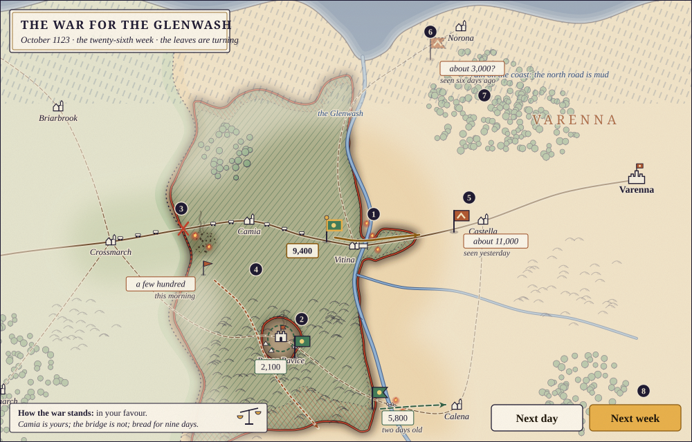
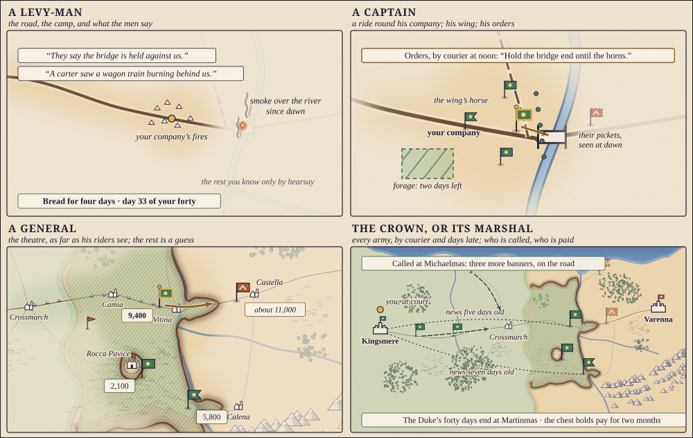
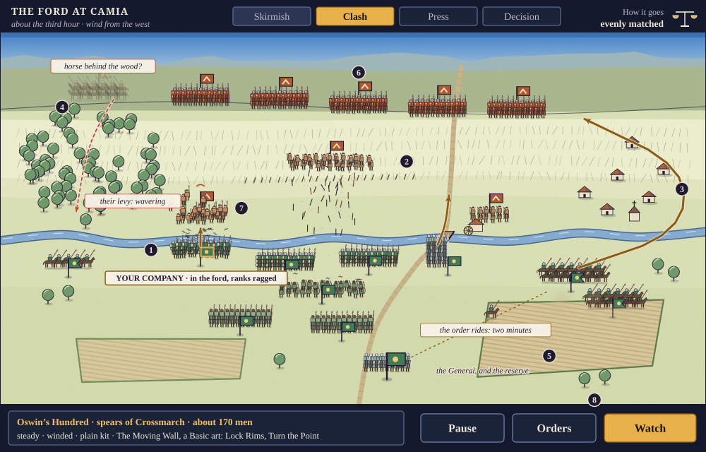
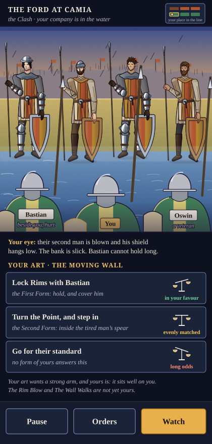
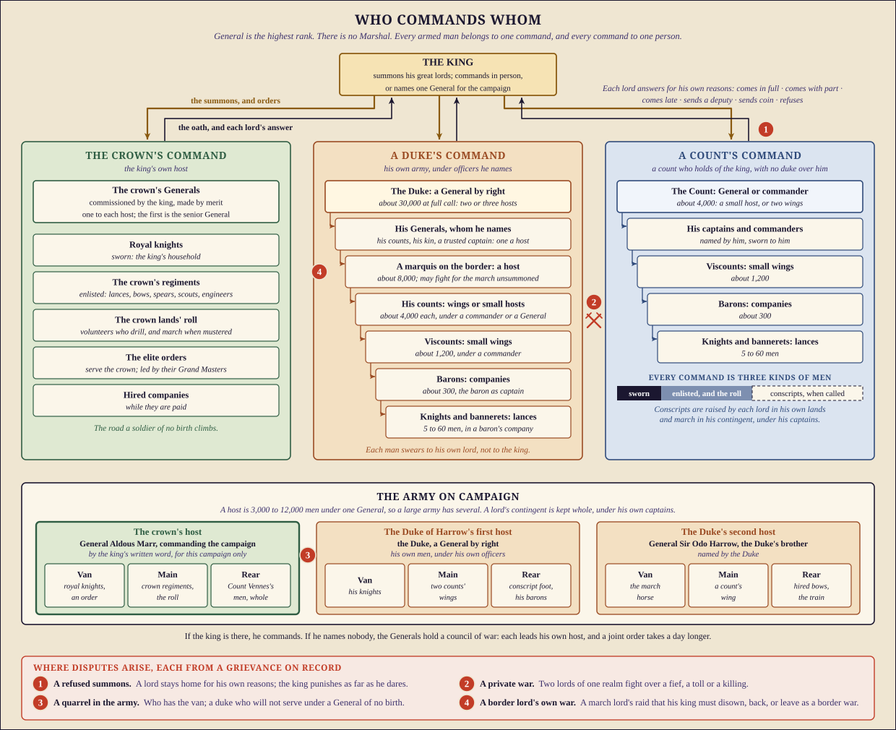
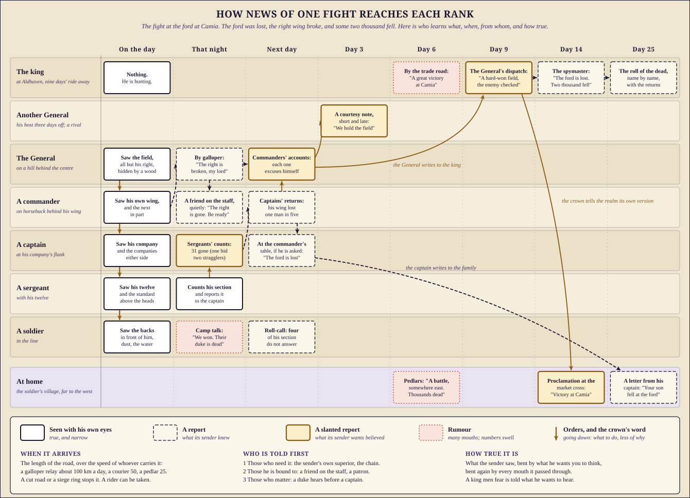

# War as a living picture: fronts that burn, armies on the roads, battles seen close (D12a, revised as D12a-2)

*First stamped 2026-11-14 05:21 ET as work item D12a (owner orders 34 and 49; D-047) · **revised 2026-11-15 21:35 ET as D12a-2** with the owner's ten answers (order 54, D-062; the choices made in the revision are D-064) · by Fable 5.2 · a design; nothing is built · it steers W1, D11 (with D11+), D12b and D9's war pieces*

The owner's words: "I no longer am a fan of the HOI4 war system within this game, but the game board representations, war simulation and tactics to the small details should be redesigned and still incorporated." Then: "Not a war board, just a well built visual simulation where you can get an up close and tactical view of it." And, with his ten answers (order 54): **"Not a single thing in this world should happen outside of reason."**

## For the owner: the whole of it on one page

**What has not changed.** War is one living picture at three distances: the *theatre* (the war on the inked map, its front creeping like a burn), the *field* (one battle, close) and the *press* (your own place in the line). One engine fights every battle in the world and writes down each cause as it acts. No war score, no templates. (Part one, §0 to §5.)

**What your answers changed and added.** (Part two, §9 to §16.)

1. **Everything has a reason.** Every king, lord, General, captain and conscript who decides anything decides from named reasons: what he wants, fears, owes, resents and reckons, bent by his temper and by what he feels that season. Dice only choose between reasons that are close. Each decision is written down with its reasons, and you can press anything and be shown why.
2. **No Marshal. General is the top.** Five ranks: soldier, sergeant, captain, commander, General. A host is 3,000 to 12,000 men under one General, so a big army has several. When hosts march together the king commands in person, or names one General to command that campaign and no longer. If he names nobody, the Generals argue it out in council, and it costs them on the field.
3. **The lords have armies of their own.** The king has his own host. Each great lord has his own command: his knights, his paid companies and his vassals' men, under officers he names, sworn to him. The king summons; each lord answers for his own reasons: all his men, some, late, coin instead, or no. A lord's men are kept together and fight under their own captains.
4. **So a realm can quarrel with itself.** A lord's private war with his neighbour over a fief, a toll or a killing. A refused summons, and how far the king dares punish it. Two dukes who both want the van, or a duke who will not serve under a General of no birth. A border lord's own war that may drag two kingdoms in. Each starts from a grievance on record and climbs one decision at a time.
5. **No levies.** Armies are sworn men (honour) and enlisted men (those who chose the path). Conscription is a proclamation in real need: one hearth in twenty, ten, or five, for a season, a year, or while the enemy is on home soil. It costs the harvest and it is remembered. Men follow, desert and mutiny for reasons you can read: pay, bread, the cause, their captain, the harvest at home.
6. **Wars start in someone's mind.** The proud king, insulted before his court, declares a war his Generals told him he would lose, and the record says so. The cold king takes the same insult, waits four years, and strikes when his enemy is busy elsewhere.
7. **Wars end only when one side surrenders or is defeated.** No timer, no score, no peace nobody asked for. Each side weighs its reasons to fight on against its reasons to yield: losses, an empty chest, unworked fields, a captured heir, a fallen capital, lords going home, a revolt behind him. Someone must ask first, and asking has a price. Demanding too much makes the loser fight on.
8. **You see from where you stand.** A soldier sees the backs in front of him. A General sees the field only if he has a hill. A king at home sees letters.
9. **It stops for anything that involves you,** from above (an order), below (your men waver) or around you (the company beside you breaks), and for nothing else. Then it carries on.
10. **Your place is given to you** by the man above, for his reasons. You may ask for another, and you are told why it is yes or no.
11. **News is reports.** Everything you did not see comes from someone, by some road, some days late, saying what he knew and what he wanted you to think. A king men are afraid of hears softened news. You write reports too, and can be caught shading them.
12. **You know the people your post gives you:** those who serve you directly, those who guard you, the one you report to, those you were thrown together with, and those you took the time to know.
13. **Coups, risings and factions are consequences.** Stability is a list of named pressures (the throne's right, each lord, the commons, the towns, the faith, the army, the king himself), not a number that drifts. A faction needs a shared grievance, a tie and a leader. A coup needs a motive, access to the king and an opening.
14. **The military path reads all of you:** your weapon, your way of fighting, and every useful aptitude (command, logistics, seamanship, scouting, engineering, medicine, letters). You go to a muster and are made offers, each with its reason. **Training is built for each unit** from what it is made of, what it can do and what it is like: archers are never drilled in the wedge, and a company that broke before horse is offered "receive horse".
15. **Everything is in the world's history,** saved the same way near and far, each record pointing at its reasons. In old saves the Marshal becomes his realm's senior General, levies become the roll and the conscription law, and a war in progress goes on.

**The build:** sixteen stages in three items (§16). **W1** (six stages, starting now with "No Marshal"), **D11** (three), **D12b** (seven, after the map). The phone's slow Next month is cured at D12b's first stage.

**Where I filled a gap as I judged you would** (D-064; overrule any of them):

- one General commands a campaign by the king's word, for that campaign only;
- the senior General takes the Marshal's council seat and nothing more;
- a lord's men serve one season at his own cost, then the crown pays or he decides again;
- a truce is a pause, never an ending;
- a war in an old save goes on instead of becoming a truce;
- a battle you were not at is played back as it was told to you, not as it truly was.

## What changed in this revision

| Where | Status |
|---|---|
| §0 What the game has now | Kept |
| §1 The theatre | Kept. §1.3's table changed: no levy-man, no Marshal, a great lord's row added |
| §2 The field and the press | Kept, with three changes marked in place: the viewpoint (§2.2, now §12.1), what stops a battle (§2.3, now §12.2), where you stand (§2.4, now §12.3). "Levies" read "conscripts" |
| §3 The simulation underneath | Kept |
| §4 What goes | Kept; the muster's row now points to §9 and §10 |
| §5 Budgets | Kept; history's budget added in §15 |
| §6 Building it | The stage table is **replaced by §16**; D9's six needs, the risks and the cut list stand |
| §7 Choices for the owner | **Answered** (order 54); each answer is set beside its question |
| §8 Records | Brought up to date |
| **§9 to §16** | **New:** command without a Marshal; manpower without levies; why wars start and how they end; your place in it; stability, factions, risings and coups; the military path and training; records and old saves; the build order |

A change inside the old text is marked *(D12a-2)*. Technical detail is under **For the builders**. A busy reader can keep to this page, the pictures, §9.2 to §9.4, §11.3, §12 and §16. Costs come from the code and a throwaway trial (`docs/design/trials/war.mjs`); pictures 1 to 4 are drawn by `docs/design/war/build.mjs`, 5 and 6 by `docs/design/war/build-command.mjs`.

---

# Part one · How a war looks and how a battle is fought (D12a)

## 0 · What the game has now, measured

| | Today | Where it stops |
|---|---|---|
| The war on the map | 204 divisions of up to 7,200 men step daily between 306 provinces some 200 km across; a province is taken whole when a day counter fills. `A.wsDay` is 48.7% of an engine month while any war runs | The owner's "tile map flattens tactics and terrain". Nothing creeps |
| A fight | `A.fightDay`: divisions fill a "combat width", trade soft and hard attack, and lose "organisation" until one side leaves. About 160 a year in a test world | Hearts of Iron's model in medieval dress: no ground, no formation |
| A battle you play | Five resolvers for one fight (line mission, wing battle, v2's four phases, 72's book scene, the general's map command); three only nudge the real fight | A scene and the map can disagree; choices are fixed lists (W1) |
| The war score | One number, −100 to 100, rewritten weekly from provinces held; it forces peace at ±80 and sizes the treaty | A gain shown to the player is gone in eight days |
| Templates | "Line Division" of nine battalions, designed with army experience | A recipe, not people. `GD.NOBLE_RUNGS` says a baron owes 300 men and a count 4,000; no army is built from it |
| The War Room | 59 `UI.wr*` functions; tabs Command, Forces, Templates, Industry, Manpower, Wars | A modern staff's desk (W8) |

Much of it is kept (§4). In all, about 9,700 lines of war in the release and 7,000 in eleven features.

## 1 · The theatre: the war on the map

### 1.1 One war, three distances

You open the war where your rank stands and move between **the theatre**, **the field** and **the press** by pressing a place or pinching. They are one state: the company that wavers in the press is the one whose standard dips on the field.

### 1.2 What the theatre shows

The ground is D9's inked map. On it:

- **Armies are standards on the roads.** The flag's cut says what leads (square for foot, swallow-tail for horse); yours is edged in gold. A press opens a slip: who leads, about how many, how fed. The enemy is an estimate with its age (5: "about 11,000, seen yesterday"; 6: a guess six days old, drawn faint).
- **The front burns** (D-016). Land a side holds beyond its border is hatched in its ink. Its edge is a char line, with embers where there was fighting this week (1). Last week's edge stays as a dotted line and the ground won is cross-hatched (4), so momentum shows. The rules, by which the picture's front was drawn:
  1. An army holds the country its riders and foragers reach: about a day's ride, farther along roads, less through wood, hill and marsh, and across a river only by a bridge or a ford.
  2. Where two reaches meet, the stronger pushes the edge a little each week. A skirmish nudges it. A won battle sends it leaping to the next river, ridge or wall.
  3. A castle or walled town that has not fallen holds its own country whatever flows round it (2: Rocca Pavice, an ember island behind the front). When it falls, its country goes with it.
  4. Land nobody garrisons drifts back to its owner. Winter slows everything.
  5. A raid scorches without holding: black stipple, a poorer harvest (E1), nothing left to forage.
- **Supply is carts on a road** from a base to the army. Cut the road and they stop at a red cross (3); the slip says "bread for nine days", then "short", then "starving".
- **A siege** is a ring, tents and smoke round a place (2); pressing it opens the walls (§2.8).
- **This week's marches** are arrows on the roads: gold for yours, dashed for your side's. The enemy's shows only if a scout or a taken letter told you.
- **Weather and season** are on the map: rain that turns a road to mud (7), a snow line coming down, a pass with the date it shuts (8), a river in spate that drowns its ford.
- **How the war stands** is one line of words and a tipped scale, its reasons on a press. It replaces the war score (§4).

It moves when time moves. On campaign the two buttons are Next day and Next week, as now (D-026); a press plays that stretch of marching, burning and weather in two or three seconds. Only what is notable stops a week: a battle, an order, hunger, a wall breached. At rest, embers and smoke drift; under reduced motion nothing does.

### 1.3 At your rank

The standing rule (war screens only when deployed, at your rank) becomes one rule of sight: **you are shown what your post's own eyes, riders and letters could know.** *(D12a-2: the owner's answers 1 and 2 confirm this and widen it from rank to who you are and where you stand, §12.1; what riders and letters bring is the report system of §12.4.)*

| Who | Sees | Decides on the march and in camp | At a siege |
|---|---|---|---|
| Conscript, soldier *(D12a-2: no levies, §10)* | The road, the camp, smoke on the horizon; rumour, late and sometimes wrong | Keep up or straggle; forage; slip home at harvest, or stay? | A ladder, a mine |
| Sergeant | The same, and his section's tasks | Keep twelve men together: pickets, foraging | A ladder party, a watch |
| Captain | A ride round his company; his wing; enemy pickets as last seen; his orders, by letter | Order of march, scouts, drill, pay; follow or bend an order | A gate, a sap or a tower |
| Commander of a wing | His wing's stretch of front; the other wings as last told | The van or the rearguard; the camp's site | A sector of the ring |
| General | The theatre as far as his riders see; beyond, a pale veil and guesses with their age | Road, pace, where to offer battle, supply, winter quarters | Starve, dig, storm or offer terms |
| A great lord with his own command *(D12a-2, §9.2)* | His own host as its General does; the rest of the army as the commanding General chooses to tell him | Whether to come, with how many, and when to go home; his own men's place and pay | His own sector, or his own castle |
| The crown *(D12a-2: there is no Marshal, §9.1)* | Every army, by dispatch, as many days old as the road is long and as true as its sender (§12.4) | Whom to summon, whether to call conscripts, whom to hire, who commands the campaign, when to yield or what terms to name | Which places to take |

A townsman behind besieged walls gets the siege from inside; a scout on a mission his own strip of map; everyone else rumour, as now.

**Scouting sharpens the picture.** With no riders out, an enemy army is "a host, somewhere east". Light horse give "about 11,000, seen yesterday"; scouts close in, "some 10,400, many of them horse"; a spy or a taken letter, their arrow for the week.

### 1.4 The war's verbs, each with a place

The owner's list (flanking, stealth, attrition, blockade, encirclement, sieges, supply lines, ambush, scouting) as orders given on the map and read from the ground:

| Order | Needs | Shows as |
|---|---|---|
| March (steady, forced, cautious) | A road; forcing it sheds stragglers | A column to scale: ten thousand men, ten kilometres |
| Hold a crossing or a pass | A ford, bridge or pass | A standard planted there; whoever comes must fight for it |
| Raid, cut a road | Horse; an enemy road in reach | A fast pennon; scorch; the red cross on their supply |
| Screen and scout | Light horse or the Scout Regiment | Your veil pushed back, theirs pulled close |
| Ambush; a flank or night march | A wood, a defile or a second road, and scouts they failed to send | Nothing, until the battle opens with their column strung out |
| Besiege, relieve, blockade | A ring of men; for a port, ships | The ring; stores counting down |
| Encircle | Every road out held | The front closes into a ring; the slip reads "cut off" |

### 1.5 For the builders: the campaign

- **Hosts on roads.** An army is at a place on D9's route graph or part-way along a road, with a next event (arrive, meet, run short, a term of service ends); the day step handles only events that fall due. With about 40 hosts in the field, every war runs at one fidelity, near or far: P12 is closed by doing less work, not by coarser rules.
- **The burn** is a byte of hold for each 10 km cell of `MAP.grid`, per war, touched weekly and only along the front. `press = enemy reach − holder's reach − the cell's damp`; hold falls under pressure and the cell changes hands at nothing; held land hardens; ungarrisoned land drifts home. Reach is a bounded flood from each host and stronghold over D9's ground (road 0.3, open 1, wood 2, marsh 3, a river edge shut except at crossings). A won battle adds a burst. The edge is a contour, cached each week; `build.mjs` draws picture 1 this way.
- **Provinces stay** for law, titles and markets; `p.occ` becomes a reading (who holds the seat and most of the cells).
- **Sight** is one function, `A.WAR.know(pc)`: a scope (road, ride, wing, theatre, realm), a reach and an age. The theatre, the field, the Annals and D10's persona tests all ask it. *(D12a-2: it gains an eye and reports, §12.6.)*
- **AI generals** keep 38-orders' tempers and pick a new objective when an event frees them, searching a month's march.
- **Dice.** The war has its own seeded stream (`seed:war`, position saved), as E1's economy does, and each battle a stream from it; orders are journalled; drawing reads and never writes.

## 2 · The field and the press: one engagement, close

### 2.1 The ground is the map's

A battle is fought where the armies met. `fieldAt(site)` cuts a patch from D9's data: the stream is the map's river, the ford is where the road crosses, the wood, ridge and village are where the map has them. The same site is always the same field: a second battle at the ford at Camia, twenty years on, is fought over the same stones. A skirmish gets 600 metres, a great battle 2,500.

### 2.2 What you see

*(D12a-2, answer 1: "depends on who you are, as realistic as possible". This is the view of someone who has a vantage: a General, a commander, a scout on a ridge. Who sees what, from where, is §12.1; a soldier in the line sees the press of §2.4 and no field.)*

You look down from a hill behind your own side, at a slant: your men from behind, theirs facing you (6: their line on the ridge you must climb). A man is the same size near and far, so a block reads as a count.

- **A company is its men:** about two hundred, as small figures in the figure library's colours, under its standard (one figure for about six men here; your own company man for man up close). Its shape is its formation: a tight block is a wall, a narrow one a column (at the bridge), a scatter is loose order (the bowmen, 2).
- **State is posture, then words.** A company whose ranks are ragged looks it (1: yours, coming out of the water); a wavering one sheds men backwards and its standard dips (7). A press gives the words: *ranks* firm, ragged or lost; *nerve* steady, shaken, wavering or broken; *wind* fresh, winded or blown.
- **Arrows are in the air;** dust rises behind horse; the fallen stay where they fell, so by the end the field shows where it was decided.
- **Orders are gold arrows** (3: the horse sent round the village onto their flank). An order on its way is a rider on a dotted line, with its time (5). What the enemy is only reported to be doing is a thin vermilion line and a question mark (4).
- **Three controls keep their names and places:** Pause, Orders, Watch (8). Above, the stretch of the battle you are in (Skirmish, Clash, Press, Decision, read from the state, not a clock) and how it goes, in words and a scale.

### 2.3 How it plays, and how long

**Watch.** The battle plays: ten to twenty-five seconds of marching, shooting and pushing. **Pause.** It stops by itself when your rank has something to decide: the arrows come, a gap opens beside you, an order arrives, their line wavers. *(D12a-2, answer 3: it stops for anything that involves you, from above, below or around, and for nothing that does not; the rule is §12.2.)* You may also stop it yourself. **Orders.** You answer on a sheet of two to four choices, each with its odds in words and the tipped scale; a commander may instead press a company, an order, then a place. The picture stands still while you choose.

- **Orders take time.** A captain's voice reaches his company at once, and drilled men move sooner than raw ones. A general's order rides: one to four beats by the distance, and a galloper can fall. Orders given before the lines meet (the array, "hold until the horns") cost nothing, so a plan pays.
- **Fight it out** is always on the Orders sheet: the same battle played to its end on your standing orders, as ten seconds of the field or at once.

| | Decisions | To play |
|---|---|---|
| A skirmish, a raid, a foraging fight | 2 to 3 | 1 to 2 minutes |
| A battle, as a soldier or sergeant | 3 to 5 | 3 to 6 |
| A battle, leading a company | 5 to 8 | 5 to 9 |
| A battle, commanding a wing or the field | 8 to 14 | 8 to 12 (a great battle to 15) |
| An assault on a wall | 3 to 6 | 3 to 6 |

Each stretch has its deciders: in the Skirmish, bowmen and light horse; at the Clash, the lines; in the Press, flanks and reserves; at the Decision, the charge, the pursuit or the last stand.

### 2.4 Your own part

**In the line** (conscript, soldier, sergeant) you are in the press: the men beside you by name, the enemy's rank in front drawn by the figure library, your own rank's helms and shoulders close. At each pause your art offers the forms you have learned that answer the moment, beside the plain moves any man has (hold, push, cover the man beside you, give ground). The sheet says what your eye tells you and how your art sits on your body (growth.md §3.6). What you do decides your own skin, the men beside you and your section's stretch of line; it moves the battle a little, and the report says how much. A sergeant also keeps twelve men in their rank.

**Leading a company,** you are on the field with the press a step away. You choose its formation from those its art teaches and its drill allows; when it looses, charges, holds or gives ground; and whether to follow, bend or ignore the wing's order, to be praised or charged for it afterwards. In the front rank your men are steadier and you can be killed or taken.

**Commanding a wing or the field,** you set the array before the lines meet, then send orders, keep or spend the reserve, and call the pursuit or forbid it. You see what a man on that hill would see: a wing in dead ground is "as last reported".

*(D12a-2, answer 4: at every rank your unit's place is given by the man above, for his reasons, and you place those below you; you may ask for another place and are told why it is granted or refused. §12.3.)*

### 2.5 What beats what, and what ground does

| Arm | Beats | Fears | Its own orders |
|---|---|---|---|
| Knights, heavy horse | Bowmen and loose foot in the open; conscripts | Spears standing in their ranks; stakes; mud; woods | Charge now, wait for the gap, dismount and hold |
| Light horse | Bowmen with no spears to run behind; baggage; the broken | Anything armoured or set | Screen, harry, feign flight |
| Spears and pikes | Horse, while they stand in their ranks | Arrows; a turned flank | Lock the wall, ground the butts |
| Men-at-arms on foot | Spears and conscripts in the long push | Bowmen they cannot catch; a flank | Break the line, storm the breach |
| Archers, crossbows | Spears that must stand or come on; crossbows pierce armour close to | Horse that reaches them; rain; a rush | Plant stakes, fall back behind the spears |
| Conscript foot, engineers *(D12a-2)* | A ditch or a wall; engineers beat walls and make stakes and bridges | Everything in the open; a sally | Fill the line, dig, ram, mine |
| Scouts | Plans: they find the ford, hide a wing, name the ambush | A fight in daylight | Screen, guide, the night knife |
| Elite orders | A company's front, and the nerve of those who watch | Massed arrows, hunger, being swamped | The order's own art |

| Ground | What it does |
|---|---|
| Open, dry | Horse at its best; numbers can reach a flank |
| A slope | Uphill, blows are weaker and men tire; height lengthens a bowshot |
| Wood | Horse useless, arrows blind, ranks lost; a wing can hide |
| Marsh, mud after rain | Armoured men and horses bog; a charge dies |
| Stream, ford | Ranks go ragged in the water; the far bank is worth a wall |
| Bridge, pass, gate | Only as many fight as fit: quality counts, numbers do not |
| Village, hedge, stakes, ditch | Cover from arrows and horse; slow to leave |
| Fog, dusk | Bowshot halved, orders go astray, surprise is possible |

### 2.6 Arts, formations and legendary arms

- **A company fights in its regiment's standard art** (growth.md §3.4): the formations it has drilled, a grade, and strengths and a weakness (open ground, the close press, against horse, a long fight) that switch on when the field matches them. The report names it: "Their lances were Hide-Knights; yours had six weeks' drill." A formation never drilled is not offered (60-unit-drill's rule, kept).
- **Named fighters fight as themselves.** Where a captain, a champion, an order knight or you stand, bouts with the men in front are settled by the duel rules: skill, art, how the art sits on the body, the arm carried.
- **A legendary must land** (D-043). In a master's hand it settles each bout before it starts, so his stretch of the front goes forward, the company facing him loses heart, and his own men do not waver. But he fights a few files' width; arrows, a spear from the side and his own wind do not care what he carries. It is decisive for a company's front, heavy for a wing's nerve, never a battle by itself. A Legend is the same, and his limit is his body.

### 2.7 Nerve and wind

Men are shaken by losses taken fast, a blow in the flank, friends running, the captain down, arrows they cannot answer, hunger and the march before the fight. They are steadied by friends behind, the standard near, a reserve in sight, high ground, pay and home soil. A side quits the field when enough of it has broken; the pursuit, if the winner has fresh horse, is where most men die and most lords are taken. *(D12a-2: nerve is the short clock of one battle; why men follow, desert and mutiny over a campaign is §10.4.)*

### 2.8 Sieges, assaults, ambush

A siege is a place you can open: the walls on a field of their own, the ring, the works creeping (ram, tower, mine), the stores as the besieger guesses them, sickness in the camp. 36-sieges' monthly choice, inside and outside, stays. An assault is an engagement on that field: a wall is worth many times a slope until a ladder holds or a breach opens. A relief army is a battle with the besieger caught between. An ambush opens with one side still in column.

### 2.9 For the builders: how it is drawn

- **One canvas, layers.** The ground (D9's map continued close) is painted once per field into a bitmap. Men are sprites cut once from the figure library's palette into an atlas per side: 12 arms × 3 facings (the fourth mirrored) × 6 frames, 24 × 32 px. A frame is one ground copy and the sprites (§5). The motion is the canvas's own: the page still draws once a press (999999-one-redraw).
- **Animation is interpolation.** The engine gives the state at each beat; the picture moves companies between two beats over about 1.2 seconds. The same beats with no picture is "Fight it out". Drawing reads the state and writes nothing (`renderRng`, `replayWithRender`).
- **The press** is at most nine library figures at card size, prepared once through 93's picture queue, and code-drawn backs for your own rank. The library has ten stances and none with a raised blade: five fighting stances are an art lot of stage 6.
- **Phone first.** Upright, the field shows your wing and scrolls sideways; the controls sit in the thumb row; a company's words open on a press, never on hover; nothing of war loads before a war is opened (X7).

## 3 · The simulation underneath

### 3.1 Beats

Every engagement in the world runs on one engine, in beats of about a minute. Each beat is worked out from where it began and applied together, so neither side strikes first:

1. **Orders** that arrive are taken up; a company without one follows its captain's temper and its drill.
2. **Movement** over the ground, by arm, formation, footing and wind.
3. **Shooting,** by range, height, cover, armour and weather; never into a press where friends stand.
4. **The press:** only the files in contact fight, and a company's front is shared among those who come at it. So numbers tell by lasting longer or by reaching a flank, and three hundred order knights are not drowned by three thousand conscripts. Each blow is weighed by arm against arm, ground, art, kit, ranks, wind, nerve and a small fortune.
5. **The charge:** horse arriving on open ground shocks, unless it meets spears standing in their ranks; then it is the horse that recoils.
6. **Nerve:** losses, flanks, panic from neighbours, the terror of an order. The broken run.
7. **Named men:** risk by where they stand; bouts when two meet; the taken are prisoners, with a ransom.
8. **The end:** a side quits, or dusk falls; the pursuit.

### 3.2 The ledger, and the report

Each time a named cause changes a blow, a volley or a test of nerve, the engine adds what it was worth to a ledger: the dead it added to their side or spared on ours (23-after-action's measure). Causes have places and moments: *the stream*, *their bowmen behind stakes*, *the Moving Wall against six weeks' drill*, *plain kit against fine*, *taken in flank at the village*, *winded by the morning's march*, *the order to the left wing never arrived*, *Leofric Stane and Winter Storm*, *fortune*.

The report is that ledger read back. A verdict in words. **What decided it:** the three to five heaviest causes, each with a weight in words (decisive, heavy, telling, slight) and a press that replays its moment on the field. The roll: the named dead, hurt and taken, and honours won. What changed on the map: "the front leapt to the Vite." And, as now, what each side says happened beside what did.

### 3.3 One engine for everyone

A battle nobody watches is the same loop without a picture: about a millisecond for nine thousand men (§5). So a far war has real battles with real causes, for the Annals and for rumour to garble, and no second, cheaper model can disagree with the first.

### 3.4 For the builders

- `src/war/engine/engage.js`, a plain module beside `war.js`, unit-tested in node; typed arrays, one row a company (side, arm, men, place, facing, formation, ranks, nerve, wind, arrows, state, order). `engage.start(...)`; `engage.beat(E, orders)` returns the next thing to ask, or nothing; `engage.report(E)`. The trial is its sketch.
- **A man's worth** = the arm's worth in raw conscripts (as calibrated today for levies: conscript 1, knight 5 to 7, order 12 to 32) × kit word (E2c) × art grade and its switched strengths (G4; until then `LORE.styles` and 60's drill record, through one `artOf(company)` seam) × experience. The tables of §2.5 are data (`data/military/`).
- **The player** enters as orders, or as an act resolved by `attempt()` and the duel engine against `facing()`; an act may move only what his post owns (his section, his company, his orders).
- **For the bench,** `b.aar = { causes: [{ label, pct }], text }` and `A.SIGNATURE.bothScales` keep their shapes (the player sees words, never `pct`).
- **Held by tests:** the same seed and orders give the same battle to the bit, in the page and in node, watched or not; each pairing of §2.5 wins at least 8 in 10 on its own ground and loses on the wrong ground; equal hosts on open ground are a coin; a host one grade of art better wins about 2 in 3 (man to man, a top art wins about 7 in 10, growth.md); 250 order knights beat 3,000 conscripts in the open; a rank's best play against its worst moves its own stake (section, company, battle) by 15 points or more, `rankfx`'s bar; the report's top cause is within a factor of two of a counterfactual (23's `aarCalibrated`).
- **The trial already has this shape** on guessed constants, over 200 seeds each: knights ride down bowmen in the open every time and are stopped by standing spears every time; a ridge behind a stream is held 9 times in 10; equal hosts split 98 to 102; one grade of art wins 131.

## 4 · What goes, and what does its work

| Gone | What it did | What does it now |
|---|---|---|
| **The war score** (`A.wsScore`, `w.score`) | Said who was winning; forced peace at ±80; sized the treaty | **How the war stands:** each side's named reasons to go on or to stop (places held and lost, armies whole or broken, captives of rank, the chest, the harvest, terms of service ending, allies), as diplomacy's reasons already work. A ruler treats when his reasons to stop outweigh the rest, by his temper. A treaty is made of real things: land held, captives, coin, the claim, an oath. *(D12a-2, answer 6: a war ends only by surrender or defeat; the two pans, the eight pathways and the terms are §11.3)* |
| **Army templates** (`r.forces.tpl`, the Templates tab, army experience) | Set what a division was made of | **Who came.** Contingents by rank and oath (D-012; *D12a-2:* each great lord's command under his own officers, §9.2), the crown's own, orders, companies for hire; their arm fixed by their regiment (D11), their kit by their lord's armoury (E2c), their skill by art and drill. The only design left is the array, made on the field |
| Divisions with organisation, combat width, planning and dig-in bonuses; seventeen daily "tactics" matched like stone, paper, scissors; provinces taken whole | Decided fights and territory | Companies on real ground (§3.1); orders with a place; the burn and its strongholds (§1.2) |
| The Industry and Manpower tabs, the equipment stockpile, the recruit queue | Made kit; raised men | Markets and armouries (E1, E2c); the muster: whom the crown calls, who answers, with how many, how late, for how long. *(D12a-2: the summons and its reasons are §9.3; sworn, enlisted and conscript men are §10)* |
| The War Room, counters, the supply map mode | The command screen | The theatre at your rank; **The camp**, one page for your own men (a soldier's section by name; a captain's roll, pay and drill; a general's contingents and their terms) |
| Five battle resolvers and `rankfx`'s nudges | Each rank's battle | One engine at three distances. 72's "squad and front on one screen" is the press and the field; 23's report is the ledger; 37's named men, 36's siege choices and 99997's rumours stay |

Also kept, on the one engine: seeded captains (9997), drill that gates formations (60) and generals' tempers (38). What is retired goes to `archive/` with a note (owner order 4).

## 5 · Budgets

| | Budget | Evidence |
|---|---|---|
| Battles in the world a year, with about six wars | Up to 60 battles, 400 skirmishes and raids, 40 assaults | Today about 160 province fights |
| All the world's wars, a month | 12 ms median; 30 in a month with a great battle | Today 40 to 85 (`A.wsDay` at 48.7% of 80 to 170 ms). The trial, under a load of 14 to 26 on four cores: a battle of 9,000 men 0.8 to 1.2 ms; of 22,700 men 3 to 7; a skirmish 0.04 to 0.07; the burn 0.15 ms a week for six wars; what a host can reach in fifteen days 0.003 ms |
| The battle you watch | A beat 2 ms; opening a field 300 ms, off the press | The trial's beat: 0.02 to 0.2 ms |
| A frame, on a phone | 30 a second; 8 ms of script and drawing at the gate's four-times throttle; at most 1,500 sprites; frames only while something moves | Not yet measured: stage 4 begins with a sprite probe on a real phone. If it fails, far companies become blocks sooner |
| Memory, and the theatre's redraw | 6 MB while a battle is open; a redraw 50 ms (D9's bar) | 216 sprites a side; 62-inked-map's cached layers |
| The save | 40 KB gzipped at any year | About 1,000 mustered companies at 20 bytes; the burn 0.5 KB a war in the trial; your last eight battles, 3 KB each. Today 9997's battalions alone are 188 KB raw. Men at home are two numbers a house, never companies |

## 6 · Building it

**War needs six things of D9:** a route graph (roads in two ranks, fords, bridges, passes, sea lanes, with lengths and seasons); ground the game can read for every 10 km cell (height, slope, cover, river edges and crossings); places as things (towns, castles, walls, the country each holds, stores); names for features; `fieldAt(site)`; and one map component with cached layers, so the burn, weather, the veil and the standards are layers, not redraws.

*(D12a-2: the table below is the first plan, kept for the record. **The build order is now §16**: sixteen stages in W1, D11 and D12b. Stage 1 here, W0, is done, D-052.)*

Each stage is a version (`v2.4.0-alpha.N`) and ends as every step does (tests, the coherency run, a playtest pass, the records, a sample save). The milestone is `release/v2.4-war`. Engines: Opus 5.5. Views and data: Sonnet 5.5. Fable 5.2 for the look of the field and the press.

| Stage | The player gets | Needs | New tests | New coherency checks |
|---|---|---|---|---|
| **1 · W0** No score, no templates (S) | "How the war stands" in words; the Templates, Industry and Manpower tabs gone | nothing | no page prints a war score or "template"; over 200 years on 5 seeds wars still end | every war has reasons on both sides |
| **2 · D9's war pieces** (in D9) | Nothing new to see | D9 | the same site gives the same field; every crossing on the graph is on its field | every road place reachable; no field without a way across its stream |
| **3 · D11a** Feudal hosts and the muster (L) | Armies of contingents: who came, how many, how late; a muster scene; hosts on roads in place of divisions; The camp | A2 stage 2, stages 1 and 2 | a realm's host is what its houses owe less what they held back; the month within §5; old saves load | one living owner a contingent; no host without a commander |
| **4 · D12b-1** One engine, the field (XL) | Every battle on the engagement engine; the field with Pause, Orders, Watch at every rank; the report from the ledger | stage 3 | §3.4's list; 12 different decision sheets in 20 battles (W1); a beat and a frame within §5 | a battle's dead are its companies' losses; every battle has a report |
| **5 · D12b-2** The theatre and the burn (L) | The living map at your rank; Next day and Next week play it | D9, D10, stage 3 | D10's personas (a civilian nothing, a conscript the road, a general his riders' reach); the front never crosses an unbridged river; ungarrisoned land drifts home; drawing is pure | no cell held by a realm outside the war |
| **6 · D12b-3** The press; arts in battle (L) | Your place in the line; forms as choices; named men; legendaries that must land | stage 4; fighting stances; G4 and G5 when they come | a master with a legendary breaks a conscript company's front 9 times in 10, and is stopped by arrows or his wind at least 2 in 10; no three campaign weeks without a decision or a skip (W3) | every company has a standard art |
| **7 · D11b** Branches as careers (L) | The critique's D11: each arm's ranks, drills, missions and pay; the muster fixes your arm | stage 3 (may run beside 4 to 6) | the critique's list for D11 | every soldier has an arm and a post |
| **8 · D12b-4** Sieges, raids, the verbs (L) | Sieges as places, assaults, raids, cut roads, ambush, blockade, encirclement, winter | stage 5; E1 for stores | each verb of §1.4 moves its own measure by 15 points in a lab; a cut road starves a host in the days its slip said | one besieger a place; no host fed through a cut road |
| **9 · D12b-5** Balance, retire, records (M) | War lengths, deaths and careers in their bands; the old war code in `archive/` | all | the balance league; the press gate without `--report`; state size; every sample save loads | the old fields are gone, or mirrors |

**Ties.** A2 stage 2 makes company and staff posts, and wing posts with them: one holder each, and a promotion hands over the men. *(D12a-2: there is no Marshal. Each host has its General; a campaign has the king or one commanding General, or a council of war, §9.1.)* E2c gives the kit word (a lord's wealth until then). G4 and G5 give arts their grades and forms through one seam, so nothing here waits for v3.

**Risks.** The size: this replaces most of 17,000 lines, so each stage leaves a playable game, and stage 4 switches every fight at once, behind `.wip` until its tests pass. A battle that drags: §2.3's lengths are tested with playtesters, and Fight it out is always there. Vassals who do not come: the muster always says why, and what would bring them. The burn must read as a front, not noise: three seeds are looked at before stage 5 ships.

**What to cut first:** fog and dusk; blockade by sea; captains bending orders; figures for far companies. *(D12a-2: "watching old battles again" is no longer on this list: answer 7 makes the played-back account part of the report system, §12.1.)* **Not to be cut:** one engine and its ledger; the burn with its strongholds; sight by rank; Pause, Orders, Watch; hosts of contingents; forms as choices in the press.

## 7 · The ten choices, and the owner's answers (order 54)

*(D12a-2: answered 2026-11-15. The questions stand as they were asked; each answer is in the owner's words, with spelling tidied, and with where it is designed. The verbatim text is `docs/OWNER_ORDERS.md` order 54.)*

1. **Where you watch a battle from.** (a) A hill behind your own side (pictures 3 and 4). (b) Straight down, like a map. (c) Side-on, like a tapestry. *Recommended: (a).*
   **Answer:** "Depends on who you are. As realistic of a situation as possible." → Not one view for everyone: you see from where your body is. §12.1.
2. **How much of a battle your rank sees.** (a) What your eye and your post would know. (b) Everyone sees the whole field. *Recommended: (a).*
   **Answer:** "Yes." → (a). §1.3, §12.1.
3. **Who sets the pace.** (a) Pause, Orders, Watch: it stops when your rank has something to decide. (b) It never stops unless you stop it. (c) Four cards with a picture each. *Recommended: (a).*
   **Answer:** "Yes, anything that involves you, whether it comes from higher up, below you or in your surroundings." → (a), with the rule of what stops it. §12.2.
4. **Where a commander stands.** (a) You choose each battle: the reserve or the front rank. (b) Commanders never fight. *Recommended: (a).*
   **Answer:** "You choose based on your rank, your role in the army and your delegations made by those above you. You can make requests, but everything comes down to tactics. There is cause and effect as well as reasoning behind every happenstance." → Your place is given from above, for reasons; you choose within it and may ask. §12.3.
5. **What holds a feudal army together.** (a) Forty days are owed; then paid or home. (b) Men stay until the war ends. *Recommended: (a).*
   **Answer:** "Remove levies. There is conscription that is mandatory service when it's needed, but armies are built on honour and those who choose to follow that path." → Neither: sworn men, enlisted men, and conscripts by proclamation. The forty days are gone; a lord decides again each season. §9.3, §10.
6. **How a war ends, with no score.** (a) By terms between rulers, each weighing named reasons by his temper. (b) A hidden score. *Recommended: (a).*
   **Answer:** "They end when one side surrenders or is defeated. Properly simulate the pathways this can go and keep a standing logic. Things can also be affected by one's emotions. Think about people's personalities. One king may declare a losing war simply because somebody insulted a high ego of theirs, whilst another might be more calm and calculated within their actions, plots and retaliations." → (a), made strict: only surrender or defeat; feelings as well as reckoning. §11.
7. **Battles you are not at.** (a) A dispatch, as late as the road is long; then you may watch it played back. (b) A general or ruler watches any battle of his war as it happens. *Recommended: (a).*
   **Answer:** "Yes, a complete report system with information and timing based on how somebody of your rank would be informed and treated within realistic scenarios and based on relationships and importance." → (a), grown into the report system. §12.4.
8. **How many men are drawn.** (a) Your own company man for man, the rest one figure for about six. (b) Every man everywhere. (c) Blocks only. *Recommended: (a).*
   **Answer:** "Keep it situation based. You may not know every person within your command, but you know those you choose to get to know, find yourself in situations with, or need to know in your place, like those who serve you directly or guard you, as well as the people you report to, whether it be the marshal in the most extreme situations or the person directly above you for a regular report." → Read as an answer about whom you *know*: §12.5. For the drawing, (a) stands, and the men drawn as people are the ones you know (D-064).
9. **Wars in old saves.** (a) A war in progress becomes a year's truce. (b) Convert each war as it stands. *Recommended: (a).*
   **Answer:** "Everything is properly accounted for in world history and saved in the same way." → Records for everything (§15), and so (b): a war in an old save goes on, because a truce nobody chose would have no reason (D-064).
10. **Words.** (a) Soldier, sergeant, captain, commander, general, Marshal; section, company, wing, army. (b) Keep File-Leader, Squad Captain, High General. *Recommended: (a).*
    **Answer:** "Remove marshal now. Properly calibrate against any prior changes. General is the highest rank in an army and keep the naming scheme regular. There can be multiple generals based on how large your army is. Nobles can have their own command systems and armies under them, but there's still a hierarchy where they serve the king. This system absolutely needs to be complex, where regional disputes have the potential to occur within reason." → (a) without the Marshal, a *host* between wing and army, and §9.

## 8 · Records

*(D12a-2.)* **Made with this revision:** DECISIONS D-064 (the choices where the owner's answers left room), PROGRESS (D12a-2 ticked; W1, D11 and D12b carry §16's stages), HISTORY, docs/README.md, and the `life-sim-systems` skill §9 (five ranks, no Marshal, no levies, wars end by surrender or defeat, reasons on every decision).

**To make as the stages are built:** the war's and politics' own seeded streams as recorded exceptions to "only `A.rand`" (as E1's); **CRITIQUE** §2 (D11 and D12b's "done when" read §16's); **growth.md** §3.8 ("the war board" reads "the field and the press"); **CLAUDE.md** (the layout of `data/military/`, the new benches and lints); CHANGELOG, when a player first sees any of it.

---

# Part two · Who fights, for whom, and why (new in D12a-2)

*Stamped 2026-11-15 21:35 ET · work item D12a-2 (owner order 54, D-062; the choices made here are D-064) · by Fable 5.2 · design only; nothing is built · it steers W1, D11 (with D11+) and D12b*

Part one says how a war looks and how a battle is fought. Part two says who is in it, who commands whom, why it began, how it ends, what you are told, and what it does to the realm. One rule runs through all of it, the owner's: **not a single thing happens outside of reason.**

## 9 · Command without a Marshal

### 9.1 Ranks and units, in plain words

There are five ranks and four units, and no others on any screen:

| Rank | Leads | Men | The old words it replaces |
|---|---|---|---|
| Soldier | himself | 1 | Soldier |
| Sergeant | a **section** | about 12 | File-Leader, Sergeant |
| Captain | a **company** | about 200 | Squad Captain, Captain |
| Commander | a **wing** of 3 to 15 companies | 600 to 3,000 | Senior Captain, Commander |
| **General** | a **host** of 2 to 5 wings | 3,000 to 12,000 | General, High General, Marshal |

**General is the highest rank.** There is no Marshal, no High General and no rank above. A rank is the post you hold (A2): a captain is the man who holds a company, and a General the man who holds a host.

**Several Generals, by the army's size.** A host is as many men as one man can lead from one hill: 12,000 at most. A force of under 3,000 is a *column* under a Commander. Everything a side has on one campaign is its **army**: one host or several, each with its own General. A realm that fields 30,000 has three Generals; one that fields 4,000 has one.

**Who commands when hosts march together.** Without a Marshal this is a question about people, and it is meant to be:

1. **The king, if he is there.** He is the sovereign, not a rank. He commands the army and leads his own host, or leaves his host to its General and commands from his banner.
2. **Otherwise one General, by the king's written word, for that campaign only.** He is "the commanding General". It is a commission, not a rank: no title after the campaign, no pay scale, no seat. The king chooses for his own reasons (trust, birth, skill, a debt, fear of a rival), and the choice is recorded with them. The Generals passed over each have an answer of their own (§9.4).
3. **If the king names nobody, the Generals hold a council of war.** Each commands his own host. A joint order takes a day longer to agree, and any General may bend it. A king who cannot bring himself to choose pays for it on the field, and the report says so.

**The senior General.** The General of the crown's first host is the realm's senior General. He speaks for the army at the king's council, in the seat the Marshal held, and does the council's military work (56's yearly task). He does not command the other Generals. It is one post with two duties, not two posts.

### 9.2 Whose men they are: the king's host and the lords' commands

Every armed man in a realm belongs to exactly one **command**, and a command belongs to one person.

**The crown's command** is the king's own:

- the **royal knights** (his household, D-012);
- the **crown's regiments**, paid men of the standing branches (D11);
- the men of the crown's own lands;
- the **elite orders**, who serve the crown, draw their men from the whole kingdom, and are led by their Grand Masters;
- **hired companies**, while paid.

Its hosts are led by Generals the king commissions. This is the road a soldier of no birth climbs: the crown's Generals are made by merit.

**A great lord's command** is his own. A great lord here is a *tenant-in-chief*: a duke, and a marquis or count with no duke over him. His command is:

- his **household knights and sworn men**;
- his own paid companies;
- **his vassals' contingents**, each raised the same way one step down.

| A lord | Brings (his own and his vassals', at full call) | As | Led by |
|---|---|---|---|
| Knight | a lance of about 5 | part of a section | himself |
| Banneret | about 60 | part of a company | himself, as a sergeant of horse or a captain's second |
| Baron | about 300 | a company or two | himself as captain, or a captain he names |
| Viscount | about 1,200 | a small wing | himself as commander, or one he names |
| Count | about 4,000 | a small host, or two wings in another's | himself, or a General he names |
| Marquis | about 8,000 | a host | himself as its General **by right**, or a General he names |
| Duke | about 30,000 | two or three hosts | himself as General of the first, and Generals he names (his counts, his kin, a trusted captain) |

(The numbers are `GD.NOBLE_RUNGS`' as they stand; they are a house's *full strength*, of which §10 says how much is standing and how much must be called.)

Three things make this a hierarchy and not a list:

- **Each man swears to his own lord, not to the king.** A knight follows his baron, the baron his count, the count his duke, the duke the king. The king's word reaches a duke's spearman only through the duke. Forced to choose, a duchy's knights stand with their duchy (D-012).
- **A lord names his own officers.** His captains and commanders are his men, sworn to him. So there are two kinds of General with one rank and one word: the crown's, made by merit, and a lord's, by right or by his naming. Neither outranks the other. Which of them should command is the oldest quarrel in any army (§9.4).
- **A contingent is kept whole.** The commanding General may place a lord's men in the van, the rear or a flank, and may give them a task. He may not break them up, or put a stranger over them, without their lord's leave. Doing it anyway is an affront with a record, and a reason for that lord in everything he decides afterwards.

**A border lord's right.** A marquis, or any lord holding a march against a hostile neighbour (9996's Warden of the March), may raise his command and fight in defence of the border without waiting for a summons. That right is what makes his own wars possible (§9.4).

### 9.3 How a royal army is assembled

1. **The king decides to call** (§11), and for what: he names the cause, the place and day of muster, and the term.
2. **The summons goes to each tenant-in-chief** by rider, as late as the road is long (§12.4). Each sends it down to his own vassals.
3. **Each lord answers, for his own reasons.** The answers are six:

   | Answer | What it is | What follows |
   |---|---|---|
   | Comes in full | all he can bring | credit with the king |
   | Comes with part | "the rest hold my border" | true or an excuse; the king weighs which |
   | Comes late | arrives after the muster day | perhaps after the battle; remembered |
   | Sends a deputy | a son or a captain leads his men | accepted, unless the king wanted *him* (as a hostage for his own loyalty) |
   | Sends coin | shield money in place of men | the crown hires companies with it; fair in law, cool in honour |
   | Refuses | with an excuse, or openly | §9.4 |

   The reasons a lord weighs, each a record with a source:

   | Pulls him to come | Pulls him to stay |
   |---|---|
   | his oath, by how much he honours oaths | a grievance against the king (an office denied, a judgment lost, a kinsman dead in the king's last war, an insult at court) |
   | his standing with the king, and what he hopes from him | the cause is not his: a far war, a war of the king's pride |
   | the cause is his own: his border, his claim, his enemy | his own danger: a hostile neighbour, a feud with the next lord, unrest at home |
   | fear of the king: his authority, his record of punishing | the harvest; an empty chest; men lost last year and not replaced |
   | plunder and ransom; glory for a young lord | kin or a marriage tie on the other side |
   | his faith, in a war the faith blesses | a faction he belongs to that wants this king weaker |
   | what the others are doing: no lord likes to be the only one absent | what the others are doing: no lord likes to be the only one who came |

4. **The muster.** On the day, the muster roll says who came, with how many, how armed, how late, and why, with the reason each lord *gave* beside it. The reason he gave and his true reason are two fields; a ruler with a good spymaster, or a player who knows the man, may read the second.
5. **The order of battle.** Contingents are grouped into wings and wings into hosts by the commander's plan and by standing. The van is the place of honour, and who is given it is a decision with a reason and a loser.
6. **Conscripts** (§10), when called, are raised by each lord in his own lands and march in *his* contingent under his captains.

A lord's contingent serves **the first campaigning season at his own cost.** After that the crown pays his men, or he weighs his reasons again each season and may take them home. This is the campaign's clock, in place of D12a's forty days: it is a decision made by a person, never a counter that runs out.

### 9.4 Regional disputes: how they arise, always for reasons

Because lords have armies of their own, a realm can fight inside itself. Four kinds of dispute come out of the structure above. Each begins with a named grievance, climbs a ladder one rung at a time, and may stop at any rung. Each rung is a decision by a person (§11.1) and a record.

**1 · A private war: one lord against his neighbour.**

- *Begins with* something real between two houses: a fief both claim through a marriage or a will (the family tree, C6); a boundary, a mill, a toll or a market right (the economy, E1); a killing, a duel, a broken betrothal; a raid by one lord's knights on the other's villages; a debt unpaid; an office or the van given to one over the other. Every house pair keeps a ledger of such things, as realms do (55-bonds), and it outlives the men.
- *The ladder:* grievance → a complaint to their overlord's court → the judgment (which the judge gives by his own temper and his relations with each, so a biased judgment is itself a new grievance) → a formal defiance → raids → a fight in the field or the siege of a castle.
- *Ends when* the overlord enforces his peace (summons both, fines, takes hostages); the weaker submits; a bishop or a kinsman brokers terms, often a marriage; or one house is ruined.
- *Whether the king steps in* is his decision: by his authority under the law, his strength against theirs, his relations with each, whether he is busy with a war abroad, and his temper. A cautious or weak king lets them fight, and every other lord learns that he will. A wrathful one crushes both, and is feared more and loved less.

**2 · A refused summons.**

- *Begins with* the reasons of §9.3.
- *The ladder, on the king's side:* accept the excuse → a fine → hostages → strip an office or a command → declare him forsworn → attaint him and send a host to take his lands. The king can climb only as far as his strength reaches. A sentence he cannot enforce costs him authority with every lord who is watching.
- *On the lord's side:* pay and submit → sulk at home → find others who refused (a league, §13.3) → rise.

**3 · A quarrel inside one army.**

- *Precedence:* two dukes both claim the van; a duke will not serve under a crown General of no birth; a General passed over for the command. The loser's answer runs from obeying coldly, through arriving late and "misunderstanding" an order, to taking his host home.
- *A feud in the line:* two contingents whose houses hate each other will not camp together, and one is slow to support the other on the field. The battle's ledger names it: *"Lord Harrow's wing held back: the feud with the Vennes."*

**4 · A border lord's own war.**

- *Begins with* a raid answered by a raid across a frontier, a quarrel over a ford or a herd, or a march lord's own ambition.
- *Then each king decides* what to do with his own man's war: disown him and pay for the damage (and so make a grievance of the marquis); back him, which is a war between realms; or leave it a **border war**, fought only by the march lords' own commands while the kingdoms stay at peace.

All four use the war's own machinery: hosts on roads, the burn, the one engagement engine. Most are a few raids and one siege.

### 9.5 For the builders

- **A command** is a record: `{ id, owner (person), realm, over (the command it holds of), kind (crown, house, order, hired, league), standing, roll, called }`, with posts in A2's registry: `cmd:<id>:host:<n>` (a General), `…:wing:<n>` (a Commander), `…:coy:<n>` (a Captain). A host's post exists while the host does: the crown's standing hosts and a march's garrison in peace; a mustered host when called. Only tenants-in-chief and the crown are full records (about ten a realm). Lower contingents are worked out from the pyramid's seeds when a muster needs them, as the nobility's lower rungs already are.
- **The senior General** is the holder of `cmd:<crown>:host:1`. The council's fifth seat (`seat:<realm>:marshal`) is retired and reads that post.
- **A campaign's command** is one post, `campaign:<war>:<side>`, held by the king or the commanding General; empty means a council of war.
- **One war record for every kind of fighting:** `w.kind` is `realm`, `private`, `border`, `rebellion` or `civil`. Its sides are lists of *commands*, not realms, so a duke can be on either side of his king's war. `w.casus` (68) carries the reasons.
- **The summons** is `A.CMD.summon(war, side)`: one `decide` (§11.1) per tenant-in-chief, when the rider arrives. `A.CMD.muster(war, side)` returns the contingents `[{ command, men by kind, arm, kit, day }]`. That list is the seam: until hosts on roads exist (stage 10) it tags the old engine's divisions with their command, and a contingent that stays home holds its divisions back; afterwards it is the companies of the hosts.
- **Held by tests:** one living owner a command; every armed company in exactly one command; no host over 12,000 or without a General; no General without a host; a campaign has one commander or a council; every summons answer has at least two reasons with living sources; in a lab, a lord with a named grievance and a hostile neighbour comes with part or not at all at least 7 times in 10, and the same lord with neither comes in full at least 9 in 10.

## 10 · Manpower without levies

The owner's answer 5: "Remove levies. There is conscription that is mandatory service when it's needed, but armies are built on honour and those who choose to follow that path."

### 10.1 Three kinds of men

| | Who they are | Why they serve | How many (a starting point, tuned in the balance stage) | Their worth |
|---|---|---|---|---|
| **Sworn men** | Household knights, a lord's retainers, royal knights, castle garrisons, the elite orders | Honour and an oath to one lord; land, a place at his table | About 1 in 400 of the people; always under arms | The best: armoured, drilled, steady. They do not desert; they can be forsworn |
| **Enlisted men** | Those who chose the path of arms: the crown's regiments, a lord's paid companies, and **the roll** (men who keep their own arms, drill some days a year and march when mustered: yeomen bowmen, town companies); hired companies beside them | Pay, a trade, advancement, comrades, plunder; for the roll, standing in their own parish | Regiments by what a treasury can pay; the roll about 1 in 100 of the people, of whom a third turn out for a war abroad and most for home soil | Good. This is where a career is made (§14) |
| **Conscripts** | Men taken by lot, by proclamation, in need | The law, and fear of it; for home soil, their own doors | Nothing in peace. One hearth in twenty, ten or five when called (§10.2) | Raw. Spears in a block. First to break, first to slip home |

An army is built on the first two. The third is what a ruler reaches for when they are not enough, and it has a price.

### 10.2 Conscription: mandatory service, when it is needed

- **Who may call.** The ruler, by proclamation, for the realm. The law says how far he may go without the estates' consent (the old levy law's three levels become this). A great lord may call in his own lands only to defend them. A lord who conscripts for a private war or a rising breaks the king's peace, and his people resent it doubly.
- **When.** The proclamation must name a need, and the need is checked against the world: an enemy host on home soil; a stronghold of the realm besieged; a host lost; or a declared war for which those who came are fewer than the enemy is believed to have. A ruler with the law on his side may call for less (a war of his pride). It is legal, and it is the most resented call there is.
- **Who goes.** Men of fighting age (by their people's years), by lot, parish by parish, hearth by hearth. Unmarried men first, then married men without children. Never a hearth's only man, except at the last call. Priests, a lord's officers, millers and smiths are spared. A man may pay for a substitute: the coin hires soldiers, and the poor notice who paid. The lot is drawn from the parish's seeds (C6), so your own hearth can be drawn.
- **How many, how long.**

  | Call | Takes | For | Allowed when |
  |---|---|---|---|
  | The first call | one hearth in twenty | one season, home by harvest | any named need |
  | The second call | one hearth in ten | up to a year | the first was not enough, or a host is lost |
  | The last call | one hearth in five | while the enemy stands on home soil | invasion only |

  They are released the day the named need ends. A ruler may hold them longer. That is a decision, with a reason, and it is counted against him below.
- **How they serve.** Raised by each lord in his own lands, armed from his armoury (E2c: a poor lord's conscripts carry poor kit), drilled four to six weeks by his sworn men before they can stand in ranks, and marched in his contingent as **conscript foot**.
- **What it costs in fields.** Each conscript is a pair of hands gone. A call of one hearth in twenty takes about 3 in 100 of a province's working men, one in ten about 6, one in five about 12. The province's output falls by that share, and by twice that share in the reaping months, when every hand counts (E1 reads it; until E1, the province's tax and prosperity). The dead and maimed do not come back, and a hearth that loses its man is poorer for a generation (C6's households).
- **What it costs in discontent.** Every call leaves a record on each province it touched: *"the call of 1123"*. Its weight grows with the call's degree, the months held, the deaths, and promises broken (held past the term, bread or pay that did not come). It is light when the war is for their own doors, heavier for a king's claim, heaviest for his pride. It is eased by a bounty at release, a victory, and going home when told they would. That record feeds everything in §13: the commons' pressure on stability, the peace faction, desertion, and risings led by the men who came back.

### 10.3 Standing forces of honour, and volunteers

- **Household knights and sworn men** hold land or a place in return for service. Their numbers follow their lord's wealth and rank. They are the officers and sergeants of everything else, and the men a lord can count on in a private war.
- **The elite orders** stay as they are (about five in the world, 150 to 350 members, trials to enter), under the crown.
- **The crown's regiments and a lord's paid companies** are the standing branches of D11: lances, light horse, the Scout Regiment, spears, bows, crossbows, men-at-arms, engineers, garrisons, the train, ships' companies. A man enlists (§14.1).
- **The roll** is the volunteer reserve. A man on it chose to be. It costs him drill days and gains him standing, a bounty when mustered and pay while he marches. A realm at peace for thirty years has a thin, soft roll; a border march has a thick, hard one.
- **Hired companies** fight for whoever pays, as long as he pays. Shield money (§9.3) and a full treasury buy them. Unpaid, they are the most dangerous men in the realm.
- **Volunteers of the hour.** A just cause, an invaded home, a holy war or a beloved lord brings men to the muster who were on no roll. A war of pride brings none. The count of them is a measure of how the realm reads the war.

### 10.4 Why men follow, why they desert, why they mutiny

Every company keeps a short ledger of what holds it and what pulls at it. It is re-read each week on campaign, and each line names its source.

| Holds them | Pulls at them |
|---|---|
| The oath to their own lord (sworn men) | Hunger; bread promised and not come |
| Pay received on the day (enlisted and hired men) | Pay in arrears, by the month |
| The cause: their own doors, their faith, a wrong to avenge | The harvest at home (conscripts and roll men, in the reaping months) |
| Their captain: known to them, shares their hardship, wins | A captain they hate, or a stranger set over them |
| Each other: time served together | A defeat; friends dead; sickness in camp; winter |
| Plunder hoped for | The term up, or the need gone, and still held |
| Fear of the provost | Home near and easy to reach; a letter saying the family is in want |

- **Desertion** is men leaving one by one. Conscripts go first and sworn men last. Deep in enemy country few dare; three days from home, many do. A deserter is a person with a fate (home in hiding, a brigand, hanged), and the roll records him.
- **Mutiny** is a company refusing as a body. It needs three things, each with a name: a shared grievance (pay, bread, a broken term, an order the men hold to be murder or dishonour, such as a third assault or marching against their own duke); a voice (a sergeant or an old soldier the others follow); and an occasion. It climbs: grumbling → a deputation to the captain → refusal → violence, or leaving in a body. Hired companies add a rung: changing sides, or paying themselves from the nearest town.
- **A lord's contingent leaves as one** when its lord decides to (§9.3). That is not a mutiny. It is politics.
- **What a commander can do** at each rung: pay; promise (worth what his word has been worth before); punish the voice (it works if he is feared and has loyal men at hand, and makes it far worse if not); give way; or stand in front of them and speak (a check on command). Each has a result, and a record his next company will have heard of.

Nerve (§2.7) is the short clock of one battle. This is the long clock of a campaign. Both write to the same ledger.

### 10.5 For the builders

- Men at home stay "two numbers a house" (§5), now three: `standing`, `roll`, and `called` (conscripts out, with their call's record). Conscripts are companies only while mustered.
- **Old fields:** `r.army` reads as the realm's standing men (sworn and enlisted); `r.levy` as its roll; a house's `levy` and `GD.NOBLE_RUNGS[].levy` as its full strength; `r.laws.levy` as the conscription law. The troop type "levy" becomes conscript foot.
- A call is `{ id, realm or command, degree, need (a record id), from, until, provinces: [{ id, men, dead }] }`.
- **Held by tests:** no page or card prints "levy" or "levies"; no conscript is under arms in a realm with no open call; every call names a need that was true on its day, or is marked a call of the ruler's will; a province's output falls by the share of §10.2 in the months of a call and recovers after release; in a lab, a company three months unpaid deserts or mutinies at least 8 times in 10, and the same company paid, fed and winning fewer than 1 in 10; every desertion and mutiny has two or more reasons.

## 11 · Why wars start, and how they end

### 11.1 One way of deciding, for everyone

Every figure who decides anything in war or politics (a king, a duke, a General, a faction's leader, a captain's company on the edge of mutiny) decides the same way. It is the owner's rule made into one mechanism (R1):

1. **The question and the options.** "Shall I answer the summons?" Come in full, come with part, send coin, refuse.
2. **The reasons.** For each option, a list of reasons. A reason has a *kind* (a want, a fear, a grudge, a debt, a duty, a reckoning, a feeling), a *weight* from the world as it is, and a *source*: the record of the thing that made it (the insult of 1112, the son who died at Camia, the empty chest).
3. **The temper.** His traits bend the weights (20-ai-personality's persona, kept): a proud man weighs an insult double; a greedy one counts coin; a cautious one counts spears twice.
4. **The heat.** What he feels *now* (below) can drown out his reckoning.
5. **The choice.** The heaviest option wins. When two are close, a seeded die chooses between them, weighted by their weights. That is the only dice: chance among reasons, never in place of them.
6. **The record.** The decision is written down with its three heaviest reasons for, the heaviest against, and whether he acted true to form or against his nature.

**Feelings are states with a cause.** A decider carries a few of them at a time. Each has a kind, a target, a source record, a heat and a rate of cooling:

| Feeling | Lit by | Does |
|---|---|---|
| **Wounded pride** | an insult (worse in public), a refusal, being passed over | demands satisfaction; will not be the first to yield |
| **Anger** | an injury, a betrayal, a raid, a defeat | wants a blow struck soon; discounts the cost |
| **Grief** | a child, a wife, a friend dead; hotter when someone's hand did it | turns to vengeance, or to weariness with war |
| **Fear** | a neighbour arming, a plot found, his own illness or age | strikes first, or gives way; sees plots |
| **Greed** | a rich weak neighbour, his own empty chest | counts the gain and forgets the risk |
| **Shame** | a lost battle, a flight, a promise he broke | needs a victory to wash it out |
| **Love and loyalty** | a friend, an ally or kin in danger | comes when reason says stay |
| **Zeal** | the faith's call, a sacrilege | weighs heaven above the treasury |

Heat cools with time, at a rate set by temper: a forgiving man's anger is gone in a season; a vengeful man's cools into a grudge in the ledger and waits. **Heat discounts reckoning:** the hotter a hot-headed man is, the less his count of spears weighs. A cold man's reckoning is never discounted.

**So the owner's two kings come out of one rule.**

- *The proud king, insulted before his court.* His reckoning says the war is a losing one (heavy, against). Wounded pride says strike (heavier, for). His pride doubles the insult and his heat halves the reckoning. He declares. The record reads: *"Because: the insult of Varenna's envoy at the Midsummer feast. Despite: his Generals' count of their spears; the chancellor's counsel. True to form."* He may well lose, and §11.3 says what losing does.
- *The cold king, insulted the same way.* The insult becomes a grudge with a date. His reckoning is not discounted, and it says: not yet. He chooses something else from the same list of options: demand an apology, close his markets to them, shelter their exiled claimant, court their neighbour, pay a faction in their court, and wait. Four years on, when they are at war in the east and their harvest has failed, the reckoning turns and he strikes. The record reads: *"Because: the insult of 1112, carried four years. Because: Varenna's host is in the east."*

**Who else is in the room.** A ruler decides, but not alone:

- his council and his great lords each have a stance of their own (their own reasons);
- a ruler with weak authority must count who will answer his summons before he calls, and his reckoning includes that count;
- under some laws he needs the council's assent;
- a hot ruler may override them all. That is recorded ("against the counsel of his chancellor"), and if the war goes badly it is a grievance for every lord he overrode.

### 11.2 Why wars start

A war begins when a decider chooses it over his other options. The reasons he may have, each read from a system that already holds it:

| Reason | Read from |
|---|---|
| An insult: an envoy shamed, a marriage refused, a betrothal broken, a mocking song | events at court; diplomacy's passing memories |
| An injury: a raid, a border lord's war, a kinsman or an envoy killed | §9.4; the house and realm ledgers |
| A claim: land or a crown through blood or marriage; land lost in an old war | the family tree (C6); 68's claims and feuds |
| An old want of the realm | 47-realm-customs |
| Fear: a neighbour grown too strong, an alliance closing round him | the reckoning, on what his reports tell him (§12.4) |
| Greed, or need: a rich weak neighbour; a chest that cannot pay his own soldiers | treasuries, E1 |
| Duty: an ally's call, an overlord's summons, the faith's cause | pacts; the faith |
| Home: restless lords who need an enemy; a new king who needs a victory | §13 |
| Grief and vengeance | deaths, and whose hand |
| The moment: their king is a child, they are at war elsewhere, plague, a rising | the world record |

Every war's record (`w.casus`, kept from 68) lists them in order of weight, with who argued for it and who against. Lords decide their private wars, refusals and risings by the same rule from the same kinds of reason.

### 11.3 How wars end: only by surrender or defeat

The owner's answer 6: "They end when one side surrenders or is defeated." There is no score, no timer, and no peace that nobody asked for.

**Defeat is a fact.** A side is defeated when it can no longer fight or no longer exists:

- its ruler is dead or taken, and no one takes up the war in his place;
- its seat has fallen and it has no host left in the field;
- every host is broken or gone home, and its strongholds have fallen or are cut off;
- its lords have gone over to the enemy or declared for themselves, so there is no side left;
- for a rising: its leader is taken or dead, and the league falls apart.

**Surrender is a decision.** Whoever decides for a side yields when his reasons to stop outweigh his reasons to go on. Either side can be the one that yields. An attacker who has failed must also ask, give up his claim and go home. So **someone always asks first**, and asking has a price: the weaker he stands, the worse the terms.

**A truce is a pause, not an end** (a winter, a harvest, a burial; a year at most). A war in which nobody marches is still a war, with its roads shut and its border raided, until someone yields.

**The standing logic: the will to fight.** Each side's decider keeps two pans, re-read every month and after every event that touches them. This is "How the war stands" (§1.2), read from his side:

| To fight on | To yield |
|---|---|
| **The cause:** what he went to war for, and how hot he still is | **Losses:** hosts broken; sworn men and lords dead or taken |
| **Hope:** hosts whole, strongholds holding, allies coming, the enemy's troubles | **Exhaustion:** the chest empty and pay in arrears; fields unworked while conscripts are held; hunger; trade cut; years at war |
| **Pride:** he will not kneel | **Land and places lost:** the capital threatened or taken; his own seat |
| **What yielding would cost him:** the terms asked; his throne, if a beaten king is a deposed king | **Captives:** his heir, his kin, his great lords in the enemy's hands; himself |
| **Winning:** land held, captives of rank | **Home:** stability falling; lords taking their men home; a peace faction with power; a rising; a claimant; a second enemy |
| | **Himself:** a wound, illness, age, grief; the anger cooled |

Two things keep this honest:

- **He weighs what he has been told, not what is true** (§12.4). A feared king hears softened news and fights on from false hope. A king with honest Generals yields while he still has something to bargain with.
- **Harsh demands lengthen wars.** "What yielding would cost" is a reason to fight on. A victor who asks for everything meets a loser with nothing to lose.

**The pathways.** How a war actually reaches surrender or defeat:

| # | Pathway | How it runs | Decided by |
|---|---|---|---|
| 1 | **The lost battle** | A host is broken and its lords taken in the pursuit. The loser asks for terms, or raises another host, if men will still come | A cautious man asks at once; a proud one tries again |
| 2 | **Exhaustion** | Nobody wins. The chest, the fields and the lords' patience give out on one side first, and it asks. Terms are light | Wealth, the harvest, how long conscripts were held |
| 3 | **The king or the capital taken** | A captured king signs to be free, or his realm refuses to be bound and the heir or regent fights on. A fallen capital moves the court, breaks legitimacy, and sets every lord thinking again | The heir's ambition ("leave him there"); the lords' stance |
| 4 | **Revolt at home** | War taxes, a long call and a defeat bring a peace faction, a rising or a coup. The ruler, or his replacement, yields abroad to keep the throne. The enemy may have paid for it | §13 |
| 5 | **The army goes home** | Lords take their contingents home at the season's end, allies make their excuses, the host melts. What is left is beaten in detail, or its king asks | §9.3, §10.4 |
| 6 | **The decider dies** | His heir did not feel the insult. The cause's heat dies with him, unless the enemy killed him: then the heir's grief is hotter than his pride was | Succession; the heir's temper |
| 7 | **Terms offered and taken** | The stronger offers; the weaker weighs them against fighting on, as he sees it. Too harsh, and he refuses, with reasons | Both tempers |
| 8 | **Conquest** | The realm ends: annexed whole or broken up. The ruling house in exile becomes a claimant, and a reason for a later war | The victor's want and his strength to hold it |

**How the losing side decides to yield, step by step.**

1. Each month, and after any battle, fall, death or desertion, the decider re-reads his pans (§11.1).
2. His temper sets the bar. A cautious man yields early, while he can bargain. A proud man holds until he is deposed, taken or defeated. An honourable man will not make peace behind an ally's back. A greedy man counts the coin. A wrathful man must cool, or be forced. A regent for a child yields sooner than any king.
3. When he chooses to ask, **envoys ride**, and take as long as the road. The fighting goes on until they arrive, so a battle can be fought after the war was lost in a tent. The record says so.
4. **The victor names his terms** from why he fought and what he holds. A war over an insult ends with an apology, a payment and the insulter handed over or dismissed, and not with a province, unless greed or the moment has been added since. Terms are made only of real things: land held; fortresses; the claim renounced or recognised; coin and ransoms; captives returned; hostages; an oath of fealty or tribute; a marriage; years of sworn peace.
5. **The loser accepts, counters or refuses**, by the same rule. A side that is *defeated* is asked nothing.
6. **He can be made to.** His lords can refuse further service. A council can vote it, where the law gives it the vote. A coup can replace him with a man who will sign.

**Every ending leaves reasons behind it:** a grudge in the ledger ("they took Brodava from us, in 1125"); a beaten king's legitimacy; lords whose sons died for his pride; ransom debts; companies paid off with nothing who turn brigand on the trade roads; posts and inheritances left empty. They are the first lines of §13 and of the next war's casus.

### 11.4 For the builders

- `A.WHY.decide(who, question, options, ctx)` returns `{ choice, reasons: [{ kind, weight, src }], form }`, logs to the decision log (20's `S.aiLog`, widened from rulers to every decider and no longer capped at 300: §15), and draws its tie from the politics stream (`seed:politics`, position saved, as the war's).
- A feeling is `{ kind, at, src, heat, since }` on the person, at most four, cooled monthly. A missing field means none (old saves).
- The will to fight is `A.WAR.will(war, side)`: the two pans as reasons. `A.checkPeace`, `A.peaceTerms`, `A.peaceOdds` and the engine's `w.score` (kept under the screen by W0, D-052) are replaced by it and retired.
- An ending is `w.end = { kind: 'surrender' | 'defeat', by, asked (a day), path (1 to 8), terms: [...], why: [...] }`.
- **Held by tests:** over 200 years on 5 seeds every war that began has reasons with living sources, and every war that ended has `w.end` with a kind, a pathway and reasons; none ended by a number or a date; in a lab, the proud hot king of §11.1 declares the losing war at least 6 times in 10 and the cold one at most 1 in 10, and the cold one strikes within ten years in at least half the worlds where the odds turn; rulers act in line with their temper at least 8 times in 10 (68's bar, kept); a victor who demands everything fights a longer war than one who demands what his casus named, in at least 7 seeds of 10; war lengths stay inside the balance bands. A lint fails any `A.chance(` with a bare constant inside a function that starts, joins or ends a war, a faction, a rising or a coup.

## 12 · Your place in it

The owner's answers 1 to 4, 7 and 8.

### 12.1 Where you watch from: it depends on who you are

There is no one viewpoint. **You see from where your body is.**

| Who you are | Where you are | What you see of a battle |
|---|---|---|
| A soldier or sergeant in the line | In the press, on foot | The press (§2.4): the backs in front, the standards above the heads, dust, noise. On a slope, a glimpse over the heads at a pause. No field |
| A mounted man in the ranks | In the saddle | The press, and over the heads to the next company |
| A captain | At his company's front or flank | His company whole; the companies either side; what the ground lets him see of the enemy before him |
| A commander | On horseback behind his wing | His wing's stretch of the field; the next wing if no wood or ridge is in the way |
| A General, or the king in the field | On the best ground he could find, if the ground has any | The field of §2.2, as far as that hill truly shows. A wing in dead ground is "as last reported". On flat ground in rain he sees little, and commands on reports |
| A scout on a ridge | Wherever he crept to | More than his General, and nobody to tell until he rides back |
| A man on the wall; an engineer at the works | On the wall, in the sap | The siege from inside; his own stretch of it |
| A surgeon, a carter, a prisoner, a camp follower | In the camp | Smoke, sound, gallopers, and then the wounded coming in |
| A king or lord at home | A hall, days away | Nothing. Dispatches (§12.4) |

§2.2's slanted view from a hill is therefore *one* of the views: the view of someone who has a hill. Sight is worked out from D9's ground: where you stand, how high, mounted or not, the weather. What you cannot see is drawn as last reported, or not at all. Who you are is more than rank: a page beside the king sees what the king sees; a General's galloper sees it in pieces.

**After the battle** you know your own part and what the camp says. The fuller picture comes as reports come. You may watch a battle played back **as the account you were given tells it**, with that account's slant, and watch it change when a truer account arrives.

### 12.2 It stops for anything that involves you

The battle, the campaign week and the month all stop for you on the same rule. **It stops when something happens to you, to your charge, or within your sight that is yours to answer, wherever it comes from:**

| From | Such as |
|---|---|
| **Above** | An order arrives for you; your superior falls and the command is yours; you are relieved, or promoted on the field; you are sent for |
| **Below** | Your men waver; a sergeant asks leave to pull back; a man refuses an order; a deputation at your tent; a captain's galloper begging support; a report you must sign |
| **Around** | The company beside you breaks; a friend goes down; the enemy's standard is within reach; a gap opens; the men before you change; a prisoner offers his sword; someone you know is in danger where you can see it |

It does **not** stop for what does not involve you. A wing collapsing a mile off does not stop a soldier. He learns of it when the panic reaches him, and *that* stops him. Once you have answered, the step carries on to its end (order 54).

### 12.3 Where you stand: rank, role and what you are given, with requests

You do not pick your place in an army. **It is given to you by the man above, for his reasons,** and inside it you give places to those below.

- **What decides where your unit stands:** his plan for this ground; your arm; your unit's state and its record; how far he trusts you; your birth and standing (the van is an honour); a favour he owes you or a grudge he holds.
- **What you decide:** a sergeant places his twelve; a captain his sections, and his own body (front rank, or behind the standard); a commander his companies and his reserve; a General the whole array and his own vantage, unless the king has forbidden him to hazard himself.
- **Delegation runs down with its limits.** "Hold the ford until the horns" is yours to carry out your own way, and yours to answer for.
- **You may ask.** For the van, the reserve or a flank; to lead the assault; to be left out of it. A soldier may ask to stand beside a friend, to carry the standard, to go with the ladder party. The answer comes with its reason: *"Refused: he wants your bows behind the stakes."* *"Granted: he owes you for Camia, and the ford wants steady men."* A request granted is yours to answer for if it goes badly.
- **Or take a place you were not given,** and be judged afterwards on how it went and who you are.

"Everything comes down to tactics": the man above decides on the ground, the arms and the enemy. His feelings about you tilt it; they do not replace it.

### 12.4 The report system: who tells you what, when, and how truthfully

Nothing in a war is known at once or known whole. Everything you learn that you did not see reaches you as a **report**: a thing sent by someone, by some road, arriving on some day, saying what he knew and what he wanted you to think.

**Kinds of report.**

| Kind | Travels | Example |
|---|---|---|
| An order | down | "Hold the ford until the horns" |
| A return | up, on a fixed day | a sergeant's count of his section; a captain's roll after a fight |
| A dispatch | up and across, when something happens | a General's account of a battle to his king |
| A scout's or spy's report | up | "About 11,000, seen yesterday at Camia" |
| A summons, a proclamation | down, to many | the call to muster; a victory announced at the market cross |
| A letter | between two people | from home; from a friend in another host |
| Rumour | sideways, along camps and trade roads | "They say the king is taken" |
| A prisoner's or deserter's tale | to whoever holds him | their numbers, their hunger |
| A herald | from the enemy | a demand, a bluff, an offer |
| The roll of the dead | down, last of all | name by name |

**Who tells you, by who you are.**

| You are | Your regular sources | What you owe upward |
|---|---|---|
| At home, not in the war | Proclamations; rumour; letters from kin in the host; the wounded coming home | nothing |
| A conscript or soldier | Your sergeant's word (what to do, never why); camp talk; your own eyes; letters from home | nothing |
| A sergeant | Your captain's orders, with a little of the why; your twelve | your section's count, each evening |
| A captain | Written orders from your commander, with his intent if he trusts you; your sergeants' reports; your pickets; the commander's table, if you are asked to it | the company's return; an account after any fight |
| A commander | The General's orders; the council of war, if you are called to it; your captains; scouts lent to your wing | the wing's return and account |
| A General | Scouts, spies and prisoners; your commanders; the quartermaster's and the paymaster's counts; the king's letters; other Generals' dispatches, by courtesy; the enemy's herald | dispatches to the king |
| A great lord with a command | All a General's for his own men; his stewards' letters from his lands; kin and agents at court | what he chooses to tell the king |
| The king, or his council | Every General's dispatch; the spymaster's account of the same events; envoys; lords' excuses; petitions | nobody |

**When it reaches you** is worked out, never assumed:

- **Distance over speed.** A runner crosses a field in a few beats. A galloper relay covers about 100 km a day on a good road. An ordinary courier makes 50; a letter in a merchant's pack, 25. Rumour runs along trade roads at about 40 and arrives bent. Mud, winter and the sea slow all of them.
- **The road must be open.** A cut road or a ring round a town stops everything, unless a messenger slips through (a chance, weighed by how tight the ring is). A rider can be taken, and then the enemy reads your letter.
- **Urgency.** A battle rides by relay. A weekly return goes with the bag.
- **Your place on the sender's list.** He tells first those who *need* it (his own superior, the chain of command). Then those he is *bound to* (a friend on the staff tells you early and quietly; a patron keeps you informed; a superior who dislikes you leaves you off the list). Then those who *matter* (a duke hears before a captain). The dead man's family hears by letter from his captain, if he is the kind of captain who writes.

**How truthful it is** comes from three things, each with a reason:

1. **What the sender knew.** His own sight (§12.1) on that day. A commander who saw one wing reports one wing.
2. **His slant.** What he wants you to think: a commander excusing a defeat; a General naming his victory; a sergeant hiding his stragglers; a rival putting the blame on you; a friend softening a death; a herald bluffing. It follows his character (an honest man shades little), his stake in the news, and **what he feels about you**: a loyal man tells you the truth; a man who fears you tells you what you want to hear. So a wrathful king is the worst-informed man in his kingdom, and for a reason.
3. **How many mouths.** Each retelling bends it: numbers swell, names change places. A dispatch is one mouth; camp rumour is twenty.

The words show it: "about", "by his own count", "they say", "nine days old, by rider from Camia". Later reports correct earlier ones: first word is a great victory at Camia; ten days on, the roll shows the ford was lost. If you know the sender, or read men well (insight, and a skill for it), a report may carry a mark: *he is not telling all.*

**You write reports too.** After an action your post owes one upward. You choose: the plain truth; shade it (claim more, blame another); or leave something out. Cross-reports find liars out: your sergeant talks, the roll does not add up, another captain saw it. Trust, once lost with a superior, costs you your place on his list.

**Where it lives on the screen.** One page, *Dispatches*, in The camp (or at court, or at home): what has come, newest first, each with who sent it, how it came and how old it is. The theatre draws only what reports have told you, at their age (§1.2). A report that involves you stops the step (§12.2). The rest wait in the bag for the step's end.

### 12.5 The people you know: by situation

In an army, as at home (C6), **you know the people your life has put in front of you**, and no others. Your company has two hundred names; you do not know two hundred men.

| You know | Because | For example |
|---|---|---|
| **Those who serve you directly** | Your post needs them | A sergeant: his twelve. A captain: his sergeants, his standard-bearer, his second. A commander: his captains, an aide, the quartermaster. A General: his commanders, his staff, his chief of scouts. A lord: his household officers |
| **Those who guard you** | They are always there | A squire, a guard knight, the men round the standard |
| **The one you report to** | Every post has one | Your sergeant, captain, commander or General. His own superior you know by sight and name only. The General or the king you meet "in the most extreme situations": a deed that brings you before him, an audience, a trial |
| **Those you are thrown together with** | Something happened | The men either side of you in the line; your tent; the man who dragged you out; the surgeon who cut you; a prisoner you guarded; the enemy who spared you, or whose sword you took |
| **Those you choose to know** | You spent the time | Walking the lines; learning your company's names; dining with your captains; drinking with the scouts |

- Knowing has three depths: by sight, by name, well. Time and shared danger deepen it.
- **Choosing to know your men costs evenings and pays back:** a captain who knows his company gets truer reports from below, steadier ranks, and warning before a mutiny. One who does not is blind in exactly the ways §10.4 and §12.4 describe.
- Men are seeds until met (9997's captains, kept): the name was always theirs; the person is made when you meet him.
- When you leave a post you keep the people ("served under you at Camia") and lose their reports.

### 12.6 For the builders

- `A.WAR.know(pc)` (§1.5) gains an eye: `{ at, height, mounted, with (whose side you stand at) }`, and returns what is seen now, what is known by report (with its age and slant), and nothing else. The field, the theatre, Dispatches, the played-back battle and D10's persona tests all ask it.
- A report is `[event id, from, to, sent, arrives, slant, mouths]`, about 24 bytes. Its words are built when read, purely, from the event's record, the sender's sight on that day and the slant (seeded from the ids, so a report always reads the same). Reports are stored only for the player's post and its direct sources. A decider's reports are stored as their effect: his belief of each enemy's strength and state, with its age (26-belief-versus-truth's shape).
- Stops are one predicate, `A.WAR.involves(pc, event)`: the event's subjects include the player, his post's unit, an order addressed to him, his charges, or a known person within his sight.
- A place is `post.place = { where, by (who gave it), why: [...] }`; a request is a `decide` by the superior.
- Known men: at most about 30 people made per posting.
- **Held by tests:** D10's personas, widened (a civilian sees nothing; a soldier never sees the field during a battle; a General on flat ground in rain sees less than on a hill in clear weather); in 20 battles as a soldier, every stop passes `involves` and no event that passes it and needed an answer was skipped; a report never arrives sooner than its road allows; a king's dispatch from a General with a stake differs from the ledger more than a spymaster's does; a shaded report by the player is found out at a rate that rises with the number of witnesses; no person is in `pc.rel` from a posting without one of the five reasons of §12.5.

## 13 · Stability, factions, rebellions, coups

None of these is a dice roll or a bar that drifts. They are what §9 to §12 *produce*, together with the family, the faith, the nobility and the economy.

### 13.1 Stability is a reading, not a number that wanders

A realm's stability is the sum of named pressures. Each is a record with a source, and each fades or is mended in its own way. The word shown (firm, steady, uneasy, shaking, breaking) opens on a press into its reasons.

| Pressure | Rises with | Falls with | Comes from |
|---|---|---|---|
| **The throne's right** | A lawful succession; an accepted adult heir; victories | A usurpation; a child or no heir; a king beaten, taken or absent | Family, succession law |
| **The lords** (one line for each tenant-in-chief) | Offices, favours, marriages, fair judgments, wars won with their help | Offices denied, judgments lost, kin dead in the king's wars, summons for wars not theirs, insults, his favourites | Nobility, §9 |
| **The commons** | Bread, peace, justice, a call that ended when promised | Hunger, taxes, a long or needless call, war on their own fields, brigands | Economy (E1), §10.2 |
| **The towns** | Trade, charters kept, debts paid | Roads cut, tolls, forced loans, unpaid hired companies | Economy |
| **The faith** | A pious ruler, the faith's wars | Impiety, church lands seized, heresy, a king under ban (which loosens every oath sworn to him) | Faith |
| **The army** | Pay on the day, victories, Generals trusted | Arrears, defeats, a General the men love more than the king | §10.4 |
| **The king himself** | Health, presence, being loved or feared | Illness, age, captivity, a temper that makes men afraid to bring him the truth | The person |

### 13.2 Each lord's stance

Every tenant-in-chief stands somewhere toward his king: **loyal, content, cool, aggrieved, plotting.** It is read from:

- his own ledger of reasons with this king (as realms keep with each other);
- his **ambition** (his traits, and what the law could ever give him: a claim through blood, a regency, a free duchy);
- his **circumstances**: his strength beside the king's; his neighbours; his allies and marriages; a son held at court; his debts; his age.

It is the same list he weighs when the summons comes (§9.3).

### 13.3 Factions

A faction forms only when all of these are true. If any stops being true, it dissolves:

1. **Two or more** lords or estates (a town, the clergy, the army's officers) **share a grievance or a want** aimed at the same thing.
2. They have **a tie** to one another: blood, marriage, a shared border, an old alliance, the same faith, the same patron.
3. One has **the ambition and the standing to lead.**

Its kinds are the release's (peace, liberty, a claimant, independence, war) and two more: *against a favourite*, and *for a regency*. Every member's reason for joining is recorded. Its strength is its members' commands (§9.2), their coin and strongholds, and any foreign backer.

**The ladder,** each rung a decision:

1. Murmuring.
2. An open league and a petition.
3. **The king's answer:** grant it (his authority falls, and every lord learns that asking works); buy the members off one at a time with offices, marriages and coin; set them against each other through their own feuds; arrest the leader (which needs force and a pretext, and failing at it is the spark); or refuse.
4. **Their answer:** back down; wait; withhold taxes and the summons; or rise.

### 13.4 Rebellion

A rising is a war (kind `rebellion`, §9.5) of the league's commands against the king's host and whoever stands with him.

- **Every other lord then chooses a side** by his own reasons. It is the muster of §9.3 asked twice, so the lines of a civil war follow kinship, grudges and marriages, with brothers on both sides.
- **A rising of the commons** follows the same rule: a shared grievance (a long call, hunger, a tax), a voice (a named person: a priest, a returned soldier), and an occasion. The men who came home unpaid from the last war supply the arms and the skill.
- **It ends as wars end** (§11.3), with its own terms: a charter, a pardon, a new king, a free duchy; or attainders, executions and the feuds they leave for three generations.

### 13.5 Coups

A coup happens at the centre, in a night, without armies. It needs three things, each with a name:

- **A motive:** ambition; fear ("he will have me arrested: strike first"); a grievance; a better claim by blood; or saving the realm from a king who is losing a war or his wits.
- **Access:** only someone who can reach the king's person can do it: the captain of his guard, a General with a host near the capital, a councillor, his heir, his queen, his brother (whoever the succession law would raise).
- **An opening:** the king away at war, ill, captive or a child; the guard unpaid, or its captain aggrieved; stability already shaking; a host just lost.

It runs in stages:

1. **The plot.** Members are approached one at a time. Each approach is a decision by the man approached, and a loyal one tells. The spymaster's skill and the king's suspicion find plots. A fearful king also finds plots that are not there, and his purges *create* the motive of fear in honest men.
2. **The night.** Settled by who holds what: the guard, the gates, the king's person, the treasury, the heir.
3. **After.** Accepted (the lords swear, each by his stance toward the new man); contested (the loyal rally to the heir: a civil war); or failed (executions and attainders, or flight to a foreign court, where the exile becomes someone else's reason for war).

### 13.6 Everything intertwined

| This | Leads to this | Through |
|---|---|---|
| A lost war | A weaker throne; a claimant emboldened; ransom debts; brigands on the roads; dearer bread | Family, economy |
| A long call to arms | A poor harvest; dear bread; the commons' anger; hearths without a man | Economy, households |
| A marriage | A tie that can make a faction; an inheritance two houses will both claim | Family |
| An office or a command given | The grievance of the man passed over (the `takeSeat` rule: the displaced become rivals) | Nobility, posts |
| A king under the faith's ban | Oaths weigh less; the summons is refused | Faith |
| A General who wins too much | An army that loves him; a king who fears him and recalls him; a General with a grievance and a host | §9, §13.5 |
| A child heir, or none | A regency faction; claimants making friends before the death | Family, succession |
| A biased judgment between two lords | A private war; a lord who will not come when called | §9.4 |
| An unpaid company | A sacked town; roads shut; a rising with veterans in it | Economy, §10.4 |
| A feared king | Softened news; false hope; a war fought too long | §12.4, §11.3 |

### 13.7 For the builders

- `r.stability` stays the number other code reads. It is now `clamp(Σ r.press[])`, each term `{ k, v, src, fade }`. A realm from an old save starts with one term, "the past", equal to its saved value, which fades into the named ones over about ten years.
- `h.op` (a house's opinion of the crown) likewise becomes the sum of `h.why[]` (at most eight terms; older ones merge into "old loyalties" or "old wrongs").
- `A.factionsYear`'s `A.chance(0.5)` and `A.ri(-2, 2)` drift go. A faction is the test of §13.3, checked when a grievance record is added or removed, not on a timer.
- Stances and pressures are re-read on events and once a year, for tenants-in-chief and estates only (about ten a realm).
- **Held by tests:** over 200 years on 5 seeds every faction, rising, coup, refusal and private war has two or more reasons with living sources; none occurs in a realm that is firm with every lord content or loyal; their count rises with the measured pressures (a rank correlation above 0.5 across realms); in a lab, removing a faction's shared grievance dissolves it within a year, and a coup is never attempted by anyone without access.

## 14 · The military path, and training

The owner (order 54): "When choosing what path you want to go in the military, pay more attention to the weapon under use, the method of combat they prefer, as well as their aptitude across any skill that could be made use of in context even outside of combat, such as command, logistics, seamanship. All of these things add value." And: "Why should one unit need aptitude in every single aspect of war? The training system should be dynamic, tailored to each unit's composition, abilities and tendencies."

### 14.1 Choosing a path: the muster

Nothing is handed to you. You go to a muster yourself (the crown's, your own lord's, an order's trials, a free company's table, a ship's master), or the lot takes you (§10.2). Enlisting is two or three scenes in which a **muster-master reads you**, and says in words what he sees:

| He weighs | From | It points to |
|---|---|---|
| **The weapon** you bring and know | Your weapon skill and arts (growth.md §3); the arms, harness or horse you own | Lance and horse → the lances. A bow you can draw → the bows. Nothing → the spears |
| **Your way of fighting** | Your art's manner (the close press, the shock, loose order, the shot, stealth, standing in a rank); your body; your temper (bold, steady, cunning) | The line-breakers; the wall; light horse; the scouts |
| **Every useful aptitude,** in or out of combat | **Command** (voice, bearing, men follow you). **Logistics** (numbers, stewardship, a trader's upbringing). **Seamanship** (coast-born, a sailor). **Scouting** (woodcraft, tracking, riding light, tongues). **Engineering** (mason, carpenter, miner, smith). **Medicine.** **Letters** (reading, ciphers, law). **Horses** (grooming, farriery). **Signals** (horn, drum). **Faith** | A sergeant's stripe sooner; the train; a ship's company; the Scout Regiment; the engineers; the surgeon's tent; a clerk's or provost's desk; the horse lines; the standard |
| **Your birth and people** | Station, house, race | A squire's place in your own house's command; an order's trials |
| **Who speaks for you** | A patron, a kinsman who is a captain | A door that would be shut |
| **What they need this season** | The command's own gaps | "The scouts lost six men at the Vite. They will have you" |

He makes **offers**, each with its reason, and you choose among them: *"The Scout Regiment will have you: you track, and you speak Varennan." "The pikes would take anyone your size." "No horse, so not the lances."* A conscript gets no offers; the lot puts him in the conscript foot. But aptitude is noticed in service, and a transfer is offered when someone has a reason to want him.

**The branches** are D11's, as data (`data/military/branches.json`): heavy lances (knights and mounted men-at-arms), light horse, the Scout Regiment, spears and pikes, men-at-arms on foot, archers, crossbows, siege engineers, garrisons, **the train** (quartermasters and carters), **ships' companies**, a lord's household guard and the royal knights, the elite orders, hired companies, and conscript foot. Each has its weapon family, its ways of fighting, the aptitudes it prizes at entry and at each rung, its ladder of posts, its drills, its duties in peace and its missions.

**Roles inside a unit.** Beside his rank a man may hold a role that uses what else he knows: clerk, forager, pathfinder, farrier, surgeon's mate, signaller, standard-bearer, provost's man, cook, carpenter. A role has duties, cards of its own, a little pay, and a line of promotion (clerk → quartermaster → master of the train). It **adds value to the unit**: a company with a good forager straggles less; one with a surgeon's mate loses fewer of its wounded; one with a carpenter is over the stream an hour sooner. The battle's and the campaign's ledgers name it.

**Promotion weighs the post's own aptitudes.** A captaincy wants command. The train wants numbers. The scouts want fieldcraft. A fine swordsman with no voice stays a fine swordsman. Peace service counts (R12).

**A unit always has something to do** (order 54: no year's wait for a first mission). In peace a company has a duty for its reasons: a garrison watch, a patrol against brigands, an escort for the tax, a road or a bridge to mend, a lord's errand, the drill camp. A soldier's first task comes within weeks of his oath, because his company has one.

### 14.2 Training tailored to each unit

A unit is described by three things, and its training is built from them:

1. **Its make-up:** the arm, its weapons and mounts, its kit, how many are veterans and how many raw, how many are conscripts, who its sergeants are.
2. **Its abilities:** which drills it knows, each with a grade. There are about forty drills in eight families, and **each arm has its own short list.** No unit is offered a drill its arm has no use for.

   | Family | Drills, for example | For |
   |---|---|---|
   | Standing | lock the wall; ground the butts; receive horse; relieve the front rank | spears, pikes, men-at-arms, conscript foot |
   | Shock | the wedge; charge knee to knee; rally after the charge; dismount and hold | lances, mounted men-at-arms |
   | Loose order | screen; harry; feigned flight; fight in pairs | light horse, scouts |
   | Shot | the volley on the horn; ranging; plant stakes; fall back behind the spears | bows, crossbows |
   | Fieldcraft | the silent march; hides; reading tracks; the night knife; drawing the ground | scouts, light horse |
   | Works | the ladder; the sap; the ram and the tower; bridging; camp and ditch | engineers, men-at-arms, conscript foot |
   | The march | pace and intervals; the forced march; foraging; loading and the wagon line | every arm in part; the train in full |
   | The sea | boarding; rowing in stroke; the landing | ships' companies |

3. **Its tendencies:** what it is *like*, from its captain's temper, its people and its regiment's art, and above all **its own history in the ledger.** It broke before horse at Camia, so it is shy of horse. It held the ford for six hours, so it is proud and stubborn. It runs after loot. It is slow to form. It chases too far.

**The syllabus** for a unit this season is worked out, not chosen from a fixed list:

- its arm's own drills that it lacks or holds at a low grade;
- what its coming task needs (the commander's intent: a siege ahead means ladders; horse expected means "receive horse");
- a remedy for a bad tendency ("hold the pursuit" for a company that chases);
- less whatever the ground and the teachers at hand cannot give.

A captain is shown four to six offers, each with its reason (*"they broke before horse at Camia"*), and picks one or two a month.

**Training has its own truth:**

- it takes weeks, returns less each time, and fades when not practised;
- it needs **a teacher** who knows the drill (a named sergeant; it may be you) and **ground** (a river for the ford drill, a wall for ladders);
- it costs arrows, lamed horses, a few injuries and tired men: a company drilled hard on the eve of battle goes in winded (the standing rule: overtraining has its own consequences);
- men react by what they are: veterans resent the conscripts' drill; conscripts need it; a proud company will not be taught by a stranger;
- time together is itself an ability (*ranks*, §2.2), and replacements thin it.

**For a soldier,** his own training is his weapon's art and his role's skills; his company's drill sessions are scenes he is in. **For a commander,** the wing's training is which companies drill what, and with whom.

### 14.3 For the builders

- `data/military/branches.json` (from `docs/research/d11-military-branches.json`, levies becoming conscript foot, with the train and ships' companies added), `drills.json` (about forty, each with its arms, its needs and what it switches on in the engagement engine), `roles.json`.
- A company's row gains `drills` (bits and grades) and `tend` (a few codes, each with the ledger record that made it). 60-unit-drill's rule stays: a formation never drilled is not offered.
- The muster-master is a `decide` on the command's side: its offers are its reasons.
- **Held by tests:** in 200 musters of varied recruits, the offered branches change with weapon, way and aptitude (no single branch is offered first to more than a third); a recruit with seamanship is offered a ship's company where his realm has a coast; no unit's syllabus contains a drill outside its arm's list; two companies of one arm with different histories get different syllabuses at least 8 times in 10; a company's role-holders move the campaign measures they claim (straggling, wounds, bridging) in a lab; a new soldier has a duty or a task within three months in 19 careers of 20.

## 15 · Records: everything in world history, and saved the same way

The owner's answer 9: "Everything is properly accounted for in world history and saved in the same way."

**One history for the whole world.** Every happening of §9 to §14 is a record in the world record (57's `S.wrec`, widened): a war begun, with its casus; a summons and each answer; a muster; a call to arms and its release; an engagement, with its ledger; a siege; a private or border war; a faction formed or dissolved; a rising; a coup and its stages; a decision of any decider; an ending, with who asked, the pathway and the terms.

**Every record carries its reasons, and every reason points at a record.** So history is a web, and "why?" can be asked of anything: press a war and see its casus; press the insult and see the feast; press the feast and see who sat where. This is the owner's rule made visible, and it is how the rule is tested.

**Saved the same way.** A far war between two realms you never visit is recorded in the same shape, at the same detail, by the same code, as the one you fought in. There is no second, cheaper history.

**What you may read** is another matter. The record holds what happened and every account of it. You read the accounts that reached you (§12.4); the Chronicle holds what became common knowledge, with the date it did.

**Kept in bounds without losing a reason:**

- An engagement keeps its full beat-by-beat ledger for your own last eight battles (§5) and for every great battle. Others keep their summary: the top causes, the numbers, the named dead and taken.
- A record that any living reason points to is never dropped. Detail thins with age only for records nothing cites.
- Budget: the war's state within §5's 40 KB; the history of war and politics within 1.5 KB gzipped a world-year (150 KB at year 100), measured in the balance stage.

**Old saves.** On first load, each change is itself written into the history, so nothing vanishes unexplained:

| The old save has | It becomes |
|---|---|
| A sitting **Marshal** | General of the crown's first host, and so the realm's senior General. The General who held that host takes the next host, or its van as a Commander. The record reads "when the Marshal's seat was laid down", and nobody is aggrieved by it |
| The player as Marshal or High General | A General, holding the host he led |
| Ranks File-Leader to Marshal | The five ranks, by §9.1's table. The post held decides, not the old grade |
| The council's Marshal seat | Retired; the council reads the senior General |
| `r.levy`, a house's `levy`, the levy law | The roll, the house's full strength, the conscription law (§10.5) |
| Levy divisions in the field | Conscript foot under an open first call, with a release date at the next harvest. Its need is "the war as the old chronicle left it" |
| Divisions and armies | Contingents of the command whose land raised them (the crown's where unknown); each army's General keeps his post |
| **A war in progress** | **It goes on.** Its sides, its casus (68's), the land each holds and its captives are carried over, and each side's will to fight is read from them. It is not turned into a truce: a truce nobody chose would be a thing without a reason. (This replaces D12a's recommendation 9a.) |
| `w.score` | Dropped; its facts (land held, battles won) are already reasons |
| `r.stability`, `h.op` | One term, "the past", that fades into named ones (§13.7) |
| Factions | Kept if they pass §13.3's test with a grievance that can be named from the save; otherwise dissolved, with the record "the league came to nothing" |

Every sample save in `tests/saves/` must load, play ten years, and pass the one-holder audit.

## 16 · The build order

This replaces §6's table. Sixteen stages in three work items, in order. Each is a version and ends as every step does (tests, the coherency run, a playtest pass, the records, a sample save). Sizes: S a day or two, M about a week, L two to three, XL more.

**W1 · Command, men and reasons** (no need of D9; begins now)

| Stage | The player gets | Needs | Done when |
|---|---|---|---|
| **W1-1** No Marshal (M) | Five plain ranks on every screen; one General to each host; the senior General at council; old saves mapped | nothing. *The owner's "remove the Marshal now"* | No page, card or note prints "Marshal", "High General", "File-Leader", "Squad Captain" or "Senior Captain" as a rank (a lint over every event and string); a sample save with a sitting Marshal (made in this stage from the last build that had the seat, and kept in `tests/saves/`) loads, he holds the first host, and the one-holder audit is clean; over 200 years on 5 seeds, no host over 12,000 and none without a General; `seat:*:marshal` is in no save written by the new build |
| **W1-2** Minds (M; R1's core) | "Because… Despite…" on every decision of a ruler or great lord; wars that begin for stated reasons, feelings among them | 20, 68 | §11.4's start-of-war tests; the lint against bare dice |
| **W1-3** Commands and the summons (L) | The crown's host and each great lord's command; the muster roll with who came and why; a refused summons and what follows; The camp's muster page | W1-1, W1-2 | §9.5's tests |
| **W1-4** No levies (M) | Sworn, enlisted and conscript men; the three calls, their cost in fields and anger; desertion and mutiny for reasons | W1-3 | §10.5's tests |
| **W1-5** Surrender or defeat (L) | Wars that end by one of eight pathways, with who asked and why; terms made of real things | W1-2, W1-3 | §11.4's end-of-war tests; `w.score`, `A.checkPeace` and `A.peaceOdds` are gone from the build |
| **W1-6** The realm's peace (L) | Stability as reasons; factions, private and border wars, risings and coups that follow from them | W1-3, W1-5 | §13.7's tests; `tests/coherency-baseline.json` gains "an unreasoned upheaval" at 0 |

**D11 · Branches and the path** (with D11+; may run beside W1-4 to W1-6)

| Stage | The player gets | Needs | Done when |
|---|---|---|---|
| **D11-1** The muster (L) | Branches as data; enlisting as scenes where you are read and made offers; roles | W1-3; A2 stage 2 | §14.3's muster tests; rank and unit words agree on every screen (R14) |
| **D11-2** Units that differ (L) | Make-up, abilities and tendencies on every company; the syllabus; duties in peace | D11-1 | §14.3's syllabus, role and first-duty tests |
| **D11-3** Careers (L) | Each branch's ladder, missions and pay (rebased, W11); peace service counts (R12) | D11-2 | CRITIQUE's D11 list: in 10 bot careers a branch, half the war cards are the branch's own; pay within the economy's bands |

**D12b · The war itself** (needs D9)

| Stage | The player gets | Needs | Done when |
|---|---|---|---|
| **D12b-1** Hosts on roads (L) | Armies as hosts of contingents on D9's roads; divisions, templates and `A.wsDay` retired | D9's war pieces (§6); W1-3, W1-4 | A host is its contingents; a month of all the world's wars within §5 (**X7 part 2's gate**, below); every sample save loads |
| **D12b-2** One engine, the field by your eye (XL) | Every battle on the engagement engine; the field from where you stand; Pause, Orders, Watch; stops for what involves you; places given and asked for; the report from the ledger | D12b-1 | §3.4's list; §12.6's sight, stop and place tests; 12 different decision sheets in 20 battles (W1 of the critique) |
| **D12b-3** Reports and the people you know (L) | Dispatches; news by road, late and slanted; reports you write; the men your post gives you; battles played back as told | D12b-2 | §12.6's report and acquaintance tests |
| **D12b-4** The theatre and the burn (L) | The living map, drawn from what reports have told you | D9, D12b-3 | §6 stage 5's tests |
| **D12b-5** The press; arts in battle (L) | Your place in the line; forms as choices; named men; legendaries that must land | D12b-2; G4, G5 when they come | §6 stage 6's tests |
| **D12b-6** Sieges, raids, the verbs (L) | Sieges as places, assaults, raids, cut roads, ambush, blockade, winter | D12b-4; E1 for stores | §6 stage 8's tests |
| **D12b-7** Balance, retire, records (M) | War lengths, deaths, careers and upheavals in their bands; the old war code in `archive/` | all | The balance league; the press gate without `--report`; state and history within §15's budgets; every sample save loads |

**How the first plan's nine stages map.** 1 (W0) is done (D-052). 2 is D9's. 3 (D11a) is W1-3, W1-4 and D12b-1. 4 is D12b-2. 5 is D12b-4. 6 is D12b-5. 7 (D11b) is D11-1 to D11-3. 8 is D12b-6. 9 is D12b-7. W1-2, W1-5, W1-6 and D12b-3 are new.

**What X7 part 2 needs** (each Next month press on a phone: the war sim is about half the engine's month at year 0, `A.wsDay` at 48.7%, 40 to 85 ms).

1. **Nothing in W1 or D11 may add to the month.** Budgets, measured by a new line in `tools/bench/press-gate.mjs`: minds, summons and stances together 2 ms in a median month (they are worked on events, for about ten deciders a realm, never in a loop over all houses or people); reports 0.5 ms (stored for the player only, built when read); the syllabus nothing (worked out when the page opens).
2. **The gain is D12b-1.** `A.wsDay` steps 204 divisions every day. Hosts on roads step only the events that fall due. X7 part 2's gate is set there: all the world's wars 12 ms in a median month, 30 with a great battle (§5), and the press gate's Next month budget lowered to match.
3. **An earlier, smaller gain, if wanted (X7 part 2a):** on the old engine, skip the days of a war on which no division moves, fights or runs short. This is allowed only if `tools/release/identity-probe.mjs` shows the same lives before and after, because the world must stay one fidelity. It is unmeasured; it should be probed for a day before it is promised.
4. **Saves.** War state from 188 KB raw of battalions to 40 KB gzipped (§5) shortens every load and autosave on a phone.
5. **Nothing of war loads before a war is opened** (§2.9), and that now includes Dispatches and the muster page.

**Models.** Engines and minds: Opus 5.5. Views and data: Sonnet 5.5. Fable 5.2 for W1-2's and W1-6's reason tables, and for the look of the field and the press.

**Risks, added to §6's.**

- *Too quiet or too wild.* A world where everything needs reasons may have too few wars and coups, or a cascade of them. The balance bands of D12b-7 hold both ends, and W1-6 ships with its counts measured over 200 years.
- *Reasons the player cannot follow.* Three reasons shown, the rest on a press.
- *Reports that feel like being lied to by the game.* Every report names its sender and how it came, and a later report always corrects it.
- *Lords who never come.* The muster always says why, and what would bring them (§6).

**Not to be cut, added to §6's list:** reasons on every decision; surrender or defeat as the only endings; commands kept whole; sight from where you stand; reports with a sender, a road and a slant.
